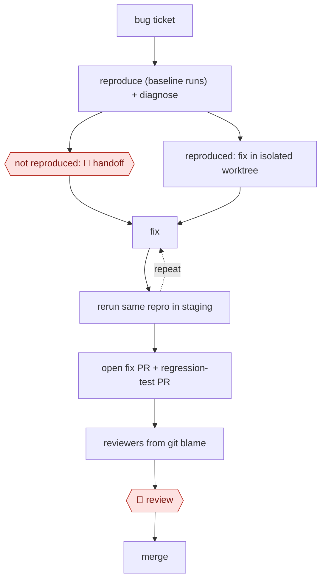

# Reproduce-first bug fix

`TEC › SWE › DEBUG` · checkpointed · evidence A · **draft: needs a reference example** ([how to add one](../../../../../CONTRIBUTING.md#1-add-an-example-run))

**Shape:** `bug ticket → reproduce (baseline runs) + diagnose → not reproduced: 🛑 handoff | reproduced: fix in isolated worktree → (fix ⟲ rerun same repro in staging) → open fix PR + regression-test PR → reviewers from git blame → 🛑 review → merge`
**Variants:** `claude-code` · `block-moneybot-autoheal` · `sentry-seer-cursor-agents` · `claude-agent-sdk-str-fix` · `claude-routines`

<!-- shape diagram: generated by scripts/build_diagrams.py from `shape`; don't edit -->

<!-- end shape diagram -->

## Background

When users report a fault in a software product, an engineer turns the report into a fix: work out what happened, make the fault happen again on purpose, change the code, and show that the fault is gone. The hard part is often not the change but the proof. A fault that appears only sometimes can look fixed after one lucky run, and a change made without ever seeing the fault may fix something else. In this workflow the agent must reproduce the fault before it touches the code, measures how often it fails before and after the change, and keeps the reproduction as a permanent test. When it cannot reproduce the fault, it stops and hands the ticket to a person. Engineers still review every change and decide what ships, because they own the product's behaviour and merging puts the change in front of customers.

**Terms:**
- **Ticket**: a recorded report of a fault in the team's tracker, such as Jira, or an issue group in an error tracker such as Sentry.
- **Reproduce (repro)**: make the reported fault happen again under controlled conditions; the repro is the test or script that does it.
- **Baseline**: how often the repro fails before any change, measured by running it many times.
- **Nondeterministic (flaky) fault**: one that happens on some runs and not others, common in products built on language models.
- **Eval case**: a test for a language-model product that scores a whole conversation, often with another model as the judge.
- **Fixtures, synthetic data**: fixed, made-up inputs (a pinned clock, a fake account balance) that make a test repeatable without real customer data.
- **Staging**: a copy of the production environment used for testing; a disposable one is created for one ticket and then removed.
- **Git worktree**: a separate working copy of the repository, so a fix does not touch the main checkout.
- **Regression test**: a test kept in the code so that a fixed fault cannot come back unnoticed.
- **git blame**: the record of who last changed each line of code, used here to pick reviewers.
- **PR (pull request), CI**: a proposed change published for review; CI is the automated checks that run on it.
- **Pre-production**: the last test environment before release.

## Build it with an agent

**Form:** `project`. A skill carries the procedure, but the rule "no product-code change without a reproduction" must hold every time, the diagnosis runs in a separate worker, and merging must be impossible for the agent. Those need a subagent and permission rules. [The kit](variants/claude-code.md) writes this build out as files.

**You need:** read access to the ticket system (`gh` or the tracker's MCP server); a test command that can run one test many times; a `CLAUDE.md` with the sample sizes, the attempt cap and the staging command; a disposable staging environment if the fault only shows there. Bug reports and logs can contain personal data: write repros with synthetic data only, and never copy production data or credentials into fixtures.

| Step | Built as |
|---|---|
| bug ticket → reproduce (baseline runs) + diagnose | The skill reads the ticket, writes the repro and runs it for the baseline; a custom read-only diagnoser subagent writes what happened, a feasible fix and the long-term ideal at the same time. |
| not reproduced: 🛑 handoff | The skill stops with a bug file: what it tried, the diagnosis, why it did not reproduce. |
| reproduced: fix in isolated worktree → (fix ⟲ rerun same repro in staging) | The skill creates a git worktree, applies the fix and reruns the same repro the same number of times, up to an attempt cap. A permission rule asks before the staging deploy. |
| open fix PR + regression-test PR → reviewers from git blame | The skill prepares both pull requests with the before and after numbers and suggests reviewers from `git blame`. Permission rules ask before `git push`, `gh pr create` and any ticket comment. |
| 🛑 review → merge | See Checkpoints. |

**Checkpoints:** `handoff`: when the repro never fails, the skill presents the bug file and stops; the agent changes no product code, and a note on the ticket is posted only if the person approves it. `review`: the skill stops once the pull requests are ready. `gh pr merge` is denied by a permission rule and the agent has no tool that closes tickets, so merging and closing stay with engineers.

**Since the sources:** Sources date from 2026-08 to 2026-11; source 2 is undated. Three of the four sources run these steps unattended over a queue of tickets: Block's orchestrating agent with six sub-agents, Cyclotron's nightly dispatch of cloud agents per Sentry issue group, and Sentry's own autofix. The build above is the interactive version, one ticket per session, as the kit writes it. A team that wants the backlog swept on a schedule would run the same skill as a `service` (a cloud scheduled task or the Agent SDK), with the handoff and the finished pull requests going to a queue; Duolingo's source reports building its agent on the Claude Agent SDK. The reviewer-ping routine in Recent practice runs as a Claude routine, the research-preview feature this catalog calls a cloud scheduled task.

*A design based on this entry's steps and the tool documentation as of 2026-11, not a reported run.*

## Steps

*As reported by the sources.*

1. The system takes in reported production issues from the ticket system [[1]](#sources) (or unresolved Sentry issue groups, merged conservatively [[2]](#sources)).
2. The agent reproduces first: it turns the failing session into a replayable test or eval case with synthetic data, and runs it 10 times for a baseline (20 if it fails only once). It pins any state that changes over time with fixtures [[1]](#sources). In parallel, a diagnoser agent writes what happened, a feasible fix and the long-term ideal [[1]](#sources).
3. 🛑 **Handoff**: if the failure never reproduces, the agent stops and parks the ticket as not reproducible for a person. It never fixes behaviour it cannot observe [[1]](#sources).
4. The agent fixes in an isolated git worktree, then deploys to a disposable staging environment and reruns the same repro with the same sample size. It accepts only a clear improvement over baseline, and loops a bounded number of times [[1]](#sources). End-to-end UI validation in the running app works the same way [[2]](#sources).
5. The agent opens two PRs, the fix and the repro as a permanent regression test. It picks reviewers by git blame and writes the outcome, including failed attempts, back to the ticket [[1]](#sources).
6. 🛑 **Review**: engineers review the change and decide what ships. Merging and closing tickets stay human actions [[1]](#sources). Agent PRs pass CI and bot review first, then go to final human review in pre-production [[2]](#sources).

**Output:** A merged fix plus a regression test built from the real failure; the ticket is updated with the result, or parked for a human.
**Failure modes → guards:** Flaky or nondeterministic bugs look fixed after one passing run → repeated sampling, and compare the same sample size before and after [[1]](#sources). Overfitting to the exact wording in the report → an advisory second case phrased differently [[1]](#sources). Unbounded loops → caps, with humans holding the irreversible actions [[1]](#sources). Fixes that ignore repo conventions → a feature-research step before coding [[3]](#sources).
**How it differs:** AWF-0003 Delegated PR starts from a labelled issue and is gated on existing tests. This workflow starts from a raw bug report, adds a reproduce-or-park gate and a before/after check on the same repro, and ships a new regression test. AWF-0004 Triage then remediate handles live incidents via runbooks, not code fixes.

**Recent practice (2026):**
- Reviewer step: an unattended routine runs on a schedule, takes fix PRs not acted on in the last four hours, finds the engineer who has worked most closely with the root-cause code, checks that the PR is still open, and pings them to merge or close, give one line of feedback, and say whether the fix was a good use of the agent. It never double-posts and avoids weekend pings (Sentry). [[4]](#sources)

## Public runs

Coverage as of 2026-11-06: **Strong**: a first-hand, detailed run that matches most of the shape. Collected and re-checked in [New workflows for empty categories](../../../../../research/2026-11-new-workflows.md). More runs added in [Third collection pass](../../../../../research/2026-11-third-pass.md).

- [Block, Autohealing Moneybot](https://engineering.block.xyz/blog/autohealing-moneybot) (2026-08-28). Six sub-agents reproduce, diagnose, fix and verify in staging, then open fix + eval PRs for human review. "more than 40 verified fixes". *First-hand: yes; confidence: high.*
- [Cyclotron, Closed-Loop Engineering System](https://cyclotron.com/post/how-i-built-a-closed-loop-engineering-system-that-saved-840-hours-in-30-days/) (2026). Sentry issues → Cursor agents reproduce, fix, validate end to end → PR → human review in pre-prod. 472 agent PRs opened, 410 merged ("86.9% merge rate"). *First-hand: vendor (the author ran it on the company's own product); confidence: med.*
- [Duolingo, AI bug-fixing agent](https://blog.duolingo.com/ai-bug-fixing-agent/) (2026-11-04). Shake-to-report Jira tickets → context, repro steps, fix, self-review, CI fix, beta build for verification. *First-hand: yes; confidence: med.*
- [Sentry, How we built an automated debugging workflow at Sentry](https://blog.sentry.io/automated-debugging-workflow-sentry/) (2026-08-06). Seer autofix opens PRs; an hourly routine picks a reviewer from commit history and pings them to merge or close. "About a 21% increase in the action rate on PRs". *First-hand: vendor; confidence: med.*

## Sources

1. Diem Nguyen, Bill Gao, Hailun Tian, Nikolaj Goodger, Riley Crane (Block), Autohealing Moneybot, 2026-08-28. https://engineering.block.xyz/blog/autohealing-moneybot
2. Nicholas Geil (Cyclotron, vendor), How I Built a Closed-Loop Engineering System That Saved 840 Hours in 30 Days, 2026 (undated). https://cyclotron.com/post/how-i-built-a-closed-loop-engineering-system-that-saved-840-hours-in-30-days/
3. Shelby Wengreen (Duolingo), How We Built an AI Agent to Fix Software Bugs, 2026-11-04. https://blog.duolingo.com/ai-bug-fixing-agent/
4. Dhrumil Parekh (Sentry), How we built an automated debugging workflow at Sentry, 2026-08-06. https://blog.sentry.io/automated-debugging-workflow-sentry/
