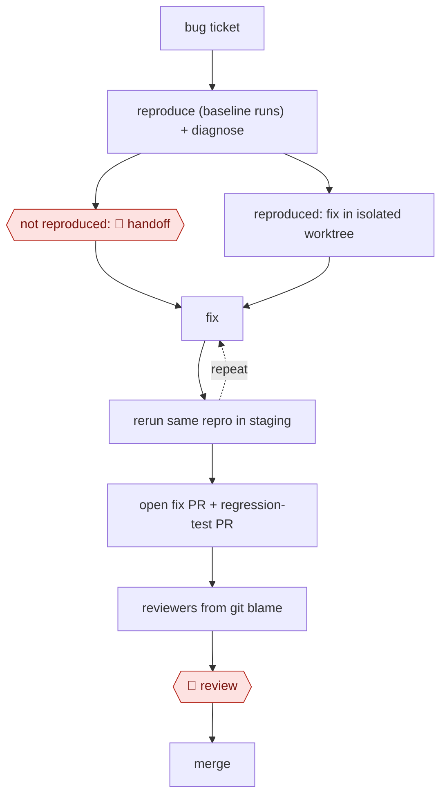

# Reproduce-first bug fix

`TEC › SWE › DEBUG` · checkpointed · evidence A · **draft: needs a reference example** ([how to add one](../../../../../CONTRIBUTING.md#1-add-an-example-run))

**Shape:** `bug ticket → reproduce (baseline runs) + diagnose → not reproduced: 🛑 handoff | reproduced: fix in isolated worktree → (fix ⟲ rerun same repro in staging) → open fix PR + regression-test PR → reviewers from git blame → 🛑 review → merge`
**How it differs:** AWF-0003 Delegated PR starts from a labelled issue and is gated on existing tests. This workflow starts from a raw bug report, adds a reproduce-or-park gate and a before/after check on the same repro, and ships a new regression test. AWF-0004 Triage then remediate handles live incidents via runbooks, not code fixes.
**Variants:** `claude-code` · `block-moneybot-autoheal` · `sentry-seer-cursor-agents` · `claude-agent-sdk-str-fix` · `claude-routines`

<!-- shape diagram: generated by scripts/build_diagrams.py from `shape`; don't edit -->

<!-- end shape diagram -->

## Steps
1. Take in reported production issues from the ticket system [[1]](#sources) (or unresolved Sentry issue groups, merged conservatively [[2]](#sources)).
2. Reproduce first: turn the failing session into a replayable test or eval case with synthetic data, and run it 10 times for a baseline (20 if it fails only once). Pin any state that changes over time with fixtures [[1]](#sources). In parallel, a diagnoser writes what happened, a feasible fix and the long-term ideal [[1]](#sources).
3. 🛑 **Handoff**: if the failure never reproduces, stop and park the ticket as not reproducible for a human. Never fix behaviour you cannot observe [[1]](#sources).
4. Fix in an isolated git worktree, then deploy to a disposable staging environment and rerun the same repro with the same sample size. Accept only a clear improvement over baseline, and loop a bounded number of times [[1]](#sources). End-to-end UI validation in the running app works the same way [[2]](#sources).
5. Open two PRs, the fix and the repro as a permanent regression test. Pick reviewers by git blame and write the outcome, including failed attempts, back to the ticket [[1]](#sources).
6. 🛑 **Review**: engineers review the change and decide what ships. Merging and closing tickets stay human actions [[1]](#sources). Agent PRs pass CI and bot review first, then go to final human review in pre-production [[2]](#sources).

**Output:** A merged fix plus a regression test built from the real failure; the ticket is updated with the result, or parked for a human.
**Failure modes → guards:** Flaky or nondeterministic bugs look fixed after one passing run → repeated sampling, and compare the same sample size before and after [[1]](#sources). Overfitting to the exact wording in the report → an advisory second case phrased differently [[1]](#sources). Unbounded loops → caps, with humans holding the irreversible actions [[1]](#sources). Fixes that ignore repo conventions → a feature-research step before coding [[3]](#sources).

**Recent practice (2026):**
- Reviewer step: an unattended routine runs on a schedule, takes fix PRs not acted on in the last four hours, finds the engineer who has worked most closely with the root-cause code, checks that the PR is still open, and pings them to merge or close, give one line of feedback, and say whether the fix was a good use of the agent. It never double-posts and avoids weekend pings (Sentry). [[4]](#sources)

## Public runs

Coverage as of 2026-11-06: **Strong**: a first-hand, detailed run that matches most of the shape. Collected and re-checked in [New workflows for empty categories](../../../../../research/2026-11-new-workflows.md). More runs added in [Third collection pass](../../../../../research/2026-11-third-pass.md).

- [Block, Autohealing Moneybot](https://engineering.block.xyz/blog/autohealing-moneybot) (2026-08-28). Six sub-agents reproduce, diagnose, fix and verify in staging, then open fix + eval PRs for human review. "more than 40 verified fixes". *First-hand: yes; confidence: high.*
- [Cyclotron, Closed-Loop Engineering System](https://cyclotron.com/post/how-i-built-a-closed-loop-engineering-system-that-saved-840-hours-in-30-days/) (2026). Sentry issues → Cursor agents reproduce, fix, validate end to end → PR → human review in pre-prod. 472 agent PRs opened, 410 merged ("86.9% merge rate"). *First-hand: vendor (the author ran it on the company's own product); confidence: med.*
- [Duolingo, AI bug-fixing agent](https://blog.duolingo.com/ai-bug-fixing-agent/) (2026-11-04). Shake-to-report Jira tickets → context, repro steps, fix, self-review, CI fix, beta build for verification. *First-hand: yes; confidence: med.*
- [Sentry, How we built an automated debugging workflow at Sentry](https://blog.sentry.io/automated-debugging-workflow-sentry/) (2026-08-06). Seer autofix opens PRs; an hourly routine picks a reviewer from commit history and pings them to merge or close. "About a 21% increase in the action rate on PRs". *First-hand: vendor; confidence: med.*

## Sources

1. Diem Nguyen, Bill Gao, Hailun Tian, Nikolaj Goodger, Riley Crane (Block), Autohealing Moneybot, 2026-08-28. https://engineering.block.xyz/blog/autohealing-moneybot
2. Nicholas Geil (Cyclotron, vendor), How I Built a Closed-Loop Engineering System That Saved 840 Hours in 30 Days, 2026 (undated). https://cyclotron.com/post/how-i-built-a-closed-loop-engineering-system-that-saved-840-hours-in-30-days/
3. Shelby Wengreen (Duolingo), How We Built an AI Agent to Fix Software Bugs, 2026-11-04. https://blog.duolingo.com/ai-bug-fixing-agent/
4. Dhrumil Parekh (Sentry), How we built an automated debugging workflow at Sentry, 2026-08-06. https://blog.sentry.io/automated-debugging-workflow-sentry/
