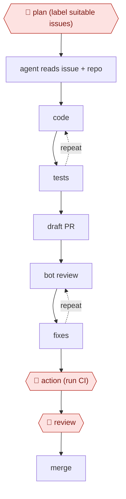

# Delegated PR

`TEC › SWE › FEAT` · sampled · evidence B · **draft: needs a reference example** ([how to add one](../../../../../CONTRIBUTING.md#1-add-an-example-run))

**Shape:** `🛑 plan (label suitable issues) → agent reads issue + repo → (code ⟲ tests) → draft PR → (bot review ⟲ fixes) → 🛑 action (run CI) → 🛑 review → merge`
**Variants:** [`claude-code` kit](variants/claude-code.md) · `copilot-coding-agent` · `claude-code-action` · `codex-cloud` · `devin` · `jules`

<!-- shape diagram: generated by scripts/build_diagrams.py from `shape`; don't edit -->

<!-- end shape diagram -->

## Background

Software teams keep a backlog of small, well-described tasks (fix this edge case, add this option) that nobody has time to pick up. In this workflow a maintainer hands such a task to a coding agent that runs in the cloud, the way one would assign it to a colleague: the agent reads the request and the code, makes the change, runs the tests and proposes the result as a pull request. Nobody watches the agent while it works, so the person's control sits at the edges. A maintainer chooses which tasks are fit to hand over, approves running the project's automated checks on the agent's code, and reviews and merges the result. That person cannot be removed, because the maintainer answers for what goes into the shared code, and code nobody has read can carry bugs or security holes into every user's copy.

**Terms:**
- **Issue**: a written request for a change, kept in a tracker such as GitHub Issues.
- **Label**: a tag on an issue; here a maintainer's label marks the issue as suitable for the agent.
- **Self-contained, testable issue**: a task that can be finished without decisions from others and checked by tests.
- **PR (pull request)**: a proposed change, published for review before it is merged into the shared code; a draft PR is marked not ready for review.
- **CI**: the automated checks (build, tests, lint) that run on every pull request.
- **GitHub Actions**: GitHub's system for running jobs, such as CI or an agent, on repository events.
- **Review bot**: an automated reviewer that comments on a pull request.
- **Merge**: accepting a pull request into the shared code.
- **Merge rate**: the share of agent pull requests that end up merged.

## Build it with an agent

**Form:** `service`. Each run starts from a comment on a labelled issue with nobody at the keyboard, and people see only the draft pull request, its checks and its review comments. [The kit](variants/claude-code.md) writes this build out as files.

**You need:** a repository on GitHub with a CI workflow; the Claude GitHub App installed and an API key or subscription token stored as a repository secret; a `CLAUDE.md` with the install, test, lint and typecheck commands and the paths the agent must not touch, such as `.github/`; an issue template with acceptance criteria. Keep secrets out of the files the agent may edit.

| Step | Built as |
|---|---|
| 🛑 plan (label suitable issues) | A maintainer adds the label by hand. The workflow file runs the agent only on labelled issues and only for comments from owners, members and collaborators. |
| agent reads issue + repo → (code ⟲ tests) | Claude Code GitHub Actions, started by an `@claude` comment, runs in the Actions runner with a tool list limited to reading, editing and the test, lint and typecheck commands. `CLAUDE.md` caps the loop at a number of failed rounds. |
| draft PR | The agent pushes a branch; the pull request stays a draft. |
| (bot review ⟲ fixes) | A review bot or an `@claude review` comment; the agent answers review comments that mention it, for one or two rounds. |
| 🛑 action (run CI) | The CI workflow runs the full checks only when a person marks the draft ready for review. |
| 🛑 review → merge | A person reviews the diff and CI in the code host and merges. |

**Checkpoints:** `plan`: only a maintainer can add the label, and the workflow's condition skips any comment on an unlabelled issue or from an untrusted account, so an outsider's comment cannot start a run. `action`: full CI starts only when a person marks the pull request ready; with GitHub's own agent, a person clicks "Approve and run workflows". `review`: the agent's allowed tools include no merge command and its branch is never the default branch; a person merges.

**Since the sources:** The dated sources and runs range from 2025-07 to 2026-03; source 3 is a documentation page read in 2026-11, and the training page in source 4 is undated. The tool in source 4 has since been renamed: GitHub's changelog of 2026-04 calls it [Copilot cloud agent, formerly Copilot coding agent](https://github.blog/changelog/2026-04-01-research-plan-and-code-with-copilot-cloud-agent), and says it can now work on a branch without opening a pull request and can produce a plan for approval before it writes code. The training page in source 4 is now titled for "Copilot in the cloud" and still says the agent does not see issue comments added after assignment. The variant slug `copilot-coding-agent` still uses the old name. The Claude Code GitHub Actions page still describes the `@claude` trigger and the `/install-github-app` setup used here. Step 4 cites no source.

*A design based on this entry's steps and the tool documentation as of 2026-11, not a reported run.*

## Steps

*As reported by the sources.*

1. 🛑 **Plan**: a maintainer labels only self-contained, testable issues for agents.
2. A maintainer dispatches the issue by assigning it to Copilot, which opens a draft PR and runs in an Actions-based environment configured by `.github/workflows/copilot-setup-steps.yml` [[4]](#sources). Alternatively, the maintainer comments `@claude`, which triggers Claude Code GitHub Actions [[3]](#sources).
3. The agent implements, runs tests, and pushes. Later instructions go as PR comments, because Copilot doesn't see issue comments added after assignment [[4]](#sources).
4. A review bot comments, and the agent addresses the comments for 1–2 rounds.
5. 🛑 **Action**: a person clicks "Approve and run workflows" so CI runs on agent PRs [[4]](#sources).
6. 🛑 **Review**: a person reviews and merges.

**Output:** merged PRs. Track the merge rate per issue label to tune what gets dispatched.
**How it differs from Plan-gated build:** no planning checkpoint mid-run; the issue *is* the plan, and the agent runs in the cloud.

## Public runs

Coverage as of 2026-11-06: **Strong**: a first-hand, detailed run that matches most of the shape. From [Where are the real runs?](../../../../../research/2026-11-real-runs.md); every number was re-checked against its page.

- [Charas & Bruggmann, Spotify Engineering](https://engineering.atspotify.com/2025/11/spotifys-background-coding-agent-part-1) (2025-11-06). Fleet migrations in containers with an LLM judge; teams review the PRs. "merged more than 1500 pull requests"; "60–90%" time saving. *First-hand: yes; confidence: high.*
- [Stephen Toub, .NET Blog](https://devblogs.microsoft.com/dotnet/ten-months-with-cca-in-dotnet-runtime/) (2026-03-23). Maintainers assign issues → agent PR → bot review → humans steer and merge. "all 878 CCA PRs"; "67.9% success rate"; "3 were reverted (0.6%)". *First-hand: yes; confidence: high.*

## Sources

3. Claude Code docs, *GitHub Actions*. https://code.claude.com/docs/en/github-actions
4. GitHub Blog, *Onboarding your AI peer programmer: setting up GitHub Copilot coding agent* (July 2025). https://github.blog/ai-and-ml/github-copilot/onboarding-your-ai-peer-programmer-setting-up-github-copilot-coding-agent-for-success/ · Microsoft Learn, *Assigning, tracking, and troubleshooting Copilot coding agent tasks*. https://learn.microsoft.com/en-us/training/modules/github-copilot-code-agent/3-assign-track-troubleshoot-copilot-code-agent-tasks
