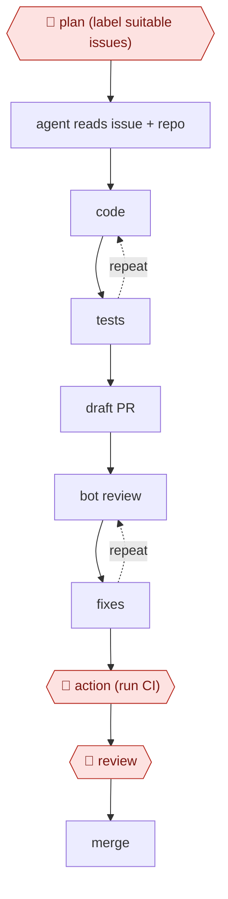

# Delegated PR

`TEC › SWE › FEAT` · sampled · evidence B · **draft: needs a reference example** ([how to add one](../../../../../CONTRIBUTING.md#1-add-an-example-run))

**Shape:** `🛑 plan (label suitable issues) → agent reads issue + repo → (code ⟲ tests) → draft PR → (bot review ⟲ fixes) → 🛑 action (run CI) → 🛑 review → merge`
**How it differs from Plan-gated build:** no planning checkpoint mid-run; the issue *is* the plan, and the agent runs in the cloud.
**Variants:** [`claude-code` kit](variants/claude-code.md) · `copilot-coding-agent` · `claude-code-action` · `codex-cloud` · `devin` · `jules`

<!-- shape diagram: generated by scripts/build_diagrams.py from `shape`; don't edit -->

<!-- end shape diagram -->

## Steps
1. 🛑 **Plan**: only self-contained, testable issues are labeled for agents.
2. Dispatch by assigning the issue to Copilot, which opens a draft PR and runs in an Actions-based environment configured by `.github/workflows/copilot-setup-steps.yml` [[4]](#sources). Alternatively, comment `@claude`, which triggers Claude Code GitHub Actions [[3]](#sources).
3. The agent implements, runs tests, and pushes. Later instructions go as PR comments, because Copilot doesn't see issue comments added after assignment [[4]](#sources).
4. A review bot comments, and the agent addresses the comments for 1–2 rounds.
5. 🛑 **Action**: a human clicks "Approve and run workflows" so CI runs on agent PRs [[4]](#sources).
6. 🛑 **Review**: human review and merge.

**Output:** merged PRs. Track the merge rate per issue label to tune what gets dispatched.

## Public runs

Coverage as of 2026-11-06: **Strong**: a first-hand, detailed run that matches most of the shape. From [Where are the real runs?](../../../../../research/2026-11-real-runs.md); every number was re-checked against its page.

- [Charas & Bruggmann, Spotify Engineering](https://engineering.atspotify.com/2025/11/spotifys-background-coding-agent-part-1) (2025-11-06). Fleet migrations in containers with an LLM judge; teams review the PRs. "merged more than 1500 pull requests"; "60–90%" time saving. *First-hand: yes; confidence: high.*
- [Stephen Toub, .NET Blog](https://devblogs.microsoft.com/dotnet/ten-months-with-cca-in-dotnet-runtime/) (2026-03-23). Maintainers assign issues → agent PR → bot review → humans steer and merge. "all 878 CCA PRs"; "67.9% success rate"; "3 were reverted (0.6%)". *First-hand: yes; confidence: high.*

## Sources

3. Claude Code docs, *GitHub Actions*. https://code.claude.com/docs/en/github-actions
4. GitHub Blog, *Onboarding your AI peer programmer: setting up GitHub Copilot coding agent* (July 2025). https://github.blog/ai-and-ml/github-copilot/onboarding-your-ai-peer-programmer-setting-up-github-copilot-coding-agent-for-success/ · Microsoft Learn, *Assigning, tracking, and troubleshooting Copilot coding agent tasks*. https://learn.microsoft.com/en-us/training/modules/github-copilot-code-agent/3-assign-track-troubleshoot-copilot-code-agent-tasks
