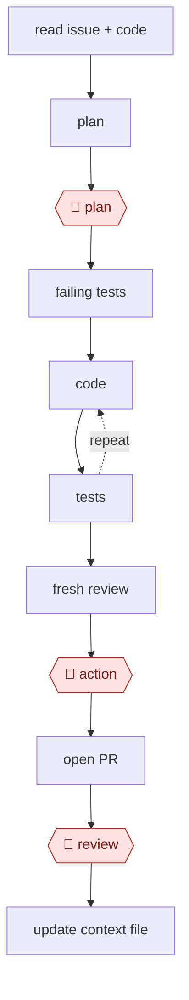

# Plan-gated build

`TEC › SWE › FEAT` · checkpointed · evidence A · **draft: needs a reference example** ([how to add one](../../../../../CONTRIBUTING.md#1-add-an-example-run))

**Shape:** `read issue + code → plan → 🛑 plan → failing tests → (code ⟲ tests) → fresh review → 🛑 action → open PR → 🛑 review → update context file`
**Agent kit:** [run this in Claude Code](variants/claude-code.md)
**Traits:** `auto-loop, orch-workers` · **Variants:** `claude-code` · `codex-cli` · `cursor-agent`

<!-- shape diagram: generated by scripts/build_diagrams.py from `shape`; don't edit -->

<!-- end shape diagram -->

## Background

Building a feature or a fix from a written request is the everyday unit of software work. A developer reads the request, finds the code involved, changes it, proves the change works and asks a colleague to review it. A coding agent can do the reading, writing and testing, but left alone it may solve a slightly different problem from the one asked, or report success without proof. This workflow puts a person at the three points where a mistake is cheapest to catch or most costly to miss: the plan, before any code is written; the moment the work leaves the developer's machine; and the finished change. Tests written before the code give the agent a pass-or-fail check, so it can correct itself between those points.

**Terms:**
- **Issue**: a written request for a change, kept in a tracker such as GitHub Issues.
- **Acceptance criteria**: the conditions the change must meet to count as done.
- **Failing test**: a test written before the code that fails until the feature exists; when it passes, the criterion is met.
- **Diff**: the set of lines a change adds and removes.
- **PR (pull request)**: a proposed change, published for review before it is merged into the shared code.
- **CI**: the automated checks that run on every pull request.
- **Context file**: `CLAUDE.md` or `AGENTS.md`, a file of project instructions the agent reads at the start of every session.

## Build it with an agent

**Form:** `project`. A skill carries the procedure, but two rules must hold every time (the tests stay frozen once written; nothing is pushed without approval) and the reviewer must not have seen the implementation. Those need hooks or permission rules and a subagent. [The kit](variants/claude-code.md) writes this build out as files.

**You need:** a repository with a working test command; a `CLAUDE.md` with the build, test and lint commands and the paths the agent must not touch; the `gh` command-line tool or your issue tracker's MCP server.

| Step | Built as |
|---|---|
| read issue + code | The skill reads the issue; built-in read-only subagents map the affected modules. |
| plan → 🛑 plan | Plan mode, or the skill writes `plans/<issue>.md` and stops. |
| failing tests | The skill writes tests from the acceptance criteria and runs them to confirm they fail. |
| (code ⟲ tests) | The main conversation, with the test command as the check to pass. A `PreToolUse` hook blocks edits to the frozen test files. A `Stop` hook reruns the tests if the loop must be enforced. |
| fresh review | A custom read-only subagent that gets the plan file and the diff, or the bundled `/code-review`, which reviews in a subagent that never saw the conversation. |
| 🛑 action → open PR | Permission rules set to ask before `git push` and `gh pr create`. |
| 🛑 review | A person reviews the pull request and CI in the code host. |
| update context file | The skill proposes lines for `CLAUDE.md`; the person accepts or drops them. |

**Checkpoints:** `plan`: plan mode cannot edit files; outside plan mode, the skill stops after writing the plan file and a hook blocks source edits until it is marked approved. `action`: an ask rule on push and PR creation. Interactive sessions now start in auto mode, where routine commands run without a prompt, so this stop exists only if the rule is written down. `review`: the pull request is opened as a draft and the agent has no permission to merge.

**Since the sources:** The public runs date from 2025-02 and 2025-08; source 2 is a documentation page read in 2026-11. The runs drove these steps with hand-written prompt files. Plan mode, subagents, hooks and a fresh-context review command are now built in, so the plan gate and the review need no custom prompts. The guard "clear context between tasks" came from an earlier version of source 2; the current page lists aggressive context management under advice you can stop following, citing 1M-token context windows and automatic compaction, while still recommending `/clear` between unrelated tasks. Keep the plan file anyway: the reviewer checks the diff against it.

*A design based on this entry's steps and the tool documentation as of 2026-11, not a reported run.*

## Steps

*As reported by the sources.*

1. The agent reads the context file, the issue (`gh issue view` or the tracker's MCP) and the relevant code. Read-only helper agents fan out to map the affected modules.
2. In plan mode (read-only), the agent writes a plan: files to touch, approach, test strategy, open questions [[2]](#sources). 🛑 **Plan**: this is the highest-leverage correction point.
3. The agent writes failing tests that encode the acceptance criteria and confirms they fail.
4. The agent implements in increments, running targeted tests and the typecheck after each one. It loops on the failure output, with a cap on iterations before it escalates to the person.
5. A reviewer agent with a fresh context checks the diff against the spec: edge cases, dead code, security.
6. For UI changes, the agent runs the dev server, takes a screenshot, and compares it with the design.
7. 🛑 **Action**: the person approves the commit, the push and opening the PR, unless these were pre-authorized.
8. 🛑 **Review**: a human reviews the PR and CI.
9. The agent writes recurring corrections back into the context file.

**Output:** a reviewed PR with tests, and an updated context file.
**Failure modes → guards:** the agent edits tests to make them pass → forbid test edits after the tests are written. Scope creep → flag any file changed outside the plan's list. Context saturation → clear context between tasks and persist the plan to a file [[2]](#sources).
**Close relative:** a version that asks approval for every edit (`assist`) is a separate species by the swap test.

## Public runs

Coverage as of 2026-11-06: **Strong**: a first-hand, detailed run that matches most of the shape. From [Where are the real runs?](../../../../../research/2026-11-real-runs.md); every number was re-checked against its page.

- [HumanLayer, *Advanced Context Engineering for Coding Agents*](https://github.com/humanlayer/advanced-context-engineering-for-coding-agents/blob/main/ace-fca.md) (no byline or date; images Aug 2025). Research → plan → implement on a 300k-LOC Rust codebase; a human reviews the research and the plan. "shipping 35k LOC to BAML"; "spent 7 hours". *First-hand: yes; confidence: high.*
- [Harper Reed, *My LLM codegen workflow atm*](https://harper.blog/2025/02/16/my-llm-codegen-workflow-atm/) (2025-02-16). Spec → prompt plan (TDD variant) → step by step, testing after each. "This entire process will take maybe 15 minutes." (planning). *First-hand: yes; confidence: med.*

## Sources

2. Claude Code docs, *Best practices*. https://code.claude.com/docs/en/best-practices
