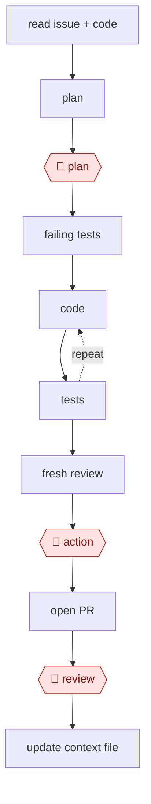

# Plan-gated build

`TEC › SWE › FEAT` · checkpointed · evidence A · **draft: needs a reference example** ([how to add one](../../../../../CONTRIBUTING.md#1-add-an-example-run))

**Shape:** `read issue + code → plan → 🛑 plan → failing tests → (code ⟲ tests) → fresh review → 🛑 action → open PR → 🛑 review → update context file`
**Agent kit:** [run this in Claude Code](variants/claude-code.md)
**Traits:** `auto-loop, orch-workers` · **Variants:** `claude-code` · `codex-cli` · `cursor-agent`

<!-- shape diagram: generated by scripts/build_diagrams.py from `shape`; don't edit -->

<!-- end shape diagram -->

- **Input:** an issue with acceptance criteria; a repo with `CLAUDE.md`/`AGENTS.md` (build, test, and lint commands, conventions, no-go areas); a working test suite.
- **Roles/Tools:** the lead agent (read, edit, allow-listed shell); read-only explorer sub-agents; a verifier (formatter and lint hooks, tests, typecheck, browser screenshots for UI); a fresh-context reviewer sub-agent.

## Steps
1. The agent reads the context file, the issue (`gh issue view` or the tracker's MCP), and relevant code. Explorers fan out to map affected modules.
2. In plan mode (read-only), the agent writes a plan: files to touch, approach, test strategy, open questions [[2]](#sources). 🛑 **Plan**: this is the highest-leverage correction point.
3. Write failing tests that encode the acceptance criteria and confirm they fail.
4. Implement in increments, with targeted tests and typecheck after each one. Loop on the failure output, and cap iterations before escalating.
5. A fresh-context reviewer checks the diff against the spec: edge cases, dead code, security.
6. For UI changes, run the dev server, take a screenshot, and compare with the design.
7. 🛑 **Action**: commit, push, and open the PR, unless these were pre-authorized.
8. 🛑 **Review**: a human reviews the PR and CI.
9. Write recurring corrections back into the context file.

**Output:** a reviewed PR with tests, and an updated context file.
**Failure modes → guards:** the agent edits tests to make them pass → forbid test edits after the tests are written. Scope creep → flag any file changed outside the plan's list. Context saturation → clear context between tasks and persist the plan to a file [[2]](#sources).
**Close relative:** a version that asks approval for every edit (`assist`) is a separate species by the swap test.

## Public runs

Coverage as of 2026-11-06: **Strong**: a first-hand, detailed run that matches most of the shape. From [Where are the real runs?](../../../../../research/2026-11-real-runs.md); every number was re-checked against its page.

- [HumanLayer, *Advanced Context Engineering for Coding Agents*](https://github.com/humanlayer/advanced-context-engineering-for-coding-agents/blob/main/ace-fca.md) (no byline or date; images Aug 2025). Research → plan → implement on a 300k-LOC Rust codebase; a human reviews the research and the plan. "shipping 35k LOC to BAML"; "spent 7 hours". *First-hand: yes; confidence: high.*
- [Harper Reed, *My LLM codegen workflow atm*](https://harper.blog/2025/02/16/my-llm-codegen-workflow-atm/) (2025-02-16). Spec → prompt plan (TDD variant) → step by step, testing after each. "This entire process will take maybe 15 minutes." (planning). *First-hand: yes; confidence: med.*

## Sources

2. Claude Code docs, *Best practices*. https://code.claude.com/docs/en/best-practices
