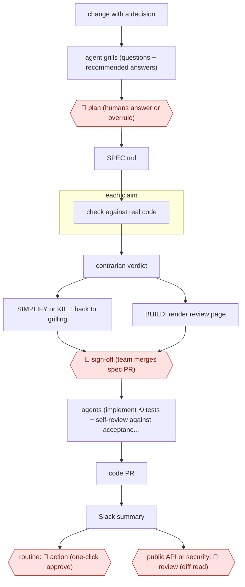

# Spec-PR then agent build

`TEC › SWE › FEAT` · checkpointed · evidence A · **draft: needs a reference example** ([how to add one](../../../../../CONTRIBUTING.md#1-add-an-example-run))

**Shape:** `change with a decision → agent grills (questions + recommended answers) → 🛑 plan (humans answer or overrule) → SPEC.md → each claim: check against real code → contrarian verdict → SIMPLIFY or KILL: back to grilling | BUILD: render review page → 🛑 sign-off (team merges spec PR) → agents (implement ⟲ tests + self-review against acceptance scenarios) → code PR → Slack summary → routine: 🛑 action (one-click approve) | public API or security: 🛑 review (diff read)`
**Variants:** `claude-code-skills` · `github-spec-kit` · `kiro`

<!-- shape diagram: generated by scripts/build_diagrams.py from `shape`; don't edit -->

<!-- end shape diagram -->

## Background

When coding agents write most of a team's code, there are more changes than people can read line by line. This workflow moves the team's attention from the finished code to the plan. Before building anything that involves a decision someone could disagree with, the agent interviews the people who want it, writes the plan down as a spec, checks every factual claim in it against the real code and argues the case for not building it at all. The team then debates the spec and approves it, and agents build against it, with acceptance tests the spec defines as the meaning of done. People keep the decisions about what to build and what to leave out, because the agent lacks the product context and the customer knowledge. They still read the code itself where a mistake would reach outside users or open a security hole.

**Terms:**
- **Spec (SPEC.md)**: the written plan that the implementing agents work from, including what counts as done.
- **Grilling**: an interview in which the agent asks every question it can about the plan, each with a recommended answer, and the people answer or overrule.
- **Pair or mob planning**: two people, or a whole group, answering the questions together.
- **Ground truth / fact-check**: checking each claim the spec makes about existing things (an API, a configuration value, a flag, a deadline) against the code or a primary source.
- **Contrarian verdict**: a step that looks for what already solves the problem and returns BUILD, SIMPLIFY or KILL.
- **Acceptance scenarios (test gate)**: the tests the spec names; passing them means the work is complete.
- **PR (pull request)**: a proposed change, published for review before it is merged; here both the spec and the code arrive as pull requests.
- **Diff**: the lines a change adds and removes.
- **Public API**: the interface other teams or customers call; a change there can break their code.
- **Hallucination**: a confident claim from a model that is not true, such as a configuration key that does not exist.

## Build it with an agent

**Form:** `project`. The planning steps are several skills that hand files to each other, the fact-check needs parallel workers, and the contrarian must be a reviewer that has not seen the interview; a rule about which code changes need a person to read the diff must also hold every time.

**You need:** a planning repository or folder where each plan is one directory; read access to clones of the code the plans touch; a `CLAUDE.md` listing the paths that count as public API or security-relevant; the test command for the acceptance scenarios; a Slack connector if summaries are posted there; the `gh` command-line tool.

| Step | Built as |
|---|---|
| change with a decision → agent grills (questions + recommended answers) → 🛑 plan (humans answer or overrule) | A grilling skill: it walks the plan as a decision tree, asks one question at a time with a recommended answer, looks up facts itself and logs each question and answer in the plan directory. |
| SPEC.md | A spec skill turns the log into `SPEC.md`, with the acceptance scenarios. |
| each claim: check against real code | The fact-check skill lists every claim about existing things and gives each to a built-in subagent that checks it against the cloned code or a primary source. |
| contrarian verdict → SIMPLIFY or KILL: back to grilling \| BUILD: render review page | A custom read-only subagent that receives only the spec and the code, never the interview, and returns BUILD, SIMPLIFY or KILL with reasons. On BUILD, a skill renders the spec and its evidence as one HTML page. |
| 🛑 sign-off (team merges spec PR) | The agent opens the plan directory as a pull request. Merging is denied. |
| agents (implement ⟲ tests + self-review against acceptance scenarios) → code PR | The build itself, as in [AWF-0001 Plan-gated build](../plan-gated-build/), with the acceptance scenarios as the tests to pass and a reviewer subagent that checks the diff against the spec. |
| Slack summary → routine: 🛑 action (one-click approve) \| public API or security: 🛑 review (diff read) | The skill posts a short summary through the Slack connector. A `PreToolUse` hook on `gh pr create` compares the changed files with the listed paths and adds a label that requires a diff review. |

**Checkpoints:** `plan`: the grilling skill asks and waits for each answer, and writes no spec until the people have answered or overruled every question. `sign-off`: the spec reaches the team as a pull request and the agent has no permission to merge it, so building starts only after the team merges. `action`: routine code pull requests are approved by a person in the code host; the agent cannot merge its own work. `review`: when the hook finds a public API or security-relevant path, the label tells reviewers to read the diff; branch rules in the code host should require that review before merge.

**Since the sources:** Source 1 and its public run date from 2026-10. The source says the whole workflow lives as skills inside the repository, with one command running the planning steps in order, and that the team has released it as open source; the build above follows the same split into skills. It leaves out two things the source built for itself: the one-click approval in Slack and agentlab, the local environment in which agents try their changes before opening a pull request. In the source most code changes merge without anyone reading the diff; the build keeps a person's approval on every code pull request, because the agent should not be the one to approve its own work.

*A design based on this entry's steps and the tool documentation as of 2026-11, not a reported run.*

## Steps

*As reported by the sources.*

1. The team applies a rule of thumb: if a change contains a decision someone could disagree with, it gets a plan. Dependency bumps, bug fixes with an obvious cause and small changes inside an agreed plan skip this workflow [[1]](#sources).
2. In `/grill-me`, the agent walks the plan as a decision tree. It asks every question it can, gives a recommended answer for each, and looks up facts itself. 🛑 **Plan**: people answer, ideally as a pair or mob, and overrule recommendations where they have the context. Every Q&A is logged [[1]](#sources).
3. In `/to-spec`, the agent turns the conversation into SPEC.md. This is the single source the implementing agent works from, and it includes the test gate (acceptance scenarios that define done) [[1]](#sources).
4. In `/ground-truth`, the agent extracts every claim about something that already exists (API, config value, flag, deadline) and verifies each one in parallel against a clone of the real code or a primary source. Mismatches are fixed and cited [[1]](#sources).
5. In `/contrarian`, the agent hunts for what already covers the problem and gives a verdict of BUILD, SIMPLIFY or KILL. Anything other than BUILD sends the plan back to grilling [[1]](#sources).
6. In `/to-website`, the agent renders the spec as an HTML page with diagrams and one-click links to the research, the fact-check and the verdict. 🛑 **Sign-off**: the plan directory is a pull request that the team argues over and merges. Review typically spreads over a day or two [[1]](#sources).
7. Agents implement against the spec, then test and review their own changes in a local environment (agentlab) before a PR opens [[1]](#sources).
8. The system posts code PRs to Slack as short summaries. 🛑 **Action**: anyone on the team can approve with one click, and most changes merge without a person reading the diff. 🛑 **Review**: when the plan shows the change touches a public API or something security-relevant, people read the PR [[1]](#sources).

**Output:** An agreed, versioned plan directory (spec, fact-check, contrarian verdict, review page) in git, plus agent-implemented code PRs merged against its test gate.
**Failure modes → guards:** A false premise survives grilling and the spec → the contrarian step was added after a human reviewer caught one. Hallucinated config keys → ground-truth found that 7 of 8 claims held and flagged the 8th. Plans break in live testing → a plan is a baseline: it gets rewritten, replaced or abandoned.
**How it differs:** AWF-0001 Plan-gated build: there, one developer approves the agent's plan and a human reviews every PR. Here the team reviews and merges the spec as a PR, fact-check and contrarian agents run before sign-off, and most code PRs merge on a one-click Slack approval without anyone reading the diff. The checkpoints and the review target both change.

## Public runs

Coverage as of 2026-11-13: **Strong**: a first-hand, detailed run that matches most of the shape. Collected and re-checked in [Third collection pass](../../../../../research/2026-11-third-pass.md).

- [Giant Swarm, Spec-driven development: how we review plans, not pull requests](https://www.giantswarm.io/blog/spec-driven-development) (2026-10-13). Team moved human review from code diffs to spec PRs; agents implement; most PRs merge unread. "from around 700 a month in summer 2025 to more than 2,100 a month in summer 2026". *First-hand: yes; confidence: high.*

## Sources

1. Dominik Schmidle (Giant Swarm), Spec-driven development: how we review plans, not pull requests, 2026-10-13. https://www.giantswarm.io/blog/spec-driven-development
