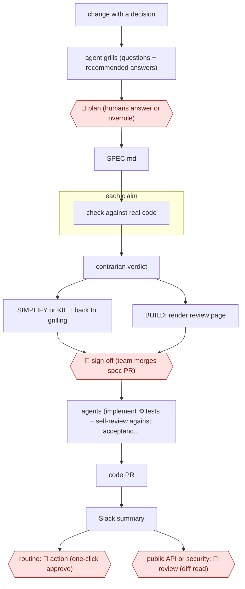

# Spec-PR then agent build

`TEC › SWE › FEAT` · checkpointed · evidence A · **draft: needs a reference example** ([how to add one](../../../../../CONTRIBUTING.md#1-add-an-example-run))

**Shape:** `change with a decision → agent grills (questions + recommended answers) → 🛑 plan (humans answer or overrule) → SPEC.md → each claim: check against real code → contrarian verdict → SIMPLIFY or KILL: back to grilling | BUILD: render review page → 🛑 sign-off (team merges spec PR) → agents (implement ⟲ tests + self-review against acceptance scenarios) → code PR → Slack summary → routine: 🛑 action (one-click approve) | public API or security: 🛑 review (diff read)`
**How it differs:** AWF-0001 Plan-gated build: there, one developer approves the agent's plan and a human reviews every PR. Here the team reviews and merges the spec as a PR, fact-check and contrarian agents run before sign-off, and most code PRs merge on a one-click Slack approval without anyone reading the diff. The checkpoints and the review target both change.
**Variants:** `claude-code-skills` · `github-spec-kit` · `kiro`

<!-- shape diagram: generated by scripts/build_diagrams.py from `shape`; don't edit -->

<!-- end shape diagram -->

## Steps
1. Apply the rule of thumb: if a change contains a decision someone could disagree with, it gets a plan. Dependency bumps, bug fixes with an obvious cause and small changes inside an agreed plan skip this workflow [[1]](#sources).
2. `/grill-me`: the agent walks the plan as a decision tree. It asks every question it can, gives a recommended answer for each, and looks up facts itself. 🛑 **Plan**: people answer, ideally as a pair or mob, and overrule recommendations where they have the context. Every Q&A is logged [[1]](#sources).
3. `/to-spec` turns the conversation into SPEC.md. This is the single source the implementing agent works from, and it includes the test gate (acceptance scenarios that define done) [[1]](#sources).
4. `/ground-truth` extracts every claim about something that already exists (API, config value, flag, deadline) and verifies each one in parallel against a clone of the real code or a primary source. Mismatches are fixed and cited [[1]](#sources).
5. `/contrarian` hunts for what already covers the problem and gives a verdict of BUILD, SIMPLIFY or KILL. Anything other than BUILD sends the plan back to grilling [[1]](#sources).
6. `/to-website` renders the spec as an HTML page with diagrams and one-click links to the research, the fact-check and the verdict. 🛑 **Sign-off**: the plan directory is a pull request that the team argues over and merges. Review typically spreads over a day or two [[1]](#sources).
7. Agents implement against the spec, then test and review their own changes in a local environment (agentlab) before a PR opens [[1]](#sources).
8. Code PRs are posted to Slack as short summaries. 🛑 **Action**: anyone on the team can approve with one click, and most changes merge without a human reading the diff. 🛑 **Review**: when the plan shows the change touches a public API or something security-relevant, people read the PR [[1]](#sources).

**Output:** An agreed, versioned plan directory (spec, fact-check, contrarian verdict, review page) in git, plus agent-implemented code PRs merged against its test gate.
**Failure modes → guards:** A false premise survives grilling and the spec → the contrarian step was added after a human reviewer caught one. Hallucinated config keys → ground-truth found that 7 of 8 claims held and flagged the 8th. Plans break in live testing → a plan is a baseline: it gets rewritten, replaced or abandoned.

## Public runs

Coverage as of 2026-11-13: **Strong**: a first-hand, detailed run that matches most of the shape. Collected and re-checked in [Third collection pass](../../../../../research/2026-11-third-pass.md).

- [Giant Swarm, Spec-driven development: how we review plans, not pull requests](https://www.giantswarm.io/blog/spec-driven-development) (2026-10-13). Team moved human review from code diffs to spec PRs; agents implement; most PRs merge unread. "from around 700 a month in summer 2025 to more than 2,100 a month in summer 2026". *First-hand: yes; confidence: high.*

## Sources

1. Dominik Schmidle (Giant Swarm), Spec-driven development: how we review plans, not pull requests, 2026-10-13. https://www.giantswarm.io/blog/spec-driven-development
