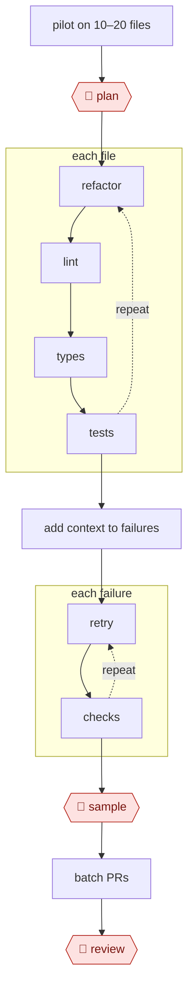

# Fan-out codemod

`TEC › SWE › MAINT` · sampled · evidence A · **draft: needs a reference example** ([how to add one](../../../../../CONTRIBUTING.md#1-add-an-example-run))

**Shape:** `pilot on 10–20 files → 🛑 plan → each file: (refactor ⟲ lint → types → tests) → add context to failures → each failure: (retry ⟲ checks) → 🛑 sample → batch PRs → 🛑 review`
**Agent kit:** [run this in Claude Code](variants/claude-code.md)
**Traits:** `parallel, eval-opt, chain` · **Variants:** `claude-code-headless` · `agent-sdk` · `codex-exec`
**Reference example:** Airbnb's Enzyme → React Testing Library migration [[5]](#sources). About 3.5k test files were migrated in roughly 6 weeks, against an estimated 1.5 years by hand. A per-file step state machine retried with error feedback. About 75% of files passed within hours, and the remaining ~900 got richer context and more retries. Fewer than 100 were finished by hand.

<!-- shape diagram: generated by scripts/build_diagrams.py from `shape`; don't edit -->

<!-- end shape diagram -->

## Background

Large codebases regularly need the same change made in hundreds or thousands of files: moving tests to a new testing library, widening a number type, replacing a deprecated call. Engineers call this a migration, and a script that performs it a codemod. By hand it is months of repetitive work; a plain script handles the simple cases but breaks on the unusual ones. Here the agent migrates every file separately and in parallel, and each file must pass the project's automatic checks before it counts as done; files that fail get more context and another try. People set the rules after a trial run on a few files, check a random sample for changes in meaning that the tests would not catch, and the owners of the code review the result. Passing tests is not proof that a file still tests what it used to, and the code owners answer for their part of the codebase.

**Terms:**
- **Migration**: changing a codebase from one library, language feature or pattern to another across many files.
- **Codemod**: a program that rewrites code automatically; an AST codemod works on the parsed structure of the code rather than its text.
- **Enzyme → React Testing Library (RTL)**: two libraries for testing web interface components; the reference example moves tests from the first to the second.
- **Pilot**: a trial run on a small, varied set of files to tune the instructions before the full run.
- **Prompt pack (rulebook)**: the frozen instructions, before-and-after examples and success definition every worker uses.
- **Few-shot examples**: worked examples placed in the prompt to show the model the expected change.
- **Lint, type check, tests**: the automatic checks, in that order: style and simple errors, type errors, then behaviour.
- **State machine**: a per-file record of which step the file has passed, so failed steps can be rerun alone.
- **Retry budget**: the maximum number of attempts per step or per file.
- **Long tail**: the minority of files that fail the first passes and need more context or hand work.
- **Semantic fidelity**: whether the migrated file still checks the same behaviour as the original.
- **Code owners**: the people or teams recorded as responsible for each part of the code (`CODEOWNERS`).
- **Headless worker**: an agent run started by a script, with no person in the conversation.

## Build it with an agent

**Form:** `project`. The fan-out needs custom parallel workers, and two rules must hold for every worker (change only the assigned file; never edit the frozen prompt pack), which takes a hook. [The kit](variants/claude-code.md) writes this build out as files, with a shell script of headless workers in place of the dynamic workflow.

**You need:** a migration branch; lint, typecheck and single-file test commands that can run in parallel or in separate worktrees; a `CLAUDE.md` with those commands and the no-go paths; a `migration/` folder for the rulebook, examples and success definition; a `CODEOWNERS` file; the `gh` command-line tool.

| Step | Built as |
|---|---|
| pilot on 10–20 files → 🛑 plan | An orchestrating skill runs the per-file skill on the pilot files in the main conversation, writes the rulebook, examples and success definition, then stops for approval. |
| each file: (refactor ⟲ lint → types → tests) | A dynamic workflow that gives each file to its own subagent running the per-file skill: refactor, then lint, types and tests, each fixed from the validator's output, within a retry budget. A `PreToolUse` hook blocks edits to any file but the assigned one and to `migration/`. |
| add context to failures → each failure: (retry ⟲ checks) | The skill clusters the failures from the workflow's results and proposes rulebook patches; after the person agrees, a second dynamic workflow reruns the failing files with sibling files, the code under test and more examples. |
| 🛑 sample | The skill draws a random sample of passed files and shows each before-and-after diff. See Checkpoints. |
| batch PRs → 🛑 review | The skill groups passed files by owner from `CODEOWNERS` and prepares one pull request per group. Permission rules ask before `git push` and `gh pr create`; code owners review in the code host. |

**Checkpoints:** `plan`: the skill stops after the pilot and starts no fan-out until the person approves the prompt pack; the hook then keeps the pack frozen. `sample`: a dynamic workflow cannot take input mid-run, so the sample comes after it: the skill presents a random share of migrated files with their diffs and waits for the person's verdict on fidelity, and patches the rulebook and reruns affected files if the person finds changes in meaning. `review`: one pull request per owner group, opened only after an ask rule, and the agent has no permission to merge.

**Since the sources:** Source 5 dates from 2025-03; the public runs range from 2024-05 to 2026-07. Source 5 reports a pipeline of model calls driven by a per-file state machine, not an agent choosing its own steps. The newest public run, Anthropic's account of 2026-07, describes the same practice with agents: a rulebook first, a stress test on three files whose output is thrown away, then implementer agents in batches with two reviewers in separate contexts and phase gates, run with dynamic workflows. The build above uses a dynamic workflow for the fan-out; the kit's shell script of `claude -p` workers still works where that feature is unavailable. Source 5's practice of growing prompts with many related files for the long tail is kept as the second pass; the build does not set a prompt size.

*A design based on this entry's steps and the tool documentation as of 2026-11, not a reported run.*

## Steps

*As reported by the sources.*

1. The team pilots on 10–20 representative files and tunes the prompt and examples. 🛑 **Plan**: a person freezes the prompt, few-shot examples, and success definition.
2. The system runs a per-file state machine: refactor → fix lint → fix types → fix tests. Each step is an LLM call that receives its validator's output. N parallel headless workers (`claude -p`, Codex exec, Agent SDK) run it, each with a retry budget.
3. For the long tail, the team adds context (sibling files, component source, more examples) and reruns. They cluster the failures and patch the prompt [[5]](#sources).
4. 🛑 **Sample**: a person checks semantic fidelity on a random sample, beyond "tests pass."
5. The system batches PRs by owner. 🛑 **Review**: code owners review. Engineers hand-fix the residue.

**Output:** a migrated codebase, a failure log, and a reusable migration prompt pack.

## Public runs

Coverage as of 2026-11-06: **Strong**: a first-hand, detailed run that matches most of the shape. From [Where are the real runs?](../../../../../research/2026-11-real-runs.md); every number was re-checked against its page.

- [Sergii Gorbachov, Slack Engineering](https://slack.engineering/balancing-old-tricks-with-new-feats-ai-powered-conversion-from-enzyme-to-react-testing-library-at-slack/) (2024-05-22). AST codemod + LLM with DOM context; rubric on sample files; humans verify. "80% of the content within these files was accurately converted"; "saving of 22% of developer time". *First-hand: yes; confidence: high.*
- [Ziftci et al., Google, arXiv 2504.09691](https://arxiv.org/abs/2504.09691) (2025-04-13). 39 int32→int64 migrations, edits per file with validation; failures go to people. "74.45% of the code changes and 69.46% of the edits were generated by the LLM". *First-hand: yes; confidence: high.*
- [Anthropic, *How Anthropic runs large-scale code migrations*](https://claude.com/blog/ai-code-migration) (2026-07-16). Rulebook → throwaway 3-file stress test → fan-out implement-review-fix → phase gates. "fanned out across all 1,448 files"; "Nineteen regressions surfaced after merge". *First-hand: yes (own product); confidence: med.*
- [Charas & Bruggmann, Spotify Engineering](https://engineering.atspotify.com/2025/11/spotifys-background-coding-agent-part-1) (2025-11-06). Fleet migrations in containers with an LLM judge; teams review the PRs. "merged more than 1500 pull requests"; "60–90%" time saving. *First-hand: yes; confidence: high.*

## Sources

5. Airbnb Tech, *Accelerating Large-Scale Test Migration with LLMs* (March 2025). https://airbnb.tech/?p=366 · InfoQ coverage: https://www.infoq.com/news/2025/03/airbnb-llm-test-migration/
