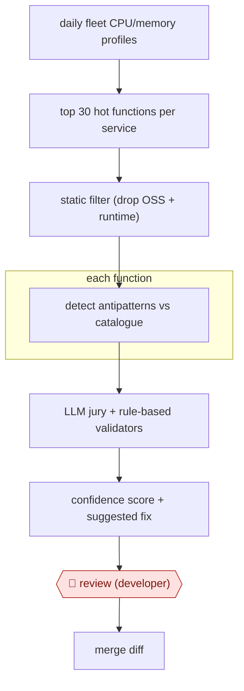

# Profile-led perf fixes

`TEC › SWE › MAINT` · checkpointed · evidence A · **draft: needs a reference example** ([how to add one](../../../../../CONTRIBUTING.md#1-add-an-example-run))

**Shape:** `daily fleet CPU/memory profiles → top 30 hot functions per service → static filter (drop OSS + runtime) → each function: detect antipatterns vs catalogue → LLM jury + rule-based validators → confidence score + suggested fix → 🛑 review (developer) → merge diff`
**Variants:** `uber-perfinsights` · `optix`

<!-- shape diagram: generated by scripts/build_diagrams.py from `shape`; don't edit -->

<!-- end shape diagram -->

## Background

Running software costs money in proportion to the computing it uses, so engineers periodically look for code that wastes it. They sample the running system with a profiler, which records where the processor time and memory go, find the few functions that use the most (the hot functions), and rewrite the wasteful ones. Doing this by hand across hundreds of services is slow and needs a specialist. Here the agent starts from the measured hot functions, checks each against a list of known wasteful patterns and drafts a fix with a confidence score. A developer still reviews every diff, because only the owner of the code can tell whether a faster version keeps the behaviour the service relies on, and a model can report a problem that is not there.

**Terms:**
- **Profile**: a sample of which functions a running service spends processor time and memory in.
- **Flat CPU**: the processor time spent in a function itself, not counting what it calls.
- **Hot function**: one of the functions that account for the most processor time.
- **Antipattern**: a known wasteful way of writing code, kept in a catalogue with the better alternative.
- **Monorepo**: one repository holding the code of many services.
- **runtime.mallocgc**: the Go runtime's memory allocator; a large share of CPU spent there points at memory-heavy code.
- **Few-shot examples**: worked examples placed in the prompt to show the model what is wanted.
- **LLM jury**: several independent model checks that must agree before a finding is kept.
- **False positive**: a reported problem that does not exist.
- **LLMCheck, Optix**: Uber's rule-based validators for the model's findings, and its tool for continuous code optimization.

## Build it with an agent

**Form:** `service`. A daily schedule starts the run, nobody is at the keyboard, and developers see only the scored suggestions.

**You need:** read access to the profiler's daily output through a script or MCP server; read access to the repository; a catalogue of antipatterns with before-and-after examples, kept as reference files; a list of functions to exclude (open-source and runtime code); validator scripts for the detection rules; a place where suggestions land, such as draft pull requests or a ticket queue; no permission to merge.

| Step | Built as |
|---|---|
| daily fleet CPU/memory profiles → top 30 hot functions per service → static filter | A scheduled script pulls the profiles, keeps the top 30 by flat CPU per service, adds memory profiles when `runtime.mallocgc` exceeds 15% of CPU, and drops open-source and runtime functions. |
| each function: detect antipatterns vs catalogue | A skill gives each function's full source and the catalogue to a subagent, which names any antipattern and drafts a fix with a confidence score. |
| LLM jury + rule-based validators → confidence score + suggested fix | Separate subagents each check that the antipattern exists and the fix is valid; scripts then apply rule-based checks and log the outcome. |
| 🛑 review (developer) | Each surviving suggestion is posted as a draft diff with its score for the code's owner. |
| merge diff | The developer merges in the code host. |

**Checkpoints:** `review`: the agent can read and propose, and has no merge tool; suggestions leave the run only as draft diffs or queue items. The developer decides on each one. Rejected suggestions are logged so the catalogue and checks can be revised by a person.

**Since the sources:** The only source and public run, Uber's blog post, dates from 2025-07; the entry's sources are all from before 2025-11. The post reports a pipeline of model calls with a jury and rule-based validators; the build keeps it as a skill, subagents and scripts rather than an agent choosing its own steps. The source page opened in this check and supports steps 1 to 4 and the figure quoted in the failure modes. Step 5 is only partly supported: the post says the output feeds "downstream tools for code transformation or manual review by developers" and that validated suggestions flow directly into Optix, which has produced hundreds of merged diffs, but it does not say that a developer reviews every diff before it merges. A search in 2026-11 found no newer account from Uber beyond summaries of the same post. It did find a 2026 conference talk on agents that work from production profiles, which also opened: a Netflix engineer's talk at AI Engineer World's Fair 2026 ([talk page](https://www.ai.engineer/talks/CgsWxRUY5Eo-ai-agents-performance-ship-faster-pay-less); month not shown). It describes production CPU profiles guiding coding agents, a shared catalogue of performance patterns, and tests and an automated canary comparison before a person reviews a fix, and it says a pattern's confidence should prompt a human review, not authorize a push to production. The build above has no canary step. The build leaves out the daily profiler and the fleet-wide scale, which depend on a company's own tooling.

*A design based on this entry's steps and the tool documentation as of 2026-11, not a reported run.*

## Steps

*As reported by the sources.*

1. Pull CPU and memory profiles from the daily fleet-wide profiler, taken at peak traffic. [[1]](#sources)
2. Keep the top 30 functions by flat CPU per service. Add memory profiles when runtime.mallocgc exceeds 15% of CPU. Drop open-source and runtime functions with a static filter. [[1]](#sources)
3. For each hot function, send its full source and a curated antipattern list to an LLM. The prompt uses few-shot examples, a role, checks that the fix is runnable, and asks for a confidence score. [[1]](#sources)
4. An LLM jury independently checks that the antipattern exists and the fix is valid. LLMCheck rule-based validators then catch false positives and log detection accuracy. [[1]](#sources)
5. 🛑 **Review**: developers review the scored suggestions before diffs merge to the Go monorepo. Validated suggestions also feed Uber's continuous optimization tool (Optix). [[1]](#sources)

**Output:** Merged optimization diffs in the monorepo, plus a tracked count of antipatterns in hot code over time.
**Failure modes → guards:** LLM false positives and hallucinations break engineers' trust → jury validation plus LLMCheck (false positives fell 'from over 80% to the low teens'). Time spent on cold code → profile-based hot-path filter first.
**How it differs:** AWF-0002 Fan-out codemod: AWF-0002 applies one planned refactor everywhere, gated by a pilot plan. Here production profiles decide what to change, each diff is a different fix, and the gate is per-diff developer review against measured hot paths.

## Public runs

Coverage as of 2026-11-06: **Strong**: a first-hand, detailed run that matches most of the shape. Collected and re-checked in [Second collection pass](../../../../../research/2026-11-second-pass.md).

- [Uber, PerfInsights](https://www.uber.com/us/en/blog/perfinsights/) (2025-07-22). In production on top Go services; hundreds of merged diffs. "from 14.5 hours to almost 1 hour of tool runtime" per issue; "93.10% time savings". *First-hand: yes; confidence: high.*

## Sources

1. Ryan Hang, Sung Whang, Joseph Wang (Uber), PerfInsights: Detecting Performance Optimization Opportunities in Go Code using Generative AI, 2025-07-22. https://www.uber.com/us/en/blog/perfinsights/
