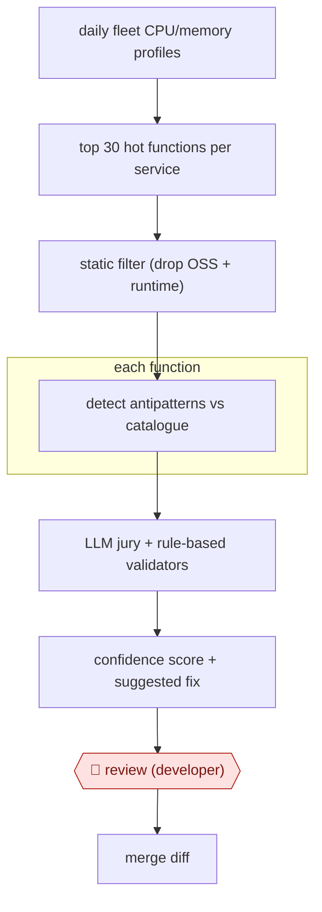

# Profile-led perf fixes

`TEC › SWE › MAINT` · checkpointed · evidence A · **draft: needs a reference example** ([how to add one](../../../../../CONTRIBUTING.md#1-add-an-example-run))

**Shape:** `daily fleet CPU/memory profiles → top 30 hot functions per service → static filter (drop OSS + runtime) → each function: detect antipatterns vs catalogue → LLM jury + rule-based validators → confidence score + suggested fix → 🛑 review (developer) → merge diff`
**How it differs:** AWF-0002 Fan-out codemod: AWF-0002 applies one planned refactor everywhere, gated by a pilot plan. Here production profiles decide what to change, each diff is a different fix, and the gate is per-diff developer review against measured hot paths.
**Variants:** `uber-perfinsights` · `optix`

<!-- shape diagram: generated by scripts/build_diagrams.py from `shape`; don't edit -->

<!-- end shape diagram -->

## Steps
1. Pull CPU and memory profiles from the daily fleet-wide profiler, taken at peak traffic. [[1]](#sources)
2. Keep the top 30 functions by flat CPU per service. Add memory profiles when runtime.mallocgc exceeds 15% of CPU. Drop open-source and runtime functions with a static filter. [[1]](#sources)
3. For each hot function, send its full source and a curated antipattern list to an LLM. The prompt uses few-shot examples, a role, checks that the fix is runnable, and asks for a confidence score. [[1]](#sources)
4. An LLM jury independently checks that the antipattern exists and the fix is valid. LLMCheck rule-based validators then catch false positives and log detection accuracy. [[1]](#sources)
5. 🛑 **Review**: developers review the scored suggestions before diffs merge to the Go monorepo. Validated suggestions also feed Uber's continuous optimization tool (Optix). [[1]](#sources)

**Output:** Merged optimization diffs in the monorepo, plus a tracked count of antipatterns in hot code over time.
**Failure modes → guards:** LLM false positives and hallucinations break engineers' trust → jury validation plus LLMCheck (false positives fell 'from over 80% to the low teens'). Time spent on cold code → profile-based hot-path filter first.

## Public runs

Coverage as of 2026-11-06: **Strong**: a first-hand, detailed run that matches most of the shape. Collected and re-checked in [Second collection pass](../../../../../research/2026-11-second-pass.md).

- [Uber, PerfInsights](https://www.uber.com/us/en/blog/perfinsights/) (2025-07-22). In production on top Go services; hundreds of merged diffs. "from 14.5 hours to almost 1 hour of tool runtime" per issue; "93.10% time savings". *First-hand: yes; confidence: high.*

## Sources

1. Ryan Hang, Sung Whang, Joseph Wang (Uber), PerfInsights: Detecting Performance Optimization Opportunities in Go Code using Generative AI, 2025-07-22. https://www.uber.com/us/en/blog/perfinsights/
