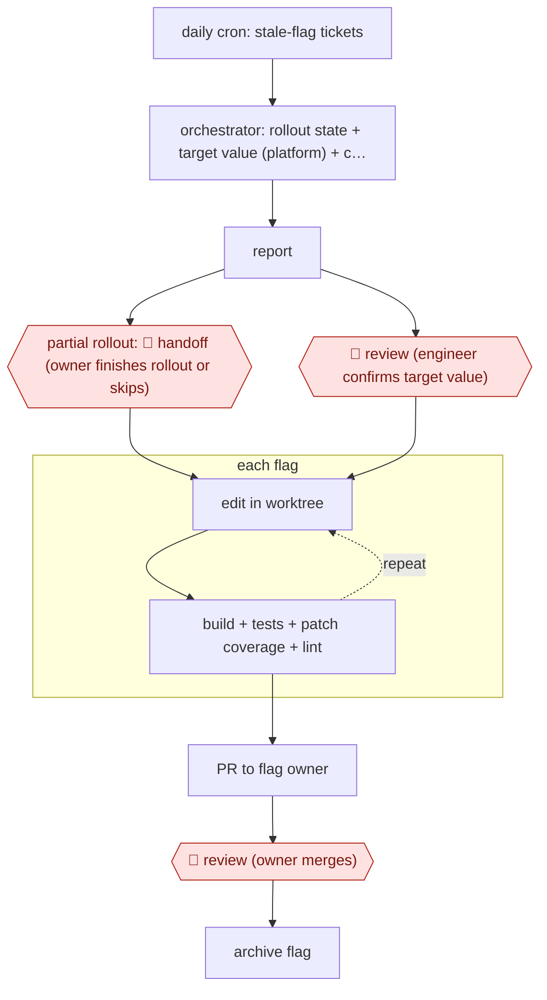

# Stale-flag cleanup PRs

`TEC › SWE › MAINT` · checkpointed · evidence A · **draft: needs a reference example** ([how to add one](../../../../../CONTRIBUTING.md#1-add-an-example-run))

**Shape:** `daily cron: stale-flag tickets → orchestrator: rollout state + target value (platform) + code references → report → partial rollout: 🛑 handoff (owner finishes rollout or skips) | 🛑 review (engineer confirms target value) → each flag: (edit in worktree ⟲ build + tests + patch coverage + lint) → PR to flag owner → 🛑 review (owner merges) → archive flag`
**Variants:** `google-adk` · `claude-opus` · `github-copilot-agent-tasks` · `github-actions`

<!-- shape diagram: generated by scripts/build_diagrams.py from `shape`; don't edit -->

<!-- end shape diagram -->

## Background

Software teams use feature flags: switches in the code that turn a new feature on for some users or all of them. Once a feature is fully rolled out the switch is no longer needed, but the old code path behind it usually stays, and the flags pile up as clutter that makes the code harder to read and change. Cleaning up one flag means finding where it is used, keeping only the code for the value the flag settled on, and updating the tests. Here the agent does that work for each stale flag and opens one pull request (PR, a proposed change for review) per flag. A person must confirm which value the flag settled on, because keeping the wrong branch silently changes what users get, and the flag's owner must review and merge the PR because they answer for that code.

**Terms:**
- **Feature flag**: a switch in the code that turns a feature on or off, or on for a share of users, without a new release.
- **Stale flag**: a flag that has not changed for a long time but is still in the code.
- **Rollout / partial rollout**: the share of users who currently get the feature; a partial rollout is one abandoned part-way, such as at 60%.
- **Target value**: the value the flag should be fixed to when its code is removed.
- **Experimentation platform**: the system that holds each flag's live state.
- **PR (pull request)**: a proposed change, published for review before it is merged into the shared code.
- **Git worktree**: a separate working copy of the repository, so several changes can proceed side by side.
- **Patch coverage**: the share of changed lines that the tests run.
- **Linter**: a tool that flags code-style and simple-error problems.
- **Archive a flag**: retire the flag in the flag service so it can no longer be used.

## Build it with an agent

**Form:** `service`. A daily schedule starts the run with nobody present, and people see only the report, the handoffs and the finished PRs.

**You need:** a daily trigger (a cloud scheduled task, or your own scheduler starting `claude -p`); a way to list stale flags, as a deterministic query or a ticket feed; read-only access to the experimentation platform through an MCP server; a checkout of each repository with its build, test, coverage and lint commands in `CLAUDE.md`; an exclusion list of flags never to touch; a queue or ticket system for the reports. Give the agent no write access to the experimentation platform and no merge permission.

| Step | Built as |
|---|---|
| daily cron: stale-flag tickets | A scheduled run reads the tickets or the deterministic list of stale flags, assigned to each flag's creator. |
| orchestrator: rollout state + target value + code references → report | A skill queries the platform for each flag's rollout percentage and target value, searches the repository for references and writes a report proposing a target value. The run ends there. |
| partial rollout: 🛑 handoff / 🛑 review (engineer confirms target value) | The report goes to the flag's owner or an engineer through the ticket. A partial rollout is returned to the owner to finish or skip; a confirmed target value is recorded in the ticket, and the next run picks it up. |
| each flag: (edit in worktree ⟲ build + tests + patch coverage + lint) | For each confirmed flag, a subagent works in its own git worktree, removes the flag and loops until build, tests, patch coverage (at least 95%) and lint pass, within a time limit. Up to four run at a time per repository. |
| PR to flag owner | A script opens the PR only after the checks have passed, assigned to the flag owner. |
| 🛑 review (owner merges) | The owner reviews and merges in the code host. |
| archive flag | Done by the owner or a separate job after deploy; the agent has no tool for it. |

**Checkpoints:** `handoff`: a partial rollout is never edited; the report is routed to the owner with the rollout state and the agent does nothing further until the owner answers. `review`: two stops, and both are enforced by what the agent lacks. The removal step only runs on flags whose target value a person has recorded, so the agent cannot start from its own proposal, and the agent has no merge or archive tool, so the owner merges and the flag is retired only after that. Where a missed stop would change user-facing behaviour, a `PreToolUse` hook can also block edits to any flag not marked confirmed.

**Since the sources:** Sources date from 2025-12 to 2026-08. Source 1 reports a two-phase system of agents driven by an orchestrator, and source 2 a GitHub Actions workflow that starts one cloud agent task per flag; the build keeps source 1's phases, with the stop between them made explicit as the end of a run. Source 2's fully deterministic eligibility filter is kept as the way to list stale flags. Neither source could be opened in this check: both sites refused the automated reader (HTTP 403), so what is stated here follows the entry's steps. The build sets no cost or time figures and does not reproduce source 1's one-hour timeout beyond saying a limit should exist. Bot-opened PRs may not run CI by default, as source 2 reports; check how your code host treats them.

*A design based on this entry's steps and the tool documentation as of 2026-11, not a reported run.*

## Steps

*As reported by the sources.*

1. A daily cron files a ticket for each stale flag: not modified in 90 days, still referenced in code, not archived, not on the exclusion list. The ticket is assigned to the flag's creator [[1]](#sources).
2. Phase 1: an orchestrator agent fetches the tickets. It queries the experimentation platform over MCP for the flag's UUID, rollout percentage and target value, then searches the repo for every reference. It writes a report proposing a target value and listing the affected files [[1]](#sources).
3. 🛑 **Review**: an engineer verifies the report and confirms the target value. 🛑 **Handoff**: a partial rollout (e.g. abandoned at 60%) goes back to the user, who completes the rollout or rollback, or skips the cleanup [[1]](#sources).
4. Phase 2: one removal agent per confirmed flag, each in its own git worktree, up to four at a time per repo. Each agent finds the constant, wrapper and call sites, simplifies the conditionals and updates the tests. It loops until the build passes, the tests pass, patch coverage is at least 95% and the linter is clean. It has a one-hour timeout and may not open a PR before the checks pass [[1]](#sources).
5. 🛑 **Review**: the PR is assigned to the flag owner, who reviews and merges it. In variants, the flag is archived in the flag service after deploy and the ticket closes [[1]](#sources)[[2]](#sources).
6. Variant: the eligibility filter is fully deterministic (boolean flags, 3+ months old, still in code). Each flag triggers one cloud agent task, PRs are labelled for tracking, and regular CI plus required human review gate the merge [[2]](#sources).

**Output:** One merge-ready PR per stale flag, assigned to the flag's owner, then archival of the flag.
**Failure modes → guards:** Hardcoding the wrong value silently changes behavior → the live rollout state comes from the platform, not the code, and a human confirms it. Incomplete removal deep in a call chain → coverage and linter checks, then a re-prompt. All 5 interventions in 50 runs were call-chain depth issues, not bugs. Bot PRs don't run CI by default → manual approval of CI runs [2].
**How it differs:** AWF-0002 Fan-out codemod applies one transformation across many files, with a pilot and sampled review. Here each unit is a flag whose target value comes from a live platform. A human confirms that value before any edit, and each owner gets a per-flag PR. AWF-0130 Profile-led perf fixes targets hot functions from profiles. The deliverable and the checkpoint arrangement differ from both.

## Public runs

Coverage as of 2026-11-13: **Strong**: a first-hand, detailed run that matches most of the shape. Collected and re-checked in [Third collection pass](../../../../../research/2026-11-third-pass.md).

- [DoorDash, Automating Feature-Flag Cleanup at Scale with a Multi-Agent LLM System](https://careersatdoordash.com/blog/automating-feature-flag-cleanup-at-scale-with-a-multi-agent-llm-system/) (2026-08-24). 50 most recent stale flags processed; one human checkpoint before parallel cleanup agents. "produced usable PRs for 45 of them at an average cost of $4.79 and 13.8 minutes per flag". *First-hand: yes; confidence: high.*
- [Glovo, How We Use AI to Keep Feature Flags Under Control](https://tech-blog.glovoapp.com/blog/how-we-use-ai-to-keep-feature-flags-under-control/) (2025-12-10). GitHub Actions workflow triggers one Copilot agent task per eligible flag; human review required. "600+ feature flags older than a year". *First-hand: yes; confidence: med.*

## Sources

1. Atharv Chandratre, Jai Datar (DoorDash), Automating Feature-Flag Cleanup at Scale with a Multi-Agent LLM System, 2026-08-24. https://careersatdoordash.com/blog/automating-feature-flag-cleanup-at-scale-with-a-multi-agent-llm-system/
2. Glovo Tech Blog, How We Use AI to Keep Feature Flags Under Control, 2025-12-10. https://tech-blog.glovoapp.com/blog/how-we-use-ai-to-keep-feature-flags-under-control/
