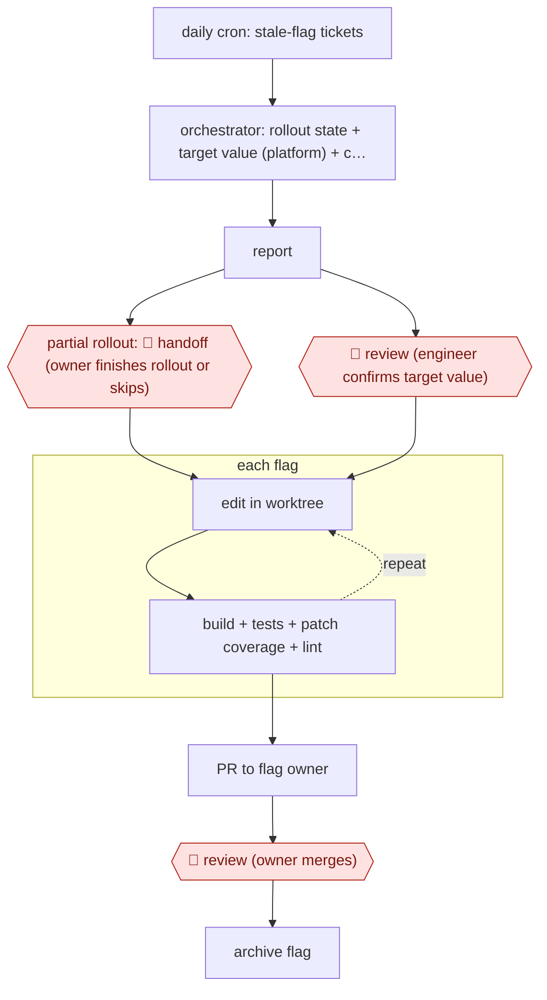

# Stale-flag cleanup PRs

`TEC › SWE › MAINT` · checkpointed · evidence A · **draft: needs a reference example** ([how to add one](../../../../../CONTRIBUTING.md#1-add-an-example-run))

**Shape:** `daily cron: stale-flag tickets → orchestrator: rollout state + target value (platform) + code references → report → partial rollout: 🛑 handoff (owner finishes rollout or skips) | 🛑 review (engineer confirms target value) → each flag: (edit in worktree ⟲ build + tests + patch coverage + lint) → PR to flag owner → 🛑 review (owner merges) → archive flag`
**How it differs:** AWF-0002 Fan-out codemod applies one transformation across many files, with a pilot and sampled review. Here each unit is a flag whose target value comes from a live platform. A human confirms that value before any edit, and each owner gets a per-flag PR. AWF-0130 Profile-led perf fixes targets hot functions from profiles. The deliverable and the checkpoint arrangement differ from both.
**Variants:** `google-adk` · `claude-opus` · `github-copilot-agent-tasks` · `github-actions`

<!-- shape diagram: generated by scripts/build_diagrams.py from `shape`; don't edit -->

<!-- end shape diagram -->

## Steps
1. A daily cron files a ticket for each stale flag: not modified in 90 days, still referenced in code, not archived, not on the exclusion list. The ticket is assigned to the flag's creator [[1]](#sources).
2. Phase 1: an orchestrator agent fetches the tickets. It queries the experimentation platform over MCP for the flag's UUID, rollout percentage and target value, then searches the repo for every reference. It writes a report proposing a target value and listing the affected files [[1]](#sources).
3. 🛑 **Review**: an engineer verifies the report and confirms the target value. 🛑 **Handoff**: a partial rollout (e.g. abandoned at 60%) goes back to the user, who completes the rollout or rollback, or skips the cleanup [[1]](#sources).
4. Phase 2: one removal agent per confirmed flag, each in its own git worktree, up to four at a time per repo. Each agent finds the constant, wrapper and call sites, simplifies the conditionals and updates the tests. It loops until the build passes, the tests pass, patch coverage is at least 95% and the linter is clean. It has a one-hour timeout and may not open a PR before the checks pass [[1]](#sources).
5. 🛑 **Review**: the PR is assigned to the flag owner, who reviews and merges it. In variants, the flag is archived in the flag service after deploy and the ticket closes [[1]](#sources)[[2]](#sources).
6. Variant: the eligibility filter is fully deterministic (boolean flags, 3+ months old, still in code). Each flag triggers one cloud agent task, PRs are labelled for tracking, and regular CI plus required human review gate the merge [[2]](#sources).

**Output:** One merge-ready PR per stale flag, assigned to the flag's owner, then archival of the flag.
**Failure modes → guards:** Hardcoding the wrong value silently changes behavior → the live rollout state comes from the platform, not the code, and a human confirms it. Incomplete removal deep in a call chain → coverage and linter checks, then a re-prompt. All 5 interventions in 50 runs were call-chain depth issues, not bugs. Bot PRs don't run CI by default → manual approval of CI runs [2].

## Public runs

Coverage as of 2026-11-13: **Strong**: a first-hand, detailed run that matches most of the shape. Collected and re-checked in [Third collection pass](../../../../../research/2026-11-third-pass.md).

- [DoorDash, Automating Feature-Flag Cleanup at Scale with a Multi-Agent LLM System](https://careersatdoordash.com/blog/automating-feature-flag-cleanup-at-scale-with-a-multi-agent-llm-system/) (2026-08-24). 50 most recent stale flags processed; one human checkpoint before parallel cleanup agents. "produced usable PRs for 45 of them at an average cost of $4.79 and 13.8 minutes per flag". *First-hand: yes; confidence: high.*
- [Glovo, How We Use AI to Keep Feature Flags Under Control](https://tech-blog.glovoapp.com/blog/how-we-use-ai-to-keep-feature-flags-under-control/) (2025-12-10). GitHub Actions workflow triggers one Copilot agent task per eligible flag; human review required. "600+ feature flags older than a year". *First-hand: yes; confidence: med.*

## Sources

1. Atharv Chandratre, Jai Datar (DoorDash), Automating Feature-Flag Cleanup at Scale with a Multi-Agent LLM System, 2026-08-24. https://careersatdoordash.com/blog/automating-feature-flag-cleanup-at-scale-with-a-multi-agent-llm-system/
2. Glovo Tech Blog, How We Use AI to Keep Feature Flags Under Control, 2025-12-10. https://tech-blog.glovoapp.com/blog/how-we-use-ai-to-keep-feature-flags-under-control/
