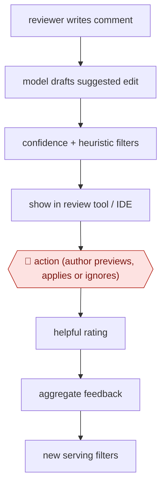

# Comment-to-edit suggestions

`TEC › SWE › REVIEW` · assist · evidence A · **draft: needs a reference example** ([how to add one](../../../../../CONTRIBUTING.md#1-add-an-example-run))

**Shape:** `reviewer writes comment → model drafts suggested edit → confidence + heuristic filters → show in review tool / IDE → 🛑 action (author previews, applies or ignores) → helpful rating → aggregate feedback → new serving filters`
**Variants:** `google-critique-ml-edits`

<!-- shape diagram: generated by scripts/build_diagrams.py from `shape`; don't edit -->

<!-- end shape diagram -->

## Background

In code review, one developer (the author) proposes a change to shared code and a colleague (the reviewer) reads it and leaves comments such as "rename this" or "handle the empty list". The author then has to turn each comment into an edit, which is often small and mechanical but still takes a round trip between two people. Here the reviewer still writes the comment; the agent drafts the edit that would resolve it and shows it to the author. The author must look at each edit and decide whether to apply it, because the author answers for the change and a plausible edit can still be wrong or clash with other work.

**Terms:**
- **Diff**: the set of lines a change adds and removes.
- **Review tool / IDE**: the web page where reviewers comment on a change, and the editor where the author writes code.
- **Precision**: the share of shown suggestions that are right.
- **3-way merge**: combining a suggested edit with the author's own newer edits to the same lines, using the original as the common base.
- **Serving filter**: a rule that decides which drafted edits are shown to the author and which are held back.

## Build it with an agent

**Form:** `skill`. One author works through one change's comments at a time and stays in the conversation, so a single skill is enough.

**You need:** a checkout of the branch under review; the reviewer's comments as text, from the code host's command-line tool or an MCP server, or pasted in; the project's test command. The agent needs no permission to push or to reply on the review.

| Step | Built as |
|---|---|
| reviewer writes comment | A person writes it in the code host; the skill reads the comments on the change. |
| model drafts suggested edit | The skill takes one comment at a time, reads the commented lines and their surroundings, and proposes an edit as a diff. |
| confidence + heuristic filters | The skill's instructions: drop a comment that is a question, asks for a design discussion or is unclear, and say why; mark the rest as ready. |
| show in review tool / IDE → 🛑 action | The skill shows each diff in the conversation and stops. A permission rule set to ask covers file edits. |
| helpful rating → aggregate feedback → new serving filters | The person says which edits were unhelpful; the skill appends the pattern to a filters file beside it, which the person approves. |

**Checkpoints:** `action`: the skill shows the diff and stops, and edits to files are under an ask rule, so nothing is written to the working tree until the author says yes. The agent has no tool to push or to resolve a comment, so the author does that in the code host.

**Since the sources:** The only source, a Google research blog post, dates from 2023-05, more than 12 months before this check. Its system used a model fine-tuned on past comments and edits and tuned its filters on logged feedback; the build above uses a general agent with written filter rules and does not reproduce the fine-tuning or the usage logging. Meta's MetaMateCR is a production system for the same task, described in an arXiv paper from 2025-07 ([MetaMateCR paper](https://arxiv.org/html/2507.13499v1)); it was seen only as a search result and not opened. The source page itself could not be opened in this check (the session's network blocked the site). No other account was opened.

*A design based on this entry's steps and the tool documentation as of 2026-11, not a reported run.*

## Steps

*As reported by the sources.*

1. A reviewer leaves a natural-language comment on a code change. [[1]](#sources)
2. The system builds model input from the change and the comment. A model fine-tuned on past comments and the edits authors made in reply drafts a suggested edit. [[1]](#sources)
3. Suggestions show only if the model is confident and serving heuristics pass. The target is 50% precision. [[1]](#sources)
4. 🛑 **Action**: the author previews the edit in the review tool or IDE and decides whether to apply it. Conflicts go through a 3-way merge view. [[1]](#sources)
5. Authors rate suggestions ('Was this helpful?'). Preview and apply events are aggregated, and recurring failure patterns become new serving filters. [[1]](#sources)

**Output:** Reviewer comments resolved by author-applied edits, which shortens the time from review to submit.
**Failure modes → guards:** Low-precision suggestions erode trust → confidence threshold plus heuristics. Conflicts with local edits → 3-way merge. Recurring bad patterns → mined from 'not helpful' feedback into filters.
**How it differs:** AWF-0070 Graded PR comments: AWF-0070 has the AI write review comments for authors to rate. Here a human reviewer writes the comment, the AI drafts the code change that resolves it, and the author must apply each edit (assist, not sampled).

## Public runs

Coverage as of 2026-11-06: **Strong**: a first-hand, detailed run that matches most of the shape. Collected and re-checked in [Second collection pass](../../../../../research/2026-11-second-pass.md).

- [Google, Resolving code review comments with ML](https://research.google/blog/resolving-code-review-comments-with-ml/) (2023-05-23). Full internal launch at Google, measured on preview and apply rates. "40% to 50% of previewed suggested edits are applied". *First-hand: yes; confidence: high.*

## Sources

1. Alexander Frömmgen, Lera Kharatyan (Google), Resolving code review comments with ML, 2023-05-23. https://research.google/blog/resolving-code-review-comments-with-ml/
