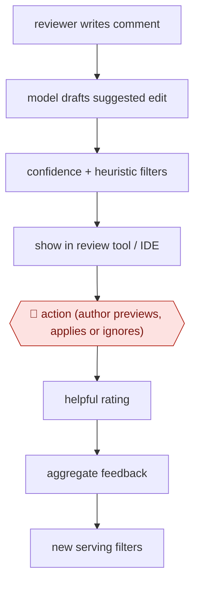

# Comment-to-edit suggestions

`TEC › SWE › REVIEW` · assist · evidence A · **draft: needs a reference example** ([how to add one](../../../../../CONTRIBUTING.md#1-add-an-example-run))

**Shape:** `reviewer writes comment → model drafts suggested edit → confidence + heuristic filters → show in review tool / IDE → 🛑 action (author previews, applies or ignores) → helpful rating → aggregate feedback → new serving filters`
**How it differs:** AWF-0070 Graded PR comments: AWF-0070 has the AI write review comments for authors to rate. Here a human reviewer writes the comment, the AI drafts the code change that resolves it, and the author must apply each edit (assist, not sampled).
**Variants:** `google-critique-ml-edits`

<!-- shape diagram: generated by scripts/build_diagrams.py from `shape`; don't edit -->

<!-- end shape diagram -->

## Steps
1. A reviewer leaves a natural-language comment on a code change. [[1]](#sources)
2. The system builds model input from the change and the comment. A model fine-tuned on past comments and the edits authors made in reply drafts a suggested edit. [[1]](#sources)
3. Suggestions show only if the model is confident and serving heuristics pass. The target is 50% precision. [[1]](#sources)
4. 🛑 **Action**: the author previews the edit in the review tool or IDE and decides whether to apply it. Conflicts go through a 3-way merge view. [[1]](#sources)
5. Authors rate suggestions ('Was this helpful?'). Preview and apply events are aggregated, and recurring failure patterns become new serving filters. [[1]](#sources)

**Output:** Reviewer comments resolved by author-applied edits, which shortens the time from review to submit.
**Failure modes → guards:** Low-precision suggestions erode trust → confidence threshold plus heuristics. Conflicts with local edits → 3-way merge. Recurring bad patterns → mined from 'not helpful' feedback into filters.

## Public runs

Coverage as of 2026-11-06: **Strong**: a first-hand, detailed run that matches most of the shape. Collected and re-checked in [Second collection pass](../../../../../research/2026-11-second-pass.md).

- [Google, Resolving code review comments with ML](https://research.google/blog/resolving-code-review-comments-with-ml/) (2023-05-23). Full internal launch at Google, measured on preview and apply rates. "40% to 50% of previewed suggested edits are applied". *First-hand: yes; confidence: high.*

## Sources

1. Alexander Frömmgen, Lera Kharatyan (Google), Resolving code review comments with ML, 2023-05-23. https://research.google/blog/resolving-code-review-comments-with-ml/
