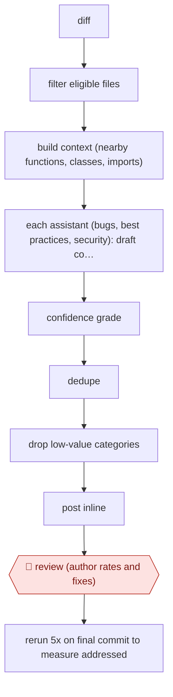

# Graded PR comments

`TEC › SWE › REVIEW` · sampled · evidence A · **draft: needs a reference example** ([how to add one](../../../../../CONTRIBUTING.md#1-add-an-example-run))

**Shape:** `diff → filter eligible files → build context (nearby functions, classes, imports) → each assistant (bugs, best practices, security): draft comments → confidence grade → dedupe → drop low-value categories → post inline → 🛑 review (author rates and fixes) → rerun 5x on final commit to measure addressed`
**Variants:** [`claude-code` kit](variants/claude-code.md) · `ureview` · `coderabbit` · `github-copilot-code-review` · `graphite-diamond`

<!-- shape diagram: generated by scripts/build_diagrams.py from `shape`; don't edit -->

<!-- end shape diagram -->

## Background

Before a change to shared code is merged, a colleague reads the diff (the lines the change adds and removes) and leaves comments on problems: a bug, a breach of the team's conventions, a security hole. Human review is slow, and reviewers vary in how much they catch. Here an agent reads every diff as soon as it is submitted and posts its own review comments alongside the human reviewer's. Many machine-written comments are noise, so each one is graded for confidence and the weak ones are dropped before anyone sees them. The author of the change still reads each comment, marks it useful or not and decides whether to act, because the author knows the intent of the change and the agent's comments are suggestions, not findings.

**Terms:**
- **Diff**: the set of lines a change adds and removes; at Uber, the unit of review.
- **PR (pull request)**: a proposed change, published for review before it is merged into the shared code.
- **CI**: the automated checks that run on every submitted change.
- **Confidence grade**: a score from a second pass over a draft comment, estimating whether it is correct and worth an engineer's time.
- **Dedupe**: merging comments that make the same point.
- **AppSec**: application security, the work of finding vulnerabilities in code.
- **Precision and recall**: of the comments posted, the share that are right; of the problems that exist, the share that were caught.
- **Addressed rate**: the share of posted comments that the final version of the change no longer triggers.

## Build it with an agent

**Form:** `service`. The source runs on every commit in CI with nobody at the keyboard, and authors see only the posted comments. The interactive [kit](variants/claude-code.md) runs the same steps on demand with a confirmation before posting, and fits a `project` build; it is the place to start before wiring it to CI.

**You need:** a trigger on new or updated pull requests (a CI job calling `claude -p`, or an Agent SDK program); read access to the repository and to the pull request; permission to post review comments, and no permission to approve, merge, push or resolve threads; a `CLAUDE.md` or conventions document for the best-practices reviewer; a config file listing files to skip, per-category thresholds and categories to suppress; a store for ratings and metrics. Treat pull request text and code as data to be read, not instructions.

| Step | Built as |
|---|---|
| diff → filter eligible files → build context | A script in the run drops config files, generated code and experimental directories, then writes a context bundle of nearby functions, classes and imports per file. |
| each assistant: draft comments | Three read-only subagents (bugs, best practices, security) run in parallel on the bundles and return comments as structured lines. |
| confidence grade → dedupe → drop low-value categories | A separate grading pass in the skill, then a script applies thresholds from the config file, merges overlaps and removes suppressed categories. |
| post inline | A step with a connector or the code host's command-line tool that posts one review of comments only. |
| 🛑 review | The author rates each comment in the code host; ratings are written to the store. |
| rerun 5x on final commit to measure addressed | A second headless run of the same skill five times on the final commit, without posting, compared with what was posted. |

**Checkpoints:** `review`: the run's only output is comments on the pull request. The agent has no tool to approve, merge, push fixes or resolve threads, and the reviewers are read-only, so the author decides what to do with each comment. Ratings go back into the config file only after a person agrees to the change.

**Since the sources:** The only source and public run, Uber's blog post, dates from 2025-08. The post reports a pipeline of model calls with separate grading and dedupe stages, which the build keeps as a skill, subagents and scripts; it is not an agent choosing its own steps. The source page opened in this check and supports each of the six steps, including the median of 4 minutes per commit in CI, the five reruns and the human-labelled benchmark. A search in 2026-11 found no newer account of uReview. The follow-on component that the search mentioned is Fixer, which the Uber post itself describes as proposing code changes in response to comments from people or AI; the post concentrates on the commenting system, and this build does not include Fixer. A search also showed Claude Code's Code Review ([docs page](https://code.claude.com/docs/en/code-review)), which opened. It is a managed service on Anthropic's infrastructure in which several agents review pull requests on GitHub, a verification step filters the findings, and the results are posted as inline comments; the page says a review never approves or blocks the pull request, and lists it for Team and Enterprise plans and GitHub-hosted repositories. The page shows no launch date, so none is given here, and the build above does not rely on it. The build leaves out Uber's human-labelled benchmark and its gate on rollouts to new languages, except as an optional step in the kit.

*A design based on this entry's steps and the tool documentation as of 2026-11, not a reported run.*

## Steps

*As reported by the sources.*

1. On each diff, skip config files, generated code and experimental directories. Build a prompt with nearby functions, class definitions and imports [[1]](#sources).
2. Run specialised assistants in parallel: Standard (bugs, exception handling, logic), Best Practices (in-house conventions) and AppSec (vulnerabilities) [[1]](#sources).
3. A second prompt scores each comment's confidence. Prune with thresholds set per assistant, language and category. Merge overlapping comments with a semantic-similarity filter. Suppress categories that have historically been of low value to developers [[1]](#sources).
4. Post the surviving comments inline on the review platform, with a median of 4 minutes per commit in CI [[1]](#sources).
5. 🛑 **Review**: the author marks each comment Useful or Not Useful and decides whether to act on it. Ratings stream to the warehouse to retune thresholds [[1]](#sources).
6. Measure: rerun the reviewer five times on the final commit. A comment counts as addressed if no rerun reproduces it. Track precision and recall against a human-labelled benchmark and gate rollouts on those numbers [[1]](#sources).

**Output:** Inline review comments on each PR, alongside the human reviewer, with usefulness and addressed-rate metrics feeding back into the thresholds.
**Failure modes → guards:** Noisy, low-value comments erode trust → per-category confidence thresholds, dedupe, and suppressing categories with poor history; hold rollout to new languages until usefulness stays high [[1]](#sources).
**How it differs:** AWF-0003 Delegated PR uses bot review inside an agent's own authoring loop. This workflow reviews every human-authored diff company-wide, and its output is comments rather than code.

## Public runs

Coverage as of 2026-11-06: **Strong**: a first-hand, detailed run that matches most of the shape. Collected and re-checked in [New workflows for empty categories](../../../../../research/2026-11-new-workflows.md).

- [Uber, uReview](https://www.uber.com/us/en/blog/ureview/) (2025-08-12). Three assistants, a grader and a dedupe filter post inline comments; addressed rate measured against human comments. "Engineers who interact with the tool mark 75% of its comments as useful"; 65% addressed vs 51% for human comments. *First-hand: yes; confidence: high.*

## Sources

1. Sonal Mahajan, Shauvik Roy Choudhary, Will Bond (Uber), uReview: Scalable, Trustworthy GenAI for Code Review at Uber, 2025-08-12. https://www.uber.com/us/en/blog/ureview/
