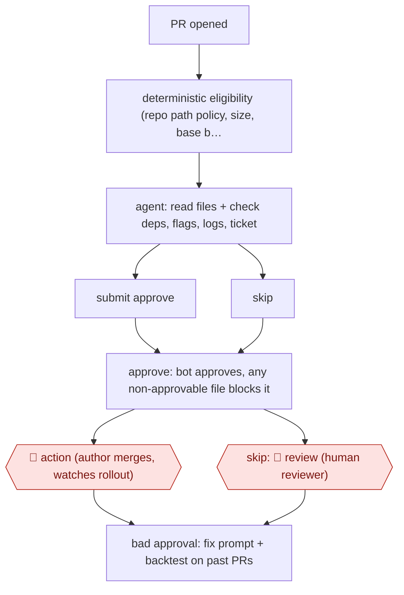

# Risk-gated auto-approval

`TEC › SWE › REVIEW` · sampled · evidence A · **draft: needs a reference example** ([how to add one](../../../../../CONTRIBUTING.md#1-add-an-example-run))

**Shape:** `PR opened → deterministic eligibility (repo path policy, size, base branch, labels) → agent: read files + check deps, flags, logs, ticket → submit approve | skip → approve: bot approves, any non-approvable file blocks it → 🛑 action (author merges, watches rollout) | skip: 🛑 review (human reviewer) → bad approval: fix prompt + backtest on past PRs`
**Variants:** `custom-harness` · `aws-bedrock` · `claude`

<!-- shape diagram: generated by scripts/build_diagrams.py from `shape`; don't edit -->

<!-- end shape diagram -->

## Background

Most companies require that someone other than the author approves a change to shared code before it is merged; the change is proposed as a pull request (PR). Reviewers are busy, so even a one-line documentation fix can wait in a queue. Here a fixed set of rules first decides whether a PR is the kind that may be approved without a person, for example by the folders it touches and its size. Only if it passes does an agent read it and either approve it or step aside. Anything the rules or the agent are unsure about goes to a human reviewer as before. A person stays in the loop even for approved PRs: the author merges, watches the change go live and rolls it back if needed, because the author stays accountable and a mistaken approval can reach real users.

**Terms:**
- **PR (pull request)**: a proposed change, published for review before it is merged into the shared code.
- **Path policy**: a file listing which folders and file types may be approved automatically and which always need a human.
- **CODEOWNERS**: a file naming the people responsible for each part of the code.
- **Terraform**: code that describes a company's cloud infrastructure; a change to it can alter live systems.
- **Migration**: a change to the structure of a database.
- **Feature flag**: a switch that turns a feature on or off in the running product without a new release.
- **Typosquatting**: publishing a software package under a name that mimics a popular one, to trick people into installing it.
- **Stacked PRs**: several PRs that build on one another.
- **Anchor comment**: one comment on the PR that holds the verdict and its reasoning.
- **Backtest**: running a changed prompt over past PRs with known outcomes to see whether its verdicts shift.

## Build it with an agent

**Form:** `service`. A PR being opened starts the run with nobody at the keyboard, and people see only skipped PRs and the labelled approvals.

**You need:** a trigger on PR events (a CI job calling `claude -p`, or an Agent SDK program); a path policy file per repository; a small set of read tools through MCP servers or scripts (files at a commit, dependency checks, ticket text, logs, feature-flag state); an account for the bot that may post an approval and a comment, with no merge permission; a store for verdicts and an audit log; a set of labelled past PRs for backtests. Give the agent no shell and no checkout.

| Step | Built as |
|---|---|
| PR opened → deterministic eligibility | A script in the trigger applies the path policy, size limit, base branch and labels, and skips the PR without calling the agent if any check fails. |
| agent: read files + check deps, flags, logs, ticket | A skill run headless, with only read tools and one tool that submits a verdict; the PR text is treated as data. For the variant, built-in subagents each review one lens. |
| submit approve or skip | The verdict tool takes a schema (approve or skip, plus a reason). No verdict, or an exhausted budget, counts as skip. |
| approve: bot approves, any non-approvable file blocks it | A script outside the agent re-checks every changed file against the path policy, and only then posts the approval from the bot account. |
| 🛑 action (author merges, watches rollout) | The anchor comment and a label tell the author the PR is approved; the author merges. |
| skip: 🛑 review (human reviewer) | The PR is left unapproved and goes to the normal review queue. |
| bad approval: fix prompt + backtest on past PRs | The skill reruns the labelled past PRs, including the bad approval, before a prompt change is accepted. |

**Checkpoints:** `action`: the agent has no merge tool, and the approval is posted by the script only after the path-policy check, so a file outside the policy cannot be approved however the agent decides; the author merges and owns the rollout. `review`: a skipped PR is simply not approved, so the usual human reviewer picks it up. Because an approval is what lets a change reach users, keep the policy check and the approval post outside the agent's tools, not in the skill's text.

**Since the sources:** Sources date from 2026-04 to 2026-10. The sources describe a custom harness with API-backed tools and an approval bot; the build above is the same arrangement made from headless runs, a skill, subagents and scripts. Both sources opened in this check and support the steps they are cited for. Clipboard's post (2026-10-12) describes the per-repository policy file, the approve-or-skip verdict as a `submit_review` tool call, no shell or checkout, the final deterministic check, the anchor comment and the evals over labelled past PRs; it runs a loop it wrote itself around a model API. Intercom's post (2026-04-21) describes the independent sub-agents, the refusal of large PRs, the author's accountability after merge, the option to ask for a human review on any change, and the labelled, queryable record of AI approvals. Intercom's variant with independent subagents is kept as an option, not the default. The build sets no thresholds or size limits; those belong in each repository's path policy.

*A design based on this entry's steps and the tool documentation as of 2026-11, not a reported run.*

## Steps

*As reported by the sources.*

1. Deterministic gates first. A per-repo policy file maps path globs to categories marked approvable or not (CI, CODEOWNERS, Terraform, auth and migrations are human-required). Further settings cover drafts, labels, stacked PRs and a maximum number of changed lines [[1]](#sources).
2. The agent reviews with a fixed set of API-backed tools and no shell or checkout: read files at the commit, check dependencies (vulnerabilities, typosquatting, age), ticket context, logs/metrics, cross-repo search and live feature-flag state. PR content is treated as data, not instructions [[1]](#sources).
3. The verdict is a schema'd `submit_review` tool call (approve or skip, with a reason). No verdict, or an exhausted tool budget, means skip. A final deterministic check refuses to approve if any file is non-approvable [[1]](#sources).
4. Variant: independent sub-agents each review one lens (problem statement, intent vs diff, safety, logic, best practices), and large PRs are refused so authors split them [[2]](#sources).
5. 🛑 **Action**: on approval the author merges and stays accountable. They watch the change go live and roll back if needed. Any engineer can request a human review on any change [[2]](#sources).
6. 🛑 **Review**: skipped PRs go to a human reviewer [[1]](#sources).
7. Each verdict is posted in one anchor comment with its reasoning, the files read and every tool call. AI-approved PRs are labelled, logged and queryable for audit [[1]](#sources)[[2]](#sources).
8. Evals over labelled past PRs gate every prompt change. A bad approval becomes a backtest case [[1]](#sources).

**Output:** An approval (or a skip that routes to a human) on every PR, with an auditable reasoning comment. Low-risk PRs merge without human review.
**Failure modes → guards:** The bot skips a tool it needed and approves a PR that causes a bug → prompt fix, backtested against past PRs including the bad approval [1]. Gaming by authors → objective deterministic gates. Rubber-stamping under volume → the agent refuses large PRs [2].
**How it differs:** AWF-0070 Graded PR comments and AWF-0133 Comment-to-edit suggestions both add comments, and a human still approves every PR. Here the agent's output is the approval decision itself, and for low-risk PRs no human reviewer is involved. The autonomy level and the checkpoint arrangement change.

## Public runs

Coverage as of 2026-11-13: **Strong**: a first-hand, detailed run that matches most of the shape. Collected and re-checked in [Third collection pass](../../../../../research/2026-11-third-pass.md).

- [Clipboard, Preflight: Automating Approvals for 28% of Our PRs](https://www.clipboard.com/resources/blog/preflight-automating-approvals-for-28-of-our-prs) (2026-10-12). Webhook bot approves or skips each PR; low-risk median time to merge fell sharply. "the median time to merge of low-risk PRs is down to 1.2h". *First-hand: yes; confidence: high.*
- [Intercom, AI is approving our pull requests](https://www.intercom.com/blog/ai-is-approving-our-pull-requests-heres-how-we-made-it-safe) (2026-04-21). Pilot then rollout of sub-agent review that approves PRs with no human reviewer. "In the first four weeks of broader rollout, 497 PRs went fully autonomous". *First-hand: yes; confidence: high.*

## Sources

1. Felipe Philipp (Clipboard), Preflight: Automating Approvals for 28% of Our PRs, 2026-10-12. https://www.clipboard.com/resources/blog/preflight-automating-approvals-for-28-of-our-prs
2. Kesha Mykhailov, Niamh Young (Intercom), AI is approving our pull requests: Here's how we made it safe, 2026-04-21. https://www.intercom.com/blog/ai-is-approving-our-pull-requests-heres-how-we-made-it-safe
