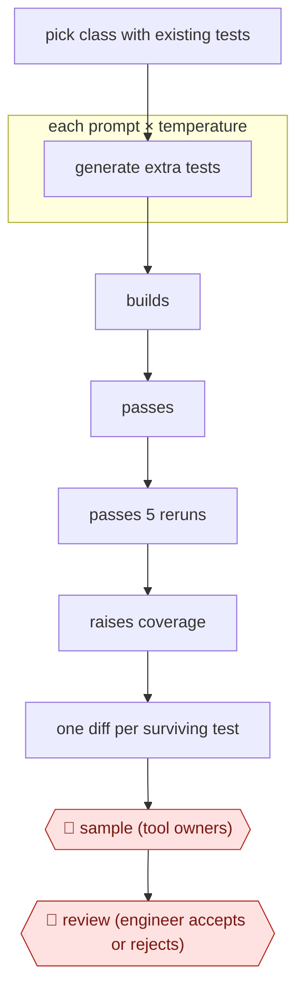

# Filtered test augmentation

`TEC › SWE › TEST` · checkpointed · evidence A · **draft: needs a reference example** ([how to add one](../../../../../CONTRIBUTING.md#1-add-an-example-run))

**Shape:** `pick class with existing tests → each prompt × temperature: generate extra tests → builds → passes → passes 5 reruns → raises coverage → one diff per surviving test → 🛑 sample (tool owners) → 🛑 review (engineer accepts or rejects)`
**How it differs:** AWF-0002 Fan-out codemod transforms existing code across many files. This workflow only adds new tests, gated by measured coverage gain, one small diff per test.
**Variants:** `testgen-llm` · `meta-ach-mutation-guided` · `qodo-cover`

<!-- shape diagram: generated by scripts/build_diagrams.py from `shape`; don't edit -->

<!-- end shape diagram -->

## Steps
1. Target an existing human-written test class: the directory of a diff an engineer just submitted, or directories that recently got human test work [[1]](#sources).
2. Generate additional test cases with several prompt strategies (extend_test, extend_coverage, corner_cases, statement_to_complete). Optionally sweep temperature 0.0–1.0 or combine two LLMs [[1]](#sources).
3. Filter in order and drop anything that fails: it must build, pass on first run, pass all five reruns (not flaky), and measurably raise coverage over the existing tests. Failing tests are thrown away because a real bug cannot be told apart from a wrong assertion [[1]](#sources).
4. Submit each surviving test as its own diff, with a summary and test plan, into normal code review [[1]](#sources).
5. 🛑 **Sample**: in the December runs, two of the tool's authors reviewed recommendations before engineers saw them [[1]](#sources).
6. 🛑 **Review**: the code-owning engineer accepts, rejects or abandons each diff, so they keep final control over what lands [[1]](#sources).

**Output:** Landed unit-test diffs that are each guaranteed to raise coverage and pass reliably, extending the existing test class.
**Failure modes → guards:** Tests without assertions or with TODO assertions, tests for trivial getters, near-duplicate tests, tests that rely on weak mocking → reject at review and dedupe; keep the coverage filter strict. Only about 4–5% of generation attempts survive, so run many cheap attempts [[1]](#sources).

## Public runs

Coverage as of 2026-11-06: **Strong**: a first-hand, detailed run that matches most of the shape. Collected and re-checked in [New workflows for empty categories](../../../../../research/2026-11-new-workflows.md).

- [Meta, Automated Unit Test Improvement using LLMs at Meta](https://arxiv.org/abs/2402.09171) (2024-02-14). Instagram and Facebook test-a-thons; each filtered test is sent as a diff for engineers to accept or reject. "73% of its recommendations being accepted for production deployment by Meta software engineers". *First-hand: yes; confidence: high.*

## Sources

1. Nadia Alshahwan, Mark Harman et al. (Meta), Automated Unit Test Improvement using Large Language Models at Meta, FSE 2024 Industry, arXiv 2402.09171, 2024-02-14. https://arxiv.org/abs/2402.09171 (full text https://arxiv.org/html/2402.09171)
