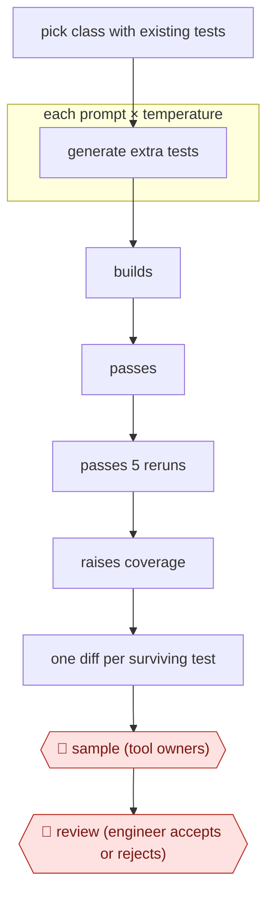

# Filtered test augmentation

`TEC › SWE › TEST` · checkpointed · evidence A · **draft: needs a reference example** ([how to add one](../../../../../CONTRIBUTING.md#1-add-an-example-run))

**Shape:** `pick class with existing tests → each prompt × temperature: generate extra tests → builds → passes → passes 5 reruns → raises coverage → one diff per surviving test → 🛑 sample (tool owners) → 🛑 review (engineer accepts or rejects)`
**Variants:** `testgen-llm` · `meta-ach-mutation-guided` · `qodo-cover`

<!-- shape diagram: generated by scripts/build_diagrams.py from `shape`; don't edit -->

<!-- end shape diagram -->

## Background

Unit tests are small automated checks that a piece of code does what it should. Teams want more of them, but writing them is slow, and an engineer asked to add tests to a class that already has some tends to cover only the obvious cases. An agent can propose many extra tests cheaply, but most proposals are worthless: they do not compile, they fail, they fail only some of the time, or they exercise nothing the existing tests do not. So every proposed test is run and thrown away unless it passes the filters, and the engineer who owns the code still decides which survivors enter the code base, because only the owner knows whether a test checks something that matters or merely restates the code.

**Terms:**
- **Unit test**: a small automated check of one piece of code.
- **Class**: in many programming languages, the unit that groups data and behaviour; tests are written per class.
- **Coverage**: the share of a program's lines that the tests run at least once.
- **Flaky test**: a test that passes on some runs and fails on others with no change to the code.
- **Prompt strategy**: a fixed way of asking the model for tests, such as "extend the existing test" or "cover corner cases".
- **Temperature**: a model setting that controls how varied its output is.
- **Diff**: the set of lines a change adds and removes; here one test is one diff, reviewed like any other change.
- **Code review**: a colleague reads a change and accepts or rejects it before it is merged.

## Build it with an agent

**Form:** `skill`. One engineer points it at one class at a time and stays in the conversation to review the survivors, so a skill with a filter script is the smallest form that works.

**You need:** a repository with a working build, test and coverage command; at least one existing human-written test class for the target; a filter script beside the skill that runs those commands; the prompt strategies written into a reference file beside the skill; permission to create branches or patch files, and no permission to push or merge.

| Step | Built as |
|---|---|
| pick class with existing tests | The engineer names the class, or the skill takes the test directories touched by the engineer's latest change. |
| each prompt × temperature: generate extra tests | The skill's reference file lists the prompt strategies. Built-in subagents each take one strategy and return candidate tests as files. |
| builds → passes → passes 5 reruns → raises coverage | A script beside the skill runs the project's own build, test and coverage commands on each candidate in that order and discards it at the first failed check. |
| one diff per surviving test | The skill writes one patch or branch per survivor, with a summary and a test plan, for the engineer to apply. |
| 🛑 sample → 🛑 review | See Checkpoints. |

**Checkpoints:** `sample`: in the source, two of the tool's authors vetted recommendations before engineers saw them. This build has no such step, because the engineer running the skill sees every survivor before anything leaves their machine. `review`: the skill ends by listing each survivor with its coverage gain and stops. The agent has no tool to push or merge, and a permission rule set to ask covers `git push`, so the code-owning engineer accepts or rejects each diff in ordinary code review.

**Since the sources:** Sources date from 2024-02 (one paper, which is also the public run). The paper's authors built a dedicated pipeline run over Meta's code and models. A skill with a filter script now does the same job on one class at a time. The build leaves out the temperature sweep and the combination of two models, which the paper describes as options of the tool, and the December review by the tool's authors. The paper was re-opened in 2026-11 and still supports the steps, the five-rerun flakiness check and the 73% figure. A web search in 2026-11 found no newer account of this practice that could be opened. One search result suggested that the open-source `qodo-cover` variant may no longer be maintained; that was not opened or confirmed, so check the project before relying on it.

*A design based on this entry's steps and the tool documentation as of 2026-11, not a reported run.*

## Steps

*As reported by the sources.*

1. The engineer, or the tool on their behalf, targets an existing human-written test class: the directory of a change an engineer just submitted, or directories that recently got human test work [[1]](#sources).
2. The agent generates additional test cases with several prompt strategies (extend_test, extend_coverage, corner_cases, statement_to_complete). Optionally it sweeps temperature 0.0–1.0 or combines two LLMs [[1]](#sources).
3. A script filters the candidates in order and drops anything that fails: it must build, pass on first run, pass all five reruns (not flaky), and measurably raise coverage over the existing tests. Failing tests are thrown away because a real bug cannot be told apart from a wrong assertion [[1]](#sources).
4. The tool submits each surviving test as its own diff, with a summary and test plan, into normal code review [[1]](#sources).
5. 🛑 **Sample**: in the December runs, two of the tool's authors reviewed recommendations before engineers saw them [[1]](#sources).
6. 🛑 **Review**: the code-owning engineer accepts, rejects or abandons each diff, so they keep final control over what lands [[1]](#sources).

**Output:** Landed unit-test diffs that are each guaranteed to raise coverage and pass reliably, extending the existing test class.
**Failure modes → guards:** Tests without assertions or with TODO assertions, tests for trivial getters, near-duplicate tests, tests that rely on weak mocking → reject at review and dedupe; keep the coverage filter strict. Only about 4–5% of generation attempts survive, so run many cheap attempts [[1]](#sources).
**How it differs:** AWF-0002 Fan-out codemod transforms existing code across many files. This workflow only adds new tests, gated by measured coverage gain, one small diff per test.

## Public runs

Coverage as of 2026-11-06: **Strong**: a first-hand, detailed run that matches most of the shape. Collected and re-checked in [New workflows for empty categories](../../../../../research/2026-11-new-workflows.md).

- [Meta, Automated Unit Test Improvement using LLMs at Meta](https://arxiv.org/abs/2402.09171) (2024-02-14). Instagram and Facebook test-a-thons; each filtered test is sent as a diff for engineers to accept or reject. "73% of its recommendations being accepted for production deployment by Meta software engineers". *First-hand: yes; confidence: high.*

## Sources

1. Nadia Alshahwan, Mark Harman et al. (Meta), Automated Unit Test Improvement using Large Language Models at Meta, FSE 2024 Industry, arXiv 2402.09171, 2024-02-14. https://arxiv.org/abs/2402.09171 (full text https://arxiv.org/html/2402.09171)
