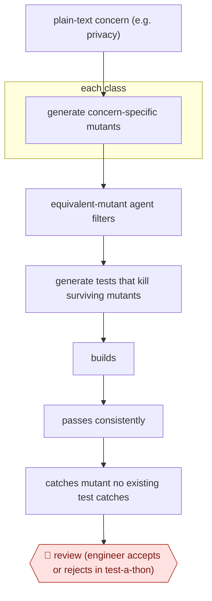

# Mutant-guided hardening tests

`TEC › SWE › TEST` · checkpointed · evidence A · **draft: needs a reference example** ([how to add one](../../../../../CONTRIBUTING.md#1-add-an-example-run))

**Shape:** `plain-text concern (e.g. privacy) → each class: generate concern-specific mutants → equivalent-mutant agent filters → generate tests that kill surviving mutants → builds → passes consistently → catches mutant no existing test catches → 🛑 review (engineer accepts or rejects in test-a-thon)`
**Variants:** `meta-ach`

<!-- shape diagram: generated by scripts/build_diagrams.py from `shape`; don't edit -->

<!-- end shape diagram -->

## Background

Software teams worry about specific kinds of failure, such as leaking users' private data, and want tests that would notice if the code ever broke in that way. Writing such tests by hand needs someone who can imagine the faults, and ordinary coverage numbers do not say whether a test would catch a fault of that kind. Here an engineer states the worry in plain words. The agent invents realistic faults of that kind, plants each in a copy of the code, and writes tests that fail when the fault is present. A test is kept only if it builds, passes reliably and catches a fault no existing test catches. Engineers still review each test, because only a person can say whether it guards the concern that was named or merely adds coverage.

**Terms:**
- **Mutant**: a copy of the code with one small, deliberate fault planted in it.
- **Kill a mutant**: a test kills a mutant when it passes on the original code and fails on the mutant, which shows the test can detect that fault.
- **Equivalent mutant**: a mutant whose change does not alter what the code does, so no test can kill it; effort spent on it is wasted.
- **Mutation-guided**: using mutants, not line coverage, to decide which tests are worth keeping.
- **Flaky test**: a test that passes on some runs and fails on others with no change to the code.
- **Test-a-thon**: a scheduled session in which a group of engineers reviews generated tests together.
- **Precision and recall**: of the items the filter dropped, the share that were right to drop; of the equivalent mutants that exist, the share it found.
- **Regression test**: a test that guards against an old kind of fault coming back.

## Build it with an agent

**Form:** `skill`. An engineer states one concern and works through the classes in the conversation, so a skill with subagents for the per-class work is the smallest form that works. Nothing in the steps needs a rule that must hold on every run.

**You need:** a repository with a working build and test command; a way to apply a planted fault to a copy of a class without touching the working tree, such as a script that applies a patch file and restores it; the concern written as plain text, which may be vague; permission to create patch files, and no permission to push or merge.

| Step | Built as |
|---|---|
| plain-text concern (e.g. privacy) | The engineer states the concern at the start; the skill saves it to a file that every later step reads. |
| each class: generate concern-specific mutants | Built-in subagents run in parallel, one per class. Each returns a few realistic mutants for the concern as patch files. |
| equivalent-mutant agent filters | A separate subagent judges whether each mutant changes behaviour and drops those that do not. Any simple pre-processing the project can script runs first. |
| generate tests that kill surviving mutants | One subagent per surviving mutant writes a test meant to fail on it. |
| builds → passes consistently → catches mutant no existing test catches | A script beside the skill builds the test, reruns it, then runs the existing suite and the new test against each mutant. |
| 🛑 review | See Checkpoints. |

**Checkpoints:** `review`: the skill ends by listing each surviving test with the mutant it kills and the coverage it adds, and asks the engineer to accept or reject it and to rate its relevance to the concern separately from its usefulness. The agent writes patch files only and has no tool to push or merge, so nothing lands without the engineer.

**Since the sources:** Sources date from 2025-01 (one paper, which is also the public run). The paper reports a dedicated multi-agent tool, ACH, run over seven Meta platforms, with its tests reviewed in test-a-thons; this build is the same steps as a skill an engineer runs per class. The paper was re-opened in 2026-11 and still supports the steps and the figures cited here (9,095 mutants, 571 tests, 73% acceptance, 36% privacy relevance, the equivalent-mutant precision and recall). A web search in 2026-11 returned only the paper and summaries of it, so no newer account of this practice that could be opened was found. The build leaves out ACH's own models and prompts and the numbers reported for them, and a skill cannot be assumed to reproduce them.

*A design based on this entry's steps and the tool documentation as of 2026-11, not a reported run.*

## Steps

*As reported by the sources.*

1. An engineer writes the concern as plain text. The paper's example is privacy faults; the text can be vague or incomplete. [[1]](#sources)
2. For each class under test, the tool (ACH) generates a few realistic mutants (simulated faults) specific to that concern, not a broad set of mutation operators. [[1]](#sources)
3. An LLM agent finds and drops equivalent mutants (precision 0.79 and recall 0.47 alone, rising to 0.95 and 0.96 with simple pre-processing). [[1]](#sources)
4. For each mutant still alive, the tool generates a unit test meant to kill it. [[1]](#sources)
5. Each test must meet three hard checks: it builds, it passes consistently (not flaky), and it catches a fault no existing test catches. Relevance and style are left to human review. [[1]](#sources)
6. 🛑 **Review**: engineers review the tests through normal code review or test-a-thons and accept or reject each one. They also rate privacy relevance. [[1]](#sources)

**Output:** Landed regression tests that guard against one named class of fault. The spread of mutants across the codebase also serves as a risk proxy per component.
**Failure modes → guards:** Equivalent mutants waste generation effort → equivalence agent plus pre-processing. Tests are useful but off the stated concern (only 36% judged privacy-relevant) → reviewers rate relevance separately from usefulness. Tests that add only trivial coverage get rejected → coverage is reported with each test.
**How it differs:** AWF-0069 Filtered test augmentation: AWF-0069 aims to raise coverage on a class that already has tests. This workflow starts from a written concern and simulated faults, and its deliverable is tests that kill specific mutants. 277 of its 571 tests would have been discarded under a coverage-only filter.

## Public runs

Coverage as of 2026-11-06: **Strong**: a first-hand, detailed run that matches most of the shape. Collected and re-checked in [Second collection pass](../../../../../research/2026-11-second-pass.md).

- [Meta, Mutation-Guided LLM-based Test Generation at Meta](https://arxiv.org/abs/2501.12862) (2025-01-22). 7 platforms; 9,095 mutants; 571 tests reviewed in Messenger and WhatsApp test-a-thons. "engineers accepted 73% of its tests, judging 36% to privacy relevant". *First-hand: yes (Meta paper on its own deployment); confidence: high.*

## Sources

1. Foster, Gulati, Harman, Harper, Mao, Ritchey, Robert, Sengupta (Meta), Mutation-Guided LLM-based Test Generation at Meta, arXiv:2501.12862, 2025-01-22. https://arxiv.org/abs/2501.12862
