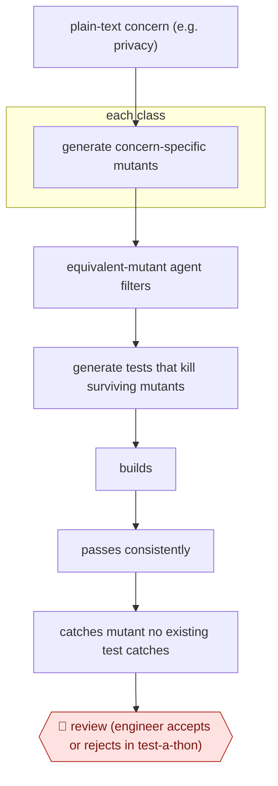

# Mutant-guided hardening tests

`TEC › SWE › TEST` · checkpointed · evidence A · **draft: needs a reference example** ([how to add one](../../../../../CONTRIBUTING.md#1-add-an-example-run))

**Shape:** `plain-text concern (e.g. privacy) → each class: generate concern-specific mutants → equivalent-mutant agent filters → generate tests that kill surviving mutants → builds → passes consistently → catches mutant no existing test catches → 🛑 review (engineer accepts or rejects in test-a-thon)`
**How it differs:** AWF-0069 Filtered test augmentation: AWF-0069 aims to raise coverage on a class that already has tests. This workflow starts from a written concern and simulated faults, and its deliverable is tests that kill specific mutants. 277 of its 571 tests would have been discarded under a coverage-only filter.
**Variants:** `meta-ach`

<!-- shape diagram: generated by scripts/build_diagrams.py from `shape`; don't edit -->

<!-- end shape diagram -->

## Steps
1. An engineer writes the concern as plain text. The paper's example is privacy faults; the text can be vague or incomplete. [[1]](#sources)
2. For each class under test, ACH generates a few realistic mutants (simulated faults) specific to that concern, not a broad set of mutation operators. [[1]](#sources)
3. An LLM agent finds and drops equivalent mutants (precision 0.79 and recall 0.47 alone, rising to 0.95 and 0.96 with simple pre-processing). [[1]](#sources)
4. For each mutant still alive, ACH generates a unit test meant to kill it. [[1]](#sources)
5. Each test must meet three hard checks: it builds, it passes consistently (not flaky), and it catches a fault no existing test catches. Relevance and style are left to human review. [[1]](#sources)
6. 🛑 **Review**: engineers review the tests through normal code review or test-a-thons and accept or reject each one. They also rate privacy relevance. [[1]](#sources)

**Output:** Landed regression tests that guard against one named class of fault. The spread of mutants across the codebase also serves as a risk proxy per component.
**Failure modes → guards:** Equivalent mutants waste generation effort → equivalence agent plus pre-processing. Tests are useful but off the stated concern (only 36% judged privacy-relevant) → reviewers rate relevance separately from usefulness. Tests that add only trivial coverage get rejected → coverage is reported with each test.

## Public runs

Coverage as of 2026-11-06: **Strong**: a first-hand, detailed run that matches most of the shape. Collected and re-checked in [Second collection pass](../../../../../research/2026-11-second-pass.md).

- [Meta, Mutation-Guided LLM-based Test Generation at Meta](https://arxiv.org/abs/2501.12862) (2025-01-22). 7 platforms; 9,095 mutants; 571 tests reviewed in Messenger and WhatsApp test-a-thons. "engineers accepted 73% of its tests, judging 36% to privacy relevant". *First-hand: yes (Meta paper on its own deployment); confidence: high.*

## Sources

1. Foster, Gulati, Harman, Harper, Mao, Ritchey, Robert, Sengupta (Meta), Mutation-Guided LLM-based Test Generation at Meta, arXiv:2501.12862, 2025-01-22. https://arxiv.org/abs/2501.12862
