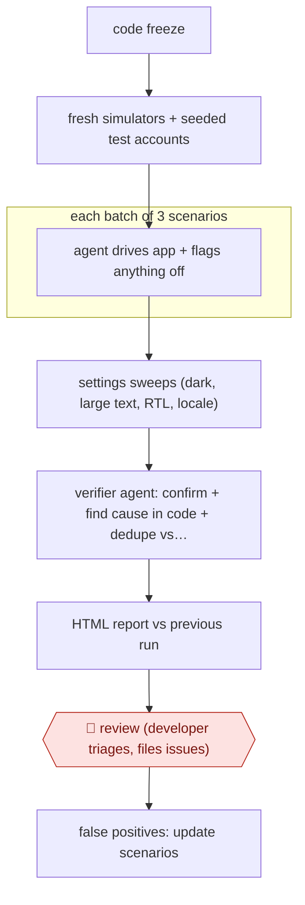

# Scenario release sweep

`TEC › SWE › TEST` · checkpointed · evidence A · **draft: needs a reference example** ([how to add one](../../../../../CONTRIBUTING.md#1-add-an-example-run))

**Shape:** `code freeze → fresh simulators + seeded test accounts → each batch of 3 scenarios: agent drives app + flags anything off → settings sweeps (dark, large text, RTL, locale) → verifier agent: confirm + find cause in code + dedupe vs tracker → HTML report vs previous run → 🛑 review (developer triages, files issues) → false positives: update scenarios`
**Variants:** `claude-code-skills` · `xcode-mcp` · `adb`

<!-- shape diagram: generated by scripts/build_diagrams.py from `shape`; don't edit -->

<!-- end shape diagram -->

## Background

Before a mobile app is released, the team stops adding features (a code freeze) and someone tries the app by hand to find bugs that automated tests miss. That means walking through the main screens again and again, on different phone sizes and under different settings such as dark mode, very large text or a right-to-left language. It is slow and repetitive, so corners get skipped. Here agents work through written scenarios on simulated phones and report what looks wrong. Automated runs also report things that are not bugs, so a developer reads the report, decides what is real and files the issues, and the final release decision stays with the team.

**Terms:**
- **Code freeze**: the point before a release after which no new features are added, only fixes.
- **Simulator / emulator**: a program that behaves like a phone, so the app can be tried without a device.
- **Scenario**: a plain-language statement of what must be true in the app ("a user can reset a password"), without the clicks needed to check it.
- **Seeded test account**: a login on a test backend, filled with known data and reset before each batch, so a scenario that deletes things does no harm.
- **RTL**: right-to-left layout, used for languages such as Arabic and Hebrew.
- **Exploratory testing**: trying the app freely and noting anything that looks off, as opposed to following a script.
- **False positive**: a reported problem that is not one.
- **Triage**: reading each reported problem and deciding whether it is real, how serious it is and who gets it.
- **Tracker**: the system where the team files and tracks issues.

## Build it with an agent

**Form:** `skill`. A developer starts the sweep before each freeze and reads the report afterwards, so one skill holding the procedure, with subagents that drive the simulators, is the smallest form that works. The source built it as skills too.

**You need:** the app buildable for simulators or emulators; scenarios as Markdown files beside the skill; a script that creates fresh simulators and a second skill or script that seeds and resets the test accounts on a test backend, never on production; the simulator-control tools your platform offers (Xcode's MCP tools for iOS, `adb` for Android) and screen recording; read-only access to the issue tracker to search for duplicates, and no tool to create issues during the run; a copy of the previous run's report to compare against.

| Step | Built as |
|---|---|
| code freeze → fresh simulators + seeded test accounts | The developer starts the skill by name. A script creates the simulators and signs each in to its own test account, which is seeded and reset before every batch. Each simulator is recorded. |
| each batch of 3 scenarios: agent drives app + flags anything off | Built-in subagents, one per batch of three scenarios, drive a simulator through the device-control tools. Each subagent is also told to flag anything else that looks wrong. A fresh subagent takes the next batch to keep each context small. A dynamic workflow script can fan the batches out across simulators. |
| settings sweeps (dark, large text, RTL, locale) | The same subagents repeat the main screens under the combined settings listed in a reference file beside the skill. |
| verifier agent: confirm + find cause in code + dedupe vs tracker | A separate subagent re-checks each candidate, reads the code for a cause, and searches the tracker through a read-only connector. |
| HTML report vs previous run | The skill writes one HTML file and compares it with the saved report from the last run. |
| 🛑 review → false positives: update scenarios | See Checkpoints. |

**Checkpoints:** `review`: the skill ends by presenting the report and stops. A permission rule denies the tracker's issue-creation tool during the run, so nothing reaches the tracker without the developer. The developer triages, then starts a separate skill that files the chosen issues with clips and screenshots, and edits any scenario that produced a false positive.

**Since the sources:** The single source and public run is dated 2026-11-10. The source's author built this with skills and subagents, which is the form chosen here, so little has changed since. The source page was opened in 2026-11 and matches the counts, settings sweeps, verifier and triage steps in Steps; the command name and the counts in Steps are the author's and are not part of the build. The source states that results vary from run to run, so the build is a release check and not a gate for merging code. It runs only on simulators and emulators, so it cannot test real networks or purchases.

*A design based on this entry's steps and the tool documentation as of 2026-11, not a reported run.*

## Steps

*As reported by the sources.*

1. The developer writes scenarios in Markdown that state what must be true, not how to check it. Optional setup hooks (DEBUG-only launch fixtures) skip the navigation. The run has 104 scenarios across 13 areas [[1]](#sources).
2. Before every code freeze, one command (`/pocket-qa ios full`) creates fresh simulators (four iPhones and an iPad). Each simulator signs in to its own test account, which a separate skill seeds and resets before every batch so destructive scenarios are harmless. Every simulator is recorded [[1]](#sources).
3. Agents drive the app through Xcode's MCP DeviceInteraction tools (adb on Android). Each agent runs three scenarios, then hands over to a fresh one to keep context cost down. Agents also flag anything else that looks off, like an exploratory tester would [[1]](#sources).
4. The agents sweep the main screens under combined settings (dark mode + Increase Contrast, largest text + Bold, RTL + long strings, German + Reduce Motion). These sweeps make up about half of the test cases [[1]](#sources).
5. A verifier agent checks each candidate issue, collects evidence (including the cause in the code) and looks for duplicates in Linear [[1]](#sources).
6. The agents put everything into a single HTML report with a verdict, the major issues, the test cases sharing each check, and a comparison with the previous run [[1]](#sources).
7. 🛑 **Review**: nothing goes to Linear automatically. The developer triages the report and files issues with clips and screenshots through another skill. False positives lead to scenario updates [[1]](#sources).
8. Per-PR variant: `verify` tests only what the diff touches and its neighbors [[1]](#sources).

**Output:** A per-release HTML QA report plus triaged issues filed in the tracker. It feeds the release go/no-go decision.
**Failure modes → guards:** Non-deterministic, so it can't gate merges → unit tests stay. It's slow (nine agent-hours) → sharding across five simulators packs that into about two hours, and the per-PR mode stays narrow. It runs only on simulators and emulators → no real network or purchases. False positives → verifier agent plus human triage.
**How it differs:** AWF-0069, AWF-0131 and AWF-0132 all produce test code or fixes that land in the repo. This produces no test code: agents execute natural-language scenarios against the running app and deliver a triaged release bug report. The deliverable and the human checkpoint (triage before filing) differ.

## Public runs

Coverage as of 2026-11-13: **Strong**: a first-hand, detailed run that matches most of the shape. Collected and re-checked in [Third collection pass](../../../../../research/2026-11-third-pass.md).

- [Alex Grebenyuk, Release Testing with Agents](https://kean.blog/post/release-testing-with-agents) (2026-11-10). Pre-freeze iOS run of 204 test cases on five simulators; first Android run. "the first full run found 60 issues across 191 test cases". *First-hand: yes; confidence: high.*

## Sources

1. Alex Grebenyuk, Release Testing with Agents (Pocket Casts), 2026-11-10. https://kean.blog/post/release-testing-with-agents
