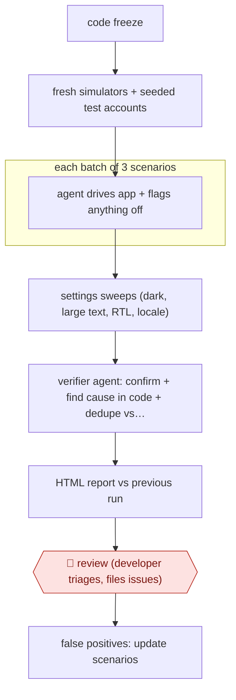

# Scenario release sweep

`TEC › SWE › TEST` · checkpointed · evidence A · **draft: needs a reference example** ([how to add one](../../../../../CONTRIBUTING.md#1-add-an-example-run))

**Shape:** `code freeze → fresh simulators + seeded test accounts → each batch of 3 scenarios: agent drives app + flags anything off → settings sweeps (dark, large text, RTL, locale) → verifier agent: confirm + find cause in code + dedupe vs tracker → HTML report vs previous run → 🛑 review (developer triages, files issues) → false positives: update scenarios`
**How it differs:** AWF-0069, AWF-0131 and AWF-0132 all produce test code or fixes that land in the repo. This produces no test code: agents execute natural-language scenarios against the running app and deliver a triaged release bug report. The deliverable and the human checkpoint (triage before filing) differ.
**Variants:** `claude-code-skills` · `xcode-mcp` · `adb`

<!-- shape diagram: generated by scripts/build_diagrams.py from `shape`; don't edit -->

<!-- end shape diagram -->

## Steps
1. Write scenarios in Markdown that state what must be true, not how to check it. Optional setup hooks (DEBUG-only launch fixtures) skip the navigation. The run has 104 scenarios across 13 areas [[1]](#sources).
2. Before every code freeze, one command (`/pocket-qa ios full`) creates fresh simulators (four iPhones and an iPad). Each simulator signs in to its own test account, which a separate skill seeds and resets before every batch so destructive scenarios are harmless. Every simulator is recorded [[1]](#sources).
3. Agents drive the app through Xcode's MCP DeviceInteraction tools (adb on Android). Each agent runs three scenarios, then hands over to a fresh one to keep context cost down. Agents also flag anything else that looks off, like an exploratory tester would [[1]](#sources).
4. The run sweeps the main screens under combined settings (dark mode + Increase Contrast, largest text + Bold, RTL + long strings, German + Reduce Motion). These sweeps make up about half of the test cases [[1]](#sources).
5. A verifier agent checks each candidate issue, collects evidence (including the cause in the code) and looks for duplicates in Linear [[1]](#sources).
6. Everything goes into a single HTML report with a verdict, the major issues, the test cases sharing each check, and a comparison with the previous run [[1]](#sources).
7. 🛑 **Review**: nothing goes to Linear automatically. The developer triages the report and files issues with clips and screenshots through another skill. False positives lead to scenario updates [[1]](#sources).
8. Per-PR variant: `verify` tests only what the diff touches and its neighbors [[1]](#sources).

**Output:** A per-release HTML QA report plus triaged issues filed in the tracker. It feeds the release go/no-go decision.
**Failure modes → guards:** Non-deterministic, so it can't gate merges → unit tests stay. It's slow (nine agent-hours) → sharding across five simulators packs that into about two hours, and the per-PR mode stays narrow. It runs only on simulators and emulators → no real network or purchases. False positives → verifier agent plus human triage.

## Public runs

Coverage as of 2026-11-13: **Strong**: a first-hand, detailed run that matches most of the shape. Collected and re-checked in [Third collection pass](../../../../../research/2026-11-third-pass.md).

- [Alex Grebenyuk, Release Testing with Agents](https://kean.blog/post/release-testing-with-agents) (2026-11-10). Pre-freeze iOS run of 204 test cases on five simulators; first Android run. "the first full run found 60 issues across 191 test cases". *First-hand: yes; confidence: high.*

## Sources

1. Alex Grebenyuk, Release Testing with Agents (Pocket Casts), 2026-11-10. https://kean.blog/post/release-testing-with-agents
