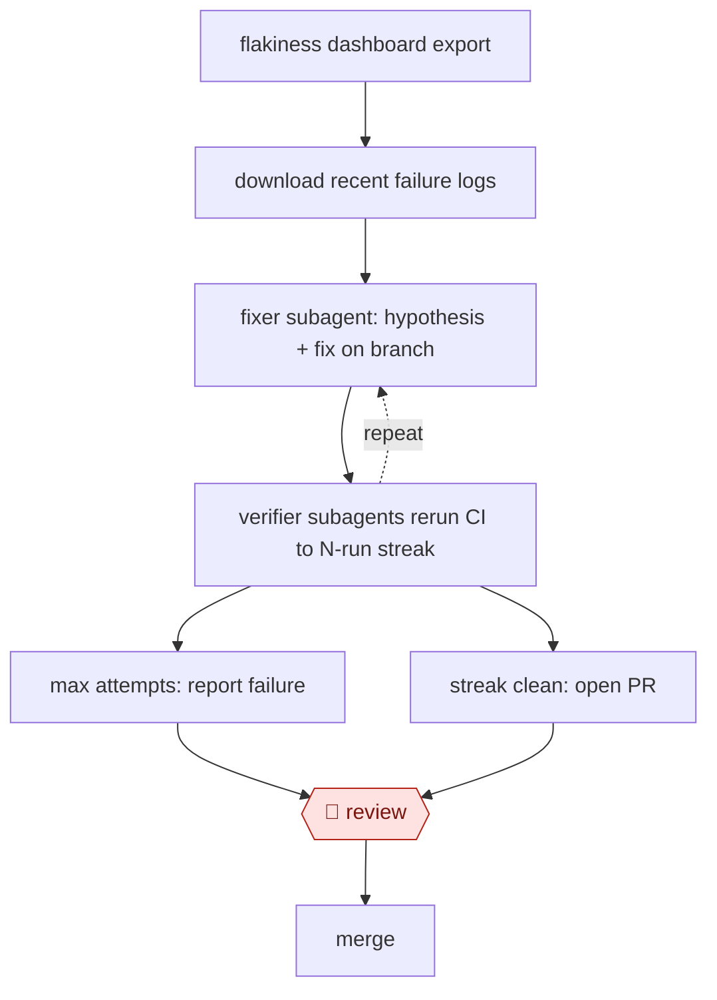

# Streak-verified flake fix

`TEC › SWE › TEST` · checkpointed · evidence A · **draft: needs a reference example** ([how to add one](../../../../../CONTRIBUTING.md#1-add-an-example-run))

**Shape:** `flakiness dashboard export → download recent failure logs → (fixer subagent: hypothesis + fix on branch ⟲ verifier subagents rerun CI to N-run streak) → max attempts: report failure | streak clean: open PR → 🛑 review → merge`
**How it differs:** AWF-0071 Reproduce-first bug fix: AWF-0071 starts from a bug ticket and has a handoff when the bug can't be reproduced. Here the trigger is a flakiness dashboard and success is a statistical streak of CI reruns. Agents run hours unattended, and the only human gate is the final PR. AWF-0069 makes new tests; this repairs existing ones.
**Variants:** `claude-code` · `devin` · `datadog-ci-visibility`

<!-- shape diagram: generated by scripts/build_diagrams.py from `shape`; don't edit -->

<!-- end shape diagram -->

## Steps
1. Seed the orchestrator with one flaky test's export from the CI-visibility dashboard (Datadog CSV). It downloads the CI logs from that test's recent failures. [[1]](#sources)
2. The orchestrator spawns a fixer subagent. It reads the logs and source, forms one hypothesis, commits one fix to a branch, and reports a summary back. [[1]](#sources)
3. The orchestrator then spawns small verifier subagents. Each reruns CI and decides whether this test failed, ignoring other flaky tests in the same run. It repeats until the configured rerun streak is reached. [[1]](#sources)
4. On any recurrence, the new logs plus earlier fix summaries go to a fresh fixer. The loop ends at the attempt limit and reports failure. [[1]](#sources)
5. With a clean streak, the orchestrator opens a PR. Several flaky tests run in parallel, one instance per seed file. [[1]](#sources)
6. 🛑 **Review**: the verified PR gets normal human code review before merge. [[1]](#sources)
7. Variant (Timee): flaky-test detection triggers a GitHub Action that sends the test name and error to Devin. The PR is auto-assigned through CODEOWNERS, and 🛑 **Review**: the team edits, merges or closes false positives. [[2]](#sources)

**Output:** A merged fix PR for each flaky test, verified by consecutive clean reruns. Tests the agent gives up on are reported back to the team.
**Failure modes → guards:** One green rerun proves nothing for an intermittent failure → configurable rerun streak. Context bloat across attempts → one fix per fixer, summaries passed forward. Other flaky tests read as noise → a dedicated verifier judges only the target test. Wrong-hypothesis fixes → human PR review; a team can rewrite or close.

## Public runs

Coverage as of 2026-11-06: **Strong**: a first-hand, detailed run that matches most of the shape. Collected and re-checked in [Second collection pass](../../../../../research/2026-11-second-pass.md).

- [Kong, How We Used Agentic AI to Fix Kong Gateway's Flakiest Tests](https://konghq.com/blog/engineering/how-we-used-agentic-ai-to-fix-kong-gateways-flakiest-tests) (2026-06-10). Ran on the 15 flakiest tests; 4–5 hours and 100–200k tokens per test. "It fixed 12 of them and gave up on 3". *First-hand: yes; confidence: high.*
- [Timee, さよなら Flaky Test！](https://tech.timee.co.jp/entry/2025/07/16/100000) (2025-07-16). Datadog detection triggers Devin PRs, reviewed through CODEOWNERS. "3件 の Flaky Test を修正する Pull Request が Devin によって作成されましたが、そのうち 2件 は開発者によって変更が加えられることがなくマージされました". *First-hand: yes; confidence: med.*

## Sources

1. Datong Sun (Kong), How We Used Agentic AI to Fix Kong Gateway's Flakiest Tests, 2026-06-10. https://konghq.com/blog/engineering/how-we-used-agentic-ai-to-fix-kong-gateways-flakiest-tests
2. Timee Product Team, さよなら Flaky Test！Devinと共に実現する、CI安定化への道, 2025-07-16. https://tech.timee.co.jp/entry/2025/07/16/100000
