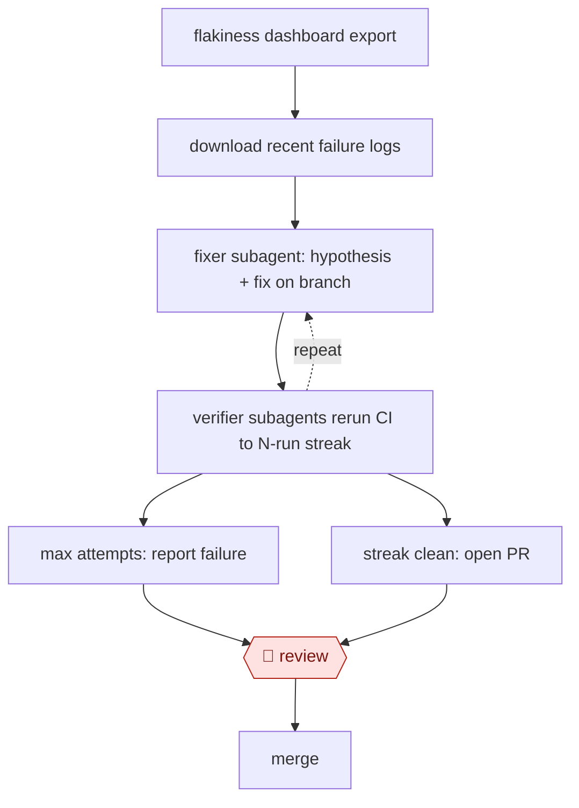

# Streak-verified flake fix

`TEC › SWE › TEST` · checkpointed · evidence A · **draft: needs a reference example** ([how to add one](../../../../../CONTRIBUTING.md#1-add-an-example-run))

**Shape:** `flakiness dashboard export → download recent failure logs → (fixer subagent: hypothesis + fix on branch ⟲ verifier subagents rerun CI to N-run streak) → max attempts: report failure | streak clean: open PR → 🛑 review → merge`
**Variants:** `claude-code` · `devin` · `datadog-ci-visibility`

<!-- shape diagram: generated by scripts/build_diagrams.py from `shape`; don't edit -->

<!-- end shape diagram -->

## Background

Large software projects run thousands of automated tests on every proposed change. Some of those tests fail only now and then with no change to the code; these are flaky tests. Each flaky failure makes an engineer rerun the whole job, and as flaky tests multiply, reruns queue up and slow everyone down. A flaky test is hard to fix because the cause is rarely obvious, and hard to prove fixed because one clean run proves nothing about a failure that comes and goes. An agent can read the failure logs, propose a fix and rerun the tests many times in a row without tiring. A person still reviews the resulting change before it is merged, because the agent's explanation of the cause can be wrong even when the reruns pass.

**Terms:**
- **Flaky test**: a test that passes on some runs and fails on others with no change to the code.
- **CI (continuous integration)**: the automated build-and-test jobs that run on every proposed change.
- **Flakiness dashboard**: a report from the CI system that ranks tests by how often they fail intermittently; here its export for one test starts the work.
- **Rerun streak**: the number of CI reruns in a row that must show no failure of the target test before a fix is trusted.
- **Hypothesis**: the agent's one stated theory of why the test is flaky.
- **PR (pull request)**: a proposed change, published for review before it is merged into the shared code.
- **CODEOWNERS**: a file that names which team owns which part of the code, so review requests go to the right people.

## Build it with an agent

**Form:** `skill`. One engineer starts the skill for one flaky test (or one session per test) and reads the result, so a skill that holds the loop, with subagents for the fixing and the checking, is the smallest form that works. The Timee variant in Steps is started by a detection event with nobody present, which would make it a `service` build.

**You need:** the flakiness export for the target test; read access to CI logs and permission to start CI reruns on a branch; a repository where the agent may push a branch and open a draft pull request, and has no permission to merge; the rerun streak and the maximum number of attempts, given as inputs when the skill is started.

| Step | Built as |
|---|---|
| flakiness dashboard export → download recent failure logs | The skill takes the export file as its input and downloads the CI logs of that test's recent failures with the CI system's command-line tool or a connector. |
| fixer subagent: hypothesis + fix on branch | A subagent reads the logs and source, states one hypothesis, commits one fix to a branch and returns a short summary. |
| verifier subagents rerun CI to N-run streak | The skill starts one small subagent per rerun. Each starts CI, polls it, and judges only whether the target test failed, ignoring other flaky tests in the same run. |
| (fixer ⟲ verifier) | If a verifier reports a recurrence, the skill gives the new logs and the earlier fix summaries to a fresh fixer subagent. The loop ends at the attempt limit. |
| max attempts: report failure \| streak clean: open PR | The skill reports failure to the engineer, or opens a draft pull request through the code host's command-line tool. |
| 🛑 review → merge | See Checkpoints. |

**Checkpoints:** `review`: the pull request is opened as a draft and the agent has no tool to merge it, so a person reads the diff and the fixer's summary and merges, edits or closes it. For several flaky tests, start one session per export file; the sessions do not share state.

**Since the sources:** Sources date from 2025-07 to 2026-06. Kong's write-up (2026-06) describes this loop built with Claude Code as one orchestrating skill and two named subagents, which is the build chosen here. It also reports that the fixer and verifier ran on different models, which this design does not require. Timee's write-up (2025-07) uses the Devin product triggered by a GitHub Action; its steps are summarised in Steps and not built here. Both pages were opened in 2026-11 and still support the steps; no newer account was needed because the newest source is under 12 months old.

*A design based on this entry's steps and the tool documentation as of 2026-11, not a reported run.*

## Steps

*As reported by the sources.*

1. The engineer seeds the orchestrator (a skill) with one flaky test's export from the CI-visibility dashboard (Datadog CSV). It downloads the CI logs from that test's recent failures. [[1]](#sources)
2. The orchestrator spawns a fixer subagent. It reads the logs and source, forms one hypothesis, commits one fix to a branch, and reports a summary back. [[1]](#sources)
3. The orchestrator then spawns small verifier subagents. Each reruns CI and decides whether this test failed, ignoring other flaky tests in the same run. It repeats until the configured rerun streak is reached. [[1]](#sources)
4. On any recurrence, the new logs plus earlier fix summaries go to a fresh fixer. The loop ends at the attempt limit and reports failure. [[1]](#sources)
5. With a clean streak, the orchestrator opens a PR. Several flaky tests run in parallel, one instance per seed file. [[1]](#sources)
6. 🛑 **Review**: the verified PR gets normal human code review before merge. [[1]](#sources)
7. Variant (Timee): flaky-test detection triggers a GitHub Action that sends the test name and error to Devin. The PR is auto-assigned through CODEOWNERS, and 🛑 **Review**: the team edits, merges or closes false positives. [[2]](#sources)

**Output:** A merged fix PR for each flaky test, verified by consecutive clean reruns. Tests the agent gives up on are reported back to the team.
**Failure modes → guards:** One green rerun proves nothing for an intermittent failure → configurable rerun streak. Context bloat across attempts → one fix per fixer, summaries passed forward. Other flaky tests read as noise → a dedicated verifier judges only the target test. Wrong-hypothesis fixes → human PR review; a team can rewrite or close.
**How it differs:** AWF-0071 Reproduce-first bug fix: AWF-0071 starts from a bug ticket and has a handoff when the bug can't be reproduced. Here the trigger is a flakiness dashboard and success is a statistical streak of CI reruns. Agents run hours unattended, and the only human gate is the final PR. AWF-0069 makes new tests; this repairs existing ones.

## Public runs

Coverage as of 2026-11-06: **Strong**: a first-hand, detailed run that matches most of the shape. Collected and re-checked in [Second collection pass](../../../../../research/2026-11-second-pass.md).

- [Kong, How We Used Agentic AI to Fix Kong Gateway's Flakiest Tests](https://konghq.com/blog/engineering/how-we-used-agentic-ai-to-fix-kong-gateways-flakiest-tests) (2026-06-10). Ran on the 15 flakiest tests; 4–5 hours and 100–200k tokens per test. "It fixed 12 of them and gave up on 3". *First-hand: yes; confidence: high.*
- [Timee, さよなら Flaky Test！](https://tech.timee.co.jp/entry/2025/07/16/100000) (2025-07-16). Datadog detection triggers Devin PRs, reviewed through CODEOWNERS. "3件 の Flaky Test を修正する Pull Request が Devin によって作成されましたが、そのうち 2件 は開発者によって変更が加えられることがなくマージされました". *First-hand: yes; confidence: med.*

## Sources

1. Datong Sun (Kong), How We Used Agentic AI to Fix Kong Gateway's Flakiest Tests, 2026-06-10. https://konghq.com/blog/engineering/how-we-used-agentic-ai-to-fix-kong-gateways-flakiest-tests
2. Timee Product Team, さよなら Flaky Test！Devinと共に実現する、CI安定化への道, 2025-07-16. https://tech.timee.co.jp/entry/2025/07/16/100000
