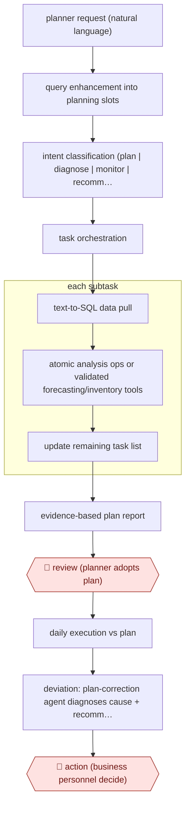

# Agent-built replenishment plans

`unplaced` (proposed: `ORG › LOG › PLANNING`) · checkpointed · evidence A · **draft: needs a reference example** ([how to add one](../../../CONTRIBUTING.md#1-add-an-example-run))

**Shape:** `planner request (natural language) → query enhancement into planning slots → intent classification (plan | diagnose | monitor | recommend) → task orchestration → (each subtask: text-to-SQL data pull → atomic analysis ops or validated forecasting/inventory tools → update remaining task list) → evidence-based plan report → 🛑 review (planner adopts plan) → daily execution vs plan → deviation: plan-correction agent diagnoses cause + recommends update → 🛑 action (business personnel decide)`
**How it differs:** No existing ORG/LOG entry covers planning. Nearest elsewhere is AWF-0123 (Scheduled metric commentary), which publishes commentary on metric moves. This one produces an executable replenishment plan, has a planner adopt it, and adds a correction loop with an action checkpoint. AWF-0064 (Repo-grounded analysis) yields an analyst memo, not a plan, and has no execution-monitoring step.
**Variants:** `jd-scpa`

<!-- shape diagram: generated by scripts/build_diagrams.py from `shape`; don't edit -->

<!-- end shape diagram -->

## Background

Replenishment planning for a retail category is a weekly argument with data: how much of each SKU to buy, given last year's sales, this year's promotion calendar, what is already in the warehouse and what suppliers can actually deliver. Planners spend most of the week assembling the evidence — pulling sales and inventory, reconciling them, building the comparison the meeting will ask for — and a minority of it deciding. A language model is well suited to the assembly and badly suited to the decision, so this workflow splits them: the planner asks in plain language, the agent turns the question into structured parameters, routes it by intent, orchestrates the subtasks, and returns a plan with the evidence attached. Then the interesting half begins. Once a plan is running, actual sales diverge from forecast every day, and the useful question is why — traffic fell, the promotion underperformed, a competitor moved — because the answer determines whether the right response is a new plan or no action at all. A correction agent diagnoses the deviation and proposes an update, and a person decides whether to take it. The whole design rests on one property: every step is an auditable atomic operation, so a wrong plan can be traced to the data pull, the parameter extraction, the aggregation or the tool.

**Terms:**
- **replenishment plan**: what to buy, in what quantity, for which SKU, over the coming period.
- **planning slot**: a structured parameter extracted from a free-text request — category, period, SKU set, constraint.
- **intent classification**: routing a request to planning, diagnosis, monitoring or recommendation.
- **text-to-SQL**: turning a question into a database query, the step where a silent error is most likely.
- **atomic operation**: a single auditable data step (filter, transform, group, sort) that can be re-run and checked.
- **deviation**: actual versus planned sales or inventory, the trigger for the correction loop.
- **plan correction**: a recommended change to the running plan, which a person accepts or rejects.
- **stock fulfilment rate**: the share of demand met from stock, the outcome metric here.

## Build it with an agent

**Form:** `service`. The planning loop runs on a schedule — weekly plans, daily execution comparison, deviations diagnosed as they appear — and nobody starts the monitoring. Planners and business staff appear at two gates, adopting a plan and deciding a correction; the agent keeps working in between. That is a service around a running plan, not a skill one planner runs and not a corpus a project would own.

**You need:** read access to the supply-chain systems with a documented schema, since text-to-SQL against an undocumented schema produces confident nonsense; the validated inventory and forecasting tools exposed as callable functions rather than reimplemented by the model, because those algorithms carry the domain assumptions; the planning slot definitions, so a vague request becomes a checkable set of parameters before any query runs; an audit trail per atomic operation, so a bad plan can be attributed; the baseline the plan will be measured against, agreed before execution; and the escalation list for deviations — which causes are the planner's to fix and which are a promotion or supply problem. The agent must not commit purchase orders and must not decide that a deviation needs no action.

| Step | Built as |
|---|---|
| planner request (natural language) | Free-text requests in the planner's own vocabulary, including the ones that name a period and a category but not a constraint. |
| query enhancement into planning slots | The request is parsed into slots — category, SKU set, horizon, service target — and shown back for confirmation before any data is pulled, since this is where ambiguity becomes a wrong plan. |
| intent classification (plan | diagnose | monitor | recommend) | One router decides which pipeline runs; a misrouted request produces a polished answer to the wrong question, which is why routing is treated as critical rather than clerical. |
| task orchestration → each subtask: text-to-SQL data pull → atomic ops or validated tools | The request is decomposed into subtasks, each pulling its own data and calling either atomic operations or the approved forecasting and inventory tools, with the remaining task list updated after every intermediate result. |
| evidence-based plan report | The report states the plan with the evidence behind it — sales history, stock position, inbound — so the planner can disagree with a number rather than with a conclusion. |
| 🛑 review (planner adopts plan) | Planners and analysts read the report and decide; the system is positioned as assisting the decision, and the build has no path to executing a plan. |
| daily execution vs plan | Actual sales and inventory are compared with plan values daily, which is the only way a stale plan is caught before the cycle ends. |
| deviation: plan-correction agent diagnoses cause + recommends update | Each deviation is diagnosed against candidate causes — traffic, promotion performance, market shift — and a correction is proposed with its reasoning. |
| 🛑 action (business personnel decide) | Business staff accept or reject the correction; rebalancing and expedited replenishment are their calls, and the build cannot place either. |

**Checkpoints:** `review`: the planner adopts the plan, and the deliverable is built so that adoption is a judgement about evidence rather than about prose. `action`: the correction is a recommendation until a person acts, which keeps the running plan under commercial accountability rather than under the model's.

**Since the sources:** Sources date from 2025-09 to 2026-01, and neither was re-opened on this pass. What has changed since is the surrounding programme rather than the study: the same company has since announced a broader supply-chain model suite that ties decision, process and physical automation together, reports more than 70 agents deployed in its industrial arm covering procurement through fulfilment, and reports a 13.8% efficiency gain in warehouse operations from handover of repetitive cross-system work to agents. None of that changes this entry's numbers, and it does sharpen the question to ask of them. A trade write-up of the announcement makes the point that "more than 1,000 scenarios" counts the places an agent was switched on, not the places it was shown to beat the thing it replaced, and that an agent which trims the average while fattening the tail raises complaints rather than lowering them. For this workflow that is the right test: the plan is judged on deviation and fulfilment, not on how many planners asked it something, and the correction loop is where a fattened tail would show up first. The entry's own figures — about 40% less weekly data-processing time, 22% more plans within a 5% accuracy deviation, 2% to 3% better stock fulfilment across more than 70,000 SKUs — remain the study's, measured around one promotion peak, and should not be extended to a steady-state year.

*A design based on this entry's steps and the tool documentation as of 2026-11, not a reported run.*

## Steps

*As reported by the sources.*

1. A planner states the planning need in natural language. Query enhancement turns it into structured planning parameters (slots) [[1]](#sources)[[2]](#sources).
2. Intent classification routes the request to planning, diagnostic, monitoring or recommendation. Task orchestration breaks it into executable subtasks [[2]](#sources).
3. Each subtask pulls data through text-to-SQL and slot matching from the supply-chain systems, then runs auditable atomic data operations or validated analytical tools such as inventory decision algorithms. The remaining task list is updated after each intermediate observation [[2]](#sources).
4. The agent returns an evidence-based planning report (sales, inventory, inbound plans) [[1]](#sources).
5. 🛑 **Review**: planners and analysts receive the report and decide on the plan. The paper casts the system as assisting business personnel, not replacing their decision [[1]](#sources).
6. After the plan is implemented, the Plan Correction Agent compares actual daily sales and metrics with planned values, detects abnormal deviations, identifies causes (lower traffic, underperforming promotions, market shifts) and generates recommendations for plan updates [[1]](#sources).
7. 🛑 **Action**: business personnel decide whether to apply the recommended correction (for example rebalancing or expedited replenishment) [[1]](#sources).

**Output:** Weekly sales/inventory replenishment plans and mid-cycle correction recommendations for JD.com category teams. In the evaluated deployment these covered more than 70,000 SKUs across Grain & Oils, Maternal & Infant Care and Small Home Appliances [2].
**Failure modes → guards:** Ambiguous requests produce the wrong plan → query enhancement plus intent routing before execution. Errors are hard to trace → atomic, auditable data operations show whether a fault came from data, slot extraction, aggregation or the tool. A plan goes stale mid-cycle (618 stock-up vs sales-peak phases) → continuous deviation monitoring and the correction agent.

## Public runs

Coverage as of 2026-11-13: **Strong**: a first-hand, detailed run that matches most of the shape. Collected and re-checked in [Fourth collection pass](../../../research/2026-11-fourth-pass.md).

- [Yin et al. (JD.com), Rethinking Supply Chain Planning: A Generative Paradigm](https://arxiv.org/html/2509.03811) (2026-01-09). Deployed at JD.com from Dec 2023; May–June 2024 (agent) vs May–June 2023 (manual) around 618. "the system reduces weekly data processing time by approximately 40%, increases planning accuracy by 22%, and improves stock fulfillment rates by 2–3%". *First-hand: study; confidence: high.*

## Sources

1. Yin, Qi, Zhang, Geng, Chen, Hu, Qi, Shen (Tsinghua / JD.com / HKU), Rethinking Supply Chain Planning: A Generative Paradigm, arXiv 2509.03811v2, 2026-01-09. https://arxiv.org/html/2509.03811
2. Cognaptus, Plan, Act, Replan: When LLM Agents Run the Aisles, 2025-09-08 (secondary summary of [1]). https://cognaptus.com/blog/2025-09-08-plan-act-replan-when-llm-agents-run-the-aisles/
3. 经济参考报, 京东把 AI「种」进供应链每个环节 (JD's supply-chain model suite and agent counts), 2026-09-03. http://dz.jjckb.cn/www/pages/webpage2009/html/2026-09/03/content_118447.htm
4. Carpamann Supply Chain, JD Logistics says AI agents now run more than 1,000 scenarios (trade analysis of the announcement and its measurement caveats), 2026. https://www.cpm-scm.com/supply-chain-review/article-483.html
