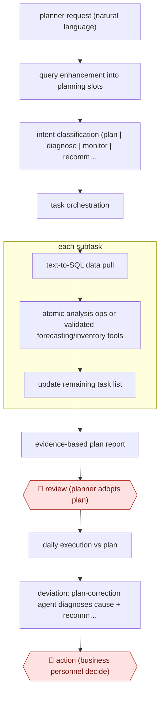

# Agent-built replenishment plans

`unplaced` (proposed: `ORG › LOG › PLANNING`) · checkpointed · evidence A · **draft: needs a reference example** ([how to add one](../../../CONTRIBUTING.md#1-add-an-example-run))

**Shape:** `planner request (natural language) → query enhancement into planning slots → intent classification (plan | diagnose | monitor | recommend) → task orchestration → (each subtask: text-to-SQL data pull → atomic analysis ops or validated forecasting/inventory tools → update remaining task list) → evidence-based plan report → 🛑 review (planner adopts plan) → daily execution vs plan → deviation: plan-correction agent diagnoses cause + recommends update → 🛑 action (business personnel decide)`
**How it differs:** No existing ORG/LOG entry covers planning. Nearest elsewhere is AWF-0123 (Scheduled metric commentary), which publishes commentary on metric moves. This one produces an executable replenishment plan, has a planner adopt it, and adds a correction loop with an action checkpoint. AWF-0064 (Repo-grounded analysis) yields an analyst memo, not a plan, and has no execution-monitoring step.
**Variants:** `jd-scpa`

<!-- shape diagram: generated by scripts/build_diagrams.py from `shape`; don't edit -->

<!-- end shape diagram -->

## Steps
1. A planner states the planning need in natural language. Query enhancement turns it into structured planning parameters (slots) [[1]](#sources)[[2]](#sources).
2. Intent classification routes the request to planning, diagnostic, monitoring or recommendation. Task orchestration breaks it into executable subtasks [[2]](#sources).
3. Each subtask pulls data through text-to-SQL and slot matching from the supply-chain systems, then runs auditable atomic data operations or validated analytical tools such as inventory decision algorithms. The remaining task list is updated after each intermediate observation [[2]](#sources).
4. The agent returns an evidence-based planning report (sales, inventory, inbound plans) [[1]](#sources).
5. 🛑 **Review**: planners and analysts receive the report and decide on the plan. The paper casts the system as assisting business personnel, not replacing their decision [[1]](#sources).
6. After the plan is implemented, the Plan Correction Agent compares actual daily sales and metrics with planned values, detects abnormal deviations, identifies causes (lower traffic, underperforming promotions, market shifts) and generates recommendations for plan updates [[1]](#sources).
7. 🛑 **Action**: business personnel decide whether to apply the recommended correction (for example rebalancing or expedited replenishment) [[1]](#sources).

**Output:** Weekly sales/inventory replenishment plans and mid-cycle correction recommendations for JD.com category teams. In the evaluated deployment these covered more than 70,000 SKUs across Grain & Oils, Maternal & Infant Care and Small Home Appliances [2].
**Failure modes → guards:** Ambiguous requests produce the wrong plan → query enhancement plus intent routing before execution. Errors are hard to trace → atomic, auditable data operations show whether a fault came from data, slot extraction, aggregation or the tool. A plan goes stale mid-cycle (618 stock-up vs sales-peak phases) → continuous deviation monitoring and the correction agent.

## Public runs

Coverage as of 2026-11-13: **Strong**: a first-hand, detailed run that matches most of the shape. Collected and re-checked in [Fourth collection pass](../../../research/2026-11-fourth-pass.md).

- [Yin et al. (JD.com), Rethinking Supply Chain Planning: A Generative Paradigm](https://arxiv.org/html/2509.03811) (2026-01-09). Deployed at JD.com from Dec 2023; May–June 2024 (agent) vs May–June 2023 (manual) around 618. "the system reduces weekly data processing time by approximately 40%, increases planning accuracy by 22%, and improves stock fulfillment rates by 2–3%". *First-hand: study; confidence: high.*

## Sources

1. Yin, Qi, Zhang, Geng, Chen, Hu, Qi, Shen (Tsinghua / JD.com / HKU), Rethinking Supply Chain Planning: A Generative Paradigm, arXiv 2509.03811v2, 2026-01-09. https://arxiv.org/html/2509.03811
2. Cognaptus, Plan, Act, Replan: When LLM Agents Run the Aisles, 2025-09-08 (secondary summary of [1]). https://cognaptus.com/blog/2025-09-08-plan-act-replan-when-llm-agents-run-the-aisles/
