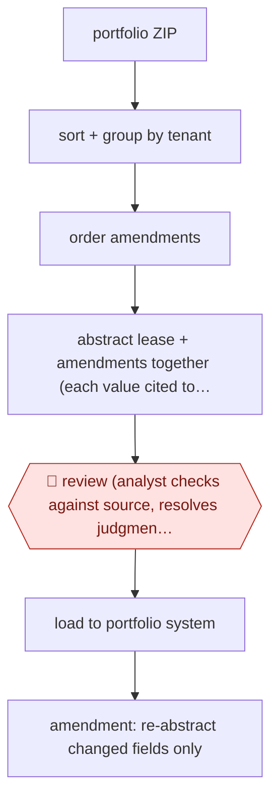

# Analyst-verified lease abstracts

`unplaced` (proposed: `ORG › RE › LEASEADMIN`) · checkpointed · evidence A · **draft: needs a reference example** ([how to add one](../../../CONTRIBUTING.md#1-add-an-example-run))

**Shape:** `portfolio ZIP → sort + group by tenant → order amendments → abstract lease + amendments together (each value cited to source) → 🛑 review (analyst checks against source, resolves judgment fields) → load to portfolio system → amendment: re-abstract changed fields only`
**How it differs:** AWF-0024 Playbook contract review marks up a contract for negotiation. AWF-0037 flags risks in a data room. Here the deliverable is a structured system-of-record dataset with amendment tracking.
**Why unplaced:** no class in taxonomy.yaml covers this yet. It is filed here until three similar workflows justify a new class `LEASEADMIN` (TAXONOMY.md rule 2).
**Variants:** `cremodels-mercury` · `dealsumm`

<!-- shape diagram: generated by scripts/build_diagrams.py from `shape`; don't edit -->

<!-- end shape diagram -->

## Steps
1. Load the portfolio as one ZIP; the system sorts files and groups them by tenant [[1]](#sources).
2. Work through the amendment history in order so later amendments supersede earlier terms [[1]](#sources).
3. Extract fields with citations; JLL's platform covers 'more than 2,500 data points per lease' [[2]](#sources).
4. 🛑 **Review**: an analyst reviews against the source, corrects errors and resolves judgment calls such as recoveries and co-tenancy [[1]](#sources); at JLL a human validates before data is finalised [[2]](#sources).
5. When amendments arrive, update only the changed data points [[2]](#sources).

**Output:** Lease abstracts in the portfolio management system, used for underwriting and lease administration.
**Failure modes → guards:** At 80% accuracy lease data is unusable ('no better than 0%') → analyst signs off every field [[1]](#sources).

## Public runs

Coverage as of 2026-11-06: **Strong**: a first-hand, detailed run that matches most of the shape. Collected and re-checked in [Second collection pass](../../../research/2026-11-second-pass.md).

- [CREModels case study](https://www.cremodels.com/ai-lease-abstraction-case-study) (2026-06-24). About 200 retail tenants for a shopping-centre landlord; analysts sign off every field. "about 200 retail tenants" (project scope). *First-hand: yes; confidence: high.*
- [Databricks, JLL](https://www.databricks.com/customers/jll/dealsumm) (n.d.). Human review stays in place; throughput doubled. "Review time per lease dropped from 130 minutes to 85 minutes". *First-hand: vendor; confidence: med.*

## Sources

1. Mike Jaworski, CREModels, AI Lease Abstraction: Production Data CRE Teams Can Trust, 2026-06-24. https://www.cremodels.com/ai-lease-abstraction-case-study
2. Databricks, JLL Turns Lease Data Into Governed Insights. https://www.databricks.com/customers/jll/dealsumm
