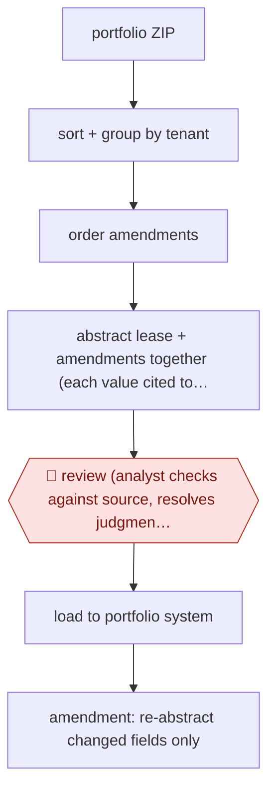

# Analyst-verified lease abstracts

`unplaced` (proposed: `ORG › RE › LEASEADMIN`) · checkpointed · evidence A · **draft: needs a reference example** ([how to add one](../../../CONTRIBUTING.md#1-add-an-example-run))

**Shape:** `portfolio ZIP → sort + group by tenant → order amendments → abstract lease + amendments together (each value cited to source) → 🛑 review (analyst checks against source, resolves judgment fields) → load to portfolio system → amendment: re-abstract changed fields only`
**How it differs:** AWF-0024 Playbook contract review marks up a contract for negotiation. AWF-0037 flags risks in a data room. Here the deliverable is a structured system-of-record dataset with amendment tracking.
**Why unplaced:** no class in taxonomy.yaml covers this yet. It is filed here until three similar workflows justify a new class `LEASEADMIN` (TAXONOMY.md rule 2).
**Variants:** `cremodels-mercury` · `dealsumm` · `kolena` · `legora`

<!-- shape diagram: generated by scripts/build_diagrams.py from `shape`; don't edit -->

<!-- end shape diagram -->

## Background

A lease is a contract that decides rent, who pays for what, and when options expire, and a portfolio of them is a set of obligations nobody can hold in their head. The abstract is the structured summary that stands in for the document: base rent, escalations, recoveries, renewal windows, the clauses that only bite in specific circumstances. Getting it wrong is expensive in a quiet way — a missed renewal notice, a recovery pool that excludes something it should include, a co-tenancy remedy nobody knew applied — and the cost lands years later, at a renewal or a sale, when the document is re-read. Manual abstracting takes hours per lease and drifts, which is why rent rolls carry errors and why anyone who audits recoveries finds money back. A model reads the lease and its amendment chain and returns each field with the page it came from, so the analyst's review becomes a check against a citation rather than a re-read. The judgement calls stay human: how a recovery formula interacts with a cap, whether a co-tenancy clause is triggered, which of two conflicting amendments governs.

**Terms:**
- **abstract**: the structured summary of a lease, one record per lease.
- **amendment chain**: the sequence of amendments, each possibly overriding terms in the original.
- **escalation**: the scheduled rent increase, fixed or indexed.
- **recoveries / CAM**: the operating costs a tenant pays back to the landlord, subject to caps and exclusions.
- **co-tenancy**: a clause tying rent or remedies to other tenants being open and trading.
- **renewal window**: the period in which an option must be exercised, often missed and always valuable.
- **rent roll**: the landlord's schedule of rents, a transcription of the leases.
- **source citation**: the page and clause a field was extracted from.

## Build it with an agent

**Form:** `service`. The work is a pipeline over a portfolio: a batch of leases arrives, abstracts are produced and reviewed, then amendments arrive continuously and only the changed fields are re-abstracted. Several analysts work a queue against a system of record, so this is a service rather than a single analyst's tool or one project's repository.

**You need:** the leases and the complete amendment chain as files, because an abstract built without the chain is wrong in exactly the fields that matter; the portfolio's field schema, so the output loads rather than gets retyped; a citation per extracted value, which is what makes a targeted review possible; the document quality of each lease recorded, since a scan and a native PDF deserve different review; and an analyst available to resolve the judgement fields — recoveries, co-tenancy, conflicting amendments — with authority to reject an abstract. The agent must not resolve a judgment field and must not load to the system of record: the abstract is a proposal until an analyst has checked it against the source.

| Step | Built as |
|---|---|
| portfolio ZIP → sort + group by tenant | Ingestion that groups documents by tenant and identifies lease versus amendment, recording document quality per file, because a scan needs heavier review than a native PDF. |
| order amendments | The chain is ordered by execution date so later amendments supersede earlier terms; an out-of-order chain produces a confidently wrong abstract. |
| abstract lease + amendments together (each value cited to source) | Fields are extracted against the consolidated term rather than the original, with each value carrying its page and clause, and rent tables read as tables rather than flattened text. |
| 🛑 review (analyst checks against source, resolves judgment fields) | Analysts check cited values against the source and decide the judgment fields; the routing is risk-based — every field on a scanned lease, targeted fields on clean ones. |
| load to portfolio system | The validated abstract is loaded, with the citation trail retained so a later dispute can be answered from the record. |
| amendment: re-abstract changed fields only | New amendments trigger a delta re-abstract of affected fields, which is also where a supersession error would surface. |

**Checkpoints:** `review`: the analyst signs off against the source, and the entry's point is that partial accuracy is worth nothing here — at 80% the dataset is worse than empty because it is trusted. The build makes that review feasible by citing every value and routing attention by document quality and clause type rather than spreading it evenly.

**Since the sources:** Sources date from 2026-02 to 2026-06 and are recent; none was re-opened on this pass. What has changed since is the detail behind this entry's blunt arithmetic, and it makes the review routable. Field-level accuracy now has a shape: roughly 80% to 88% on scanned leases, 90% to 95% on clean text-layer PDFs, and 95% or better on digitally native documents, with the drop traceable to OCR corrupting the text before the model reasons over it. Accuracy also splits by clause type — escalations at 95% to 98% when the clause uses a common format and 85% to 90% when the increase depends on an external trigger, recoveries at 90% to 95% for standard gross-up and stop clauses but weaker on bespoke exclusion schedules, critical dates at 97% to 99% with the characteristic failure being a date that points to an exhibit not in the uploaded set. Two implications for this build. First, "sign off every field" is the right rule for a scanned portfolio and an expensive one for a clean one; the defensible version routes by document quality and the five clause types that carry the damage — renewal deadlines, co-tenancy remedies, escalations, recovery mechanics, surrender conditions. Second, conditional logic is where extraction fails structurally, so co-tenancy and recovery formulas should be treated as a detector that points an analyst at the clause, not as an extraction at all. One widely repeated figure — that over half of rent rolls contain a material error — could not be traced to a primary study and should be quoted with that caveat.

*A design based on this entry's steps and the tool documentation as of 2026-11, not a reported run.*

## Steps

*As reported by the sources.*

1. Load the portfolio as one ZIP; the system sorts files and groups them by tenant [[1]](#sources).
2. Work through the amendment history in order so later amendments supersede earlier terms [[1]](#sources).
3. Extract fields with citations; JLL's platform covers 'more than 2,500 data points per lease' [[2]](#sources).
4. 🛑 **Review**: an analyst reviews against the source, corrects errors and resolves judgment calls such as recoveries and co-tenancy [[1]](#sources); at JLL a human validates before data is finalised [[2]](#sources).
5. When amendments arrive, update only the changed data points [[2]](#sources).

**Output:** Lease abstracts in the portfolio management system, used for underwriting and lease administration.
**Failure modes → guards:** At 80% accuracy lease data is unusable ('no better than 0%') → analyst signs off every field [[1]](#sources).

## Public runs

Coverage as of 2026-11-06: **Strong**: a first-hand, detailed run that matches most of the shape. Collected and re-checked in [Second collection pass](../../../research/2026-11-second-pass.md). More runs added in [Third collection pass](../../../research/2026-11-third-pass.md).

- [CREModels case study](https://www.cremodels.com/ai-lease-abstraction-case-study) (2026-06-24). About 200 retail tenants for a shopping-centre landlord; analysts sign off every field. "about 200 retail tenants" (project scope). *First-hand: yes; confidence: high.*
- [Databricks, JLL](https://www.databricks.com/customers/jll/dealsumm) (n.d.). Human review stays in place; throughput doubled. "Review time per lease dropped from 130 minutes to 85 minutes". *First-hand: vendor; confidence: med.*
- [Kolena, How Real Capital Solutions Cut Lease Review Time by 85%](https://www.kolena.com/blog/how-real-capital-solutions-cut-lease-review-time-by-85/) (2026-02-26). PE CRE manager ($2.8B AUM) abstracts leases + amendments, output to SharePoint/Teams folder for internal review. "Internal review time dropped from an average of two hours to roughly 17 minutes". *First-hand: vendor; confidence: med.*
- [Axiom, 2,000 Leases Digitized with Axiom Tech+Talent for Real Estate Manager](https://www.axiomlaw.com/resources/case-studies/real-estate-contracts-digitized-ai-lawyers) (2026-06-03). Portfolio of 93 properties; Legora took over review of 1,400 leases; one SME verifies data accuracy. "After Legora, the 5-lawyer team turned into one subject matter expert to verify data accuracy". *First-hand: vendor; confidence: low.*

## Sources

1. Mike Jaworski, CREModels, AI Lease Abstraction: Production Data CRE Teams Can Trust, 2026-06-24. https://www.cremodels.com/ai-lease-abstraction-case-study
2. Databricks, JLL Turns Lease Data Into Governed Insights. https://www.databricks.com/customers/jll/dealsumm
3. Kolena Editorial Team, How Real Capital Solutions Cut Lease Review Time by 85%, 2026-02-26. https://www.kolena.com/blog/how-real-capital-solutions-cut-lease-review-time-by-85/
4. Axiom, Real Estate Manager Uses Axiom AI Lawyers to Digitize 2,000 Contracts, 2026-06-03. https://www.axiomlaw.com/resources/case-studies/real-estate-contracts-digitized-ai-lawyers
5. SFAI Labs, The real cost of a missed lease clause, 2026, on accuracy by document quality and clause type. https://sfailabs.com/guides/real-cost-missed-lease-clause
6. LeaseTrace, How long does AI lease abstraction take? (2026 FAQ), on accuracy by field and the exhibit-reference failure. https://leasetrace.neolain.com/en/leaselens/faq
