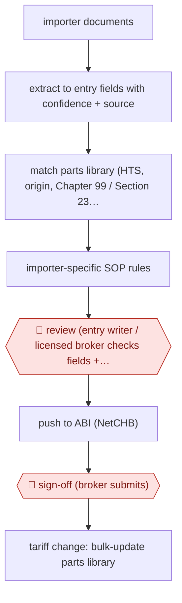

# Broker-reviewed entry prep

`unplaced` (proposed: `ORG › LOG › CUSTOMS`) · checkpointed · evidence A · **draft: needs a reference example** ([how to add one](../../../CONTRIBUTING.md#1-add-an-example-run))

**Shape:** `importer documents → extract to entry fields with confidence + source → match parts library (HTS, origin, Chapter 99 / Section 232 stacking) → importer-specific SOP rules → 🛑 review (entry writer / licensed broker checks fields + confidence) → push to ABI (NetCHB) → 🛑 sign-off (broker submits) → tariff change: bulk-update parts library`
**How it differs:** Closest in shape is AWF-0041 Review-ready 1040 prep (extract with confidence → preparer review → senior signs). It fails the swap test: the deliverable is a customs filing with tariff-stacking logic and a maintained parts library, signed by a licensed customs broker.
**Why unplaced:** no class in taxonomy.yaml covers this yet. It is filed here until three similar workflows justify a new class `CUSTOMS` (TAXONOMY.md rule 2).
**Variants:** `cervo` · `avathon`

<!-- shape diagram: generated by scripts/build_diagrams.py from `shape`; don't edit -->

<!-- end shape diagram -->

## Steps
1. Ingest commercial documents and extract entry data, with a confidence level and source for each field [[2]](#sources)[[3]](#sources).
2. Apply the dynamic parts library (HTS codes, origin splits, Section 232/301/122 stacking) and importer-specific rules from the agent studio [[1]](#sources)[[2]](#sources).
3. 🛑 **Review**: entry writers review entries in the tool before pushing to their ABI, seeing 'confidence levels and source data for each field' [[3]](#sources).
4. 🛑 **Sign-off**: brokers stay 'fully in control of review and submission' via NetCHB [[2]](#sources).
5. When rules change, bulk-update the parts library ahead of effective dates [[3]](#sources).

**Output:** Customs entry (CBP form 7501) filed by the licensed broker.
**Failure modes → guards:** Tariff rules change faster than parts data → mass parts-library updates. Misclassification penalties → broker review of every entry; Krenz & Hannan audits moved to 100% of entries.

**Recent practice (2026):**
- Document intake: incoming documents (over four dozen types from shippers, carriers and government agencies) are split, classified and attached to their shipment, and the system requests any missing document before extraction completes (C.H. Robinson, 2026-10-26). [[5]](#sources)

## Public runs

Coverage as of 2026-11-13: **Strong**: a first-hand, detailed run that matches most of the shape. Updated in [Third collection pass](../../../research/2026-11-third-pass.md).

- [Cervo, Krenz & Hannan](https://usecervo.com/case-studies/krenz-and-hannan) (n.d.). Freight forwarder and broker; quotes from its import department manager. "15 - 60+ minutes per entry → 5 - 10 minutes". *First-hand: vendor; confidence: med.*
- [Cervo, M. J. Carrillo](https://usecervo.com/case-studies/m-j-carrillo) (n.d.). Border brokerage; quotes from its licensed broker and VP of operations. "70%+ of monthly shipments processed through Cervo within four weeks of go-live". *First-hand: vendor; confidence: med.*
- [Cervo, EMD Customs](https://usecervo.com/case-studies/emd-customs) (n.d.). Three-person brokerage. "75% reduction in processing time". *First-hand: vendor; confidence: low.*
- [C.H. Robinson, Debuts Lean AI for Ocean Shipping, Air Freight and Customs](https://ir.chrobinson.com/news/press-releases/news-details/2026/C-H--Robinson-Debuts-Lean-AI-for-Ocean-Shipping-Air-Freight-and-Customs/default.aspx) (2026-10-26). Customs agents split, classify and attach documents, extract data, chase missing docs; brokers keep validation. "So far, time spent has been reduced 23%, allowing the company’s customs brokers to focus on critical validation and compliance steps.". *First-hand: yes; confidence: high.*

## Sources

1. Cervo AI, EMD Customs case study. https://usecervo.com/case-studies/emd-customs
2. Cervo AI, Krenz & Hannan case study. https://usecervo.com/case-studies/krenz-and-hannan
3. Cervo AI, M. J. Carrillo case study. https://usecervo.com/case-studies/m-j-carrillo
4. Avathon, AI-Powered Classification for Global Trade Management (Livingston International), 2025-10-09. https://avathon.com/resources/avathon-launches-ai-powered-classification-for-global-trade-management/
5. C.H. Robinson, C.H. Robinson Debuts Lean AI for Ocean Shipping, Air Freight and Customs, 2026-10-26. https://ir.chrobinson.com/news/press-releases/news-details/2026/C-H--Robinson-Debuts-Lean-AI-for-Ocean-Shipping-Air-Freight-and-Customs/default.aspx
