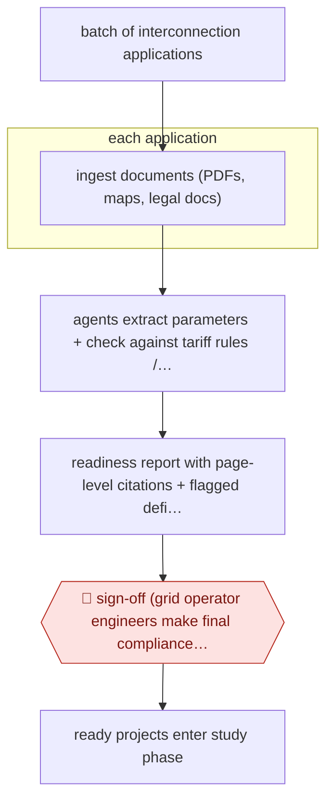

# Cited interconnection readiness review

`unplaced` (proposed: `ORG › ENE › INTERCONNECT`) · checkpointed · evidence B · **draft: needs a reference example** ([how to add one](../../../CONTRIBUTING.md#1-add-an-example-run))

**Shape:** `batch of interconnection applications → each application: ingest documents (PDFs, maps, legal docs) → agents extract parameters + check against tariff rules / manuals → readiness report with page-level citations + flagged deficiencies → 🛑 sign-off (grid operator engineers make final compliance determination) → ready projects enter study phase`
**How it differs:** Closest AWF-0151 First-pass submittal review (construction submittal vs specs, PM review then reviewer-of-record sign-off). Same check-against-rules pattern, but this runs a whole regulatory queue batch in parallel against a tariff, deliverable is a cited readiness report per application, and only the grid operator's final determination is a checkpoint (no per-item PM edit step). Different field: grid interconnection.
**Variants:** `tapestry-hyperq`

<!-- shape diagram: generated by scripts/build_diagrams.py from `shape`; don't edit -->

<!-- end shape diagram -->

## Background

A grid operator's interconnection queue is the gate between a proposed power project and the network, and the gate has a paperwork problem before it has an engineering one. An application arrives as a bundle: site control documents, single-line diagrams, maps, proof of deposits, legal attestations. Someone has to check that bundle against the tariff and the operator's manuals, and reject or flag what is deficient before the expensive study work begins. At the volumes now in play — one annual intake window with hundreds of applications — that check is where the queue either moves or stalls. This workflow puts agents over each application in parallel, extracts the parameters, checks them against the tariff, and writes a readiness report whose every finding carries a page, clause or coordinate citation. The engineers then make the compliance determination. The design bet is narrow and worth stating: the value is not the judgement, it is that a human can verify a judgement in seconds because the evidence is attached, and that a black-box answer in a regulated queue is worse than no answer at all.

**Terms:**
- **interconnection application**: a request to connect a generator or load to the transmission system.
- **tariff**: the operator's filed rules, including the interconnection process and its requirements.
- **site control**: documentary evidence the developer controls the land, the most common deficiency.
- **readiness review**: the check that an application is complete enough to enter the study queue.
- **study phase**: the engineering studies that follow a complete application.
- **deficiency**: a missing or non-conforming item, flagged with its rule.
- **determination**: the operator's formal decision that an application complies, which only the operator can make.
- **intake cycle**: the window in which applications are accepted, after which the next one is a year away.

## Build it with an agent

**Form:** `project`. The tariff, the instruction set distilled from how staff rated past applications, the per-application reports and the audit trail all belong to one intake cycle and have to persist together for the cycle's disputes and appeals. That is a repository with a workflow per cycle, not a skill one engineer runs and not a continuous service.

**You need:** the application bundle in machine-readable form, including the maps and the scanned legal documents; the tariff and manuals as versioned text, since a check against a superseded rule is a wrong flag; the historical rating decisions, which are what turn a generic checklist into the operator's own standard; a report format where every finding carries a citation down to page, clause or coordinate, because that is what makes verification cheap; the p95 runtime budget, since a report that arrives after the study queue opens is useless; and the engineers' time for the determination, staffed for the whole batch rather than a sample. The agent must not issue a determination and must not reject an application: both are the operator's, and a wrongly rejected application is a legal exposure.

| Step | Built as |
|---|---|
| batch of interconnection applications | The cycle's intake as a batch, with each application's documents enumerated so a missing file is a finding rather than a silent gap. |
| each application: ingest documents (PDFs, maps, legal docs) | Parallel ingestion per application, with maps and scans handled explicitly, since the site-control evidence often lives in a scanned deed. |
| agents extract parameters + check against tariff rules / manuals | Extraction and compliance checks split across agents against the versioned tariff, with an orchestration layer that records which rule each check applied. |
| readiness report with page-level citations + flagged deficiencies | One report per application, findings cited to page, clause or coordinate, so the engineer can confirm or refute each in seconds. |
| 🛑 sign-off (grid operator engineers make final compliance determination) | The engineer makes the determination; the build has no path to a decision, a rejection or a queue position. |
| ready projects enter study phase | Applications the operator clears move on, and the reports stay as the record of what was checked and by whom. |

**Checkpoints:** `sign-off`: the determination is the operator's, and the workflow's only claim is that the engineer reaches it faster with citations in hand — which also means the build must never be the thing that decides a project is not ready.

**Since the sources:** The source dates from 2026-06-02 and was not re-opened on this pass. What has changed since: the operator has started describing the deployment in its own words, and its words are more careful than the vendor's numbers. In a public FAQ updated in 2026-03, the operator says it is testing the tool with its developers, that [early results indicate it can streamline certain elements of the evaluation](https://reliablepowertodaytomorrow.com?p=418/), and that further detail will follow as teams validate results through benchmarking — which is a testing posture, not a production claim, and it sits against a vendor field note reporting 811 applications at a median of 6 minutes 15 seconds. Both can be true; they are measuring different things, and this entry should not average them. The queue context explains why the batch matters: the operator's transition queue still had roughly 46 GW to work through by the end of 2026, the first regular cycle closed its single annual application window on 2026-04-27, and the average time from request to commercial operation has risen to over eight years. With one intake window a year, the readiness review is the last cheap filter before a year-long study, which is the argument for doing it on the whole batch rather than a sample.

*A design based on this entry's steps and the tool documentation as of 2026-11, not a reported run.*

## Steps

*As reported by the sources.*

1. PJM's tariff, user manuals and how staff rated past applications are distilled into an instruction set; extraction and compliance tasks are split across agents with an orchestration layer [[1]](#sources).
2. Each application in the cycle is processed in parallel: the agents ingest PDFs, maps and legal documents and run the site-control Application Readiness Review against tariff requirements [[1]](#sources).
3. The output is a readiness report per application with page-, clause- or coordinate-level citations and flagged deficiencies [[1]](#sources).
4. 🛑 **Sign-off**: PJM's expert engineers perform the final compliance determination using the report [[1]](#sources).

**Output:** Citation-backed readiness reports per application, handed to grid-operator engineers; projects judged ready advance to the study phase.
**Failure modes → guards:** Black-box judgments in a regulated queue → every assessment links to the source page/clause, and engineers keep the determination [1]. Runtime tail on complex applications → p95 tracked (28 minutes) [1].

## Public runs

Coverage as of 2026-11-13: **Weak**: only anonymous, vendor-linked or journalist-told accounts. Collected and re-checked in [Third collection pass](../../../research/2026-11-third-pass.md).

- [Tapestry, HyperQ deployment in PJM's Cycle 1](https://www.tapestryenergy.com/en/projects/field-notes-hyperq-deployment-in-pjm-s-cycle-1) (2026-06-02). Site-control intake for PJM Cycle 1; PJM quoted on human governance; engineers make final determinations. "citation-backed readiness reports for 811 applications at a median runtime of 6 minutes and 15 seconds per application". *First-hand: vendor; confidence: med.*

## Sources

1. Tapestry (Alphabet), Field Notes: HyperQ deployment in PJM's Cycle 1, 2026-06-02. https://www.tapestryenergy.com/en/projects/field-notes-hyperq-deployment-in-pjm-s-cycle-1
2. PJM, FAQ on demand growth, the interconnection backlog and the HyperQ trial (early results, validation ongoing), entries dated 2026-03. https://reliablepowertodaytomorrow.com?p=418/
3. Reslink Energy, FERC interconnection queue reform 2026, updated 2026-10-24, on the single annual intake window and the eight-year average. https://www.reslink.org/blogs/ferc-interconnection-reform
