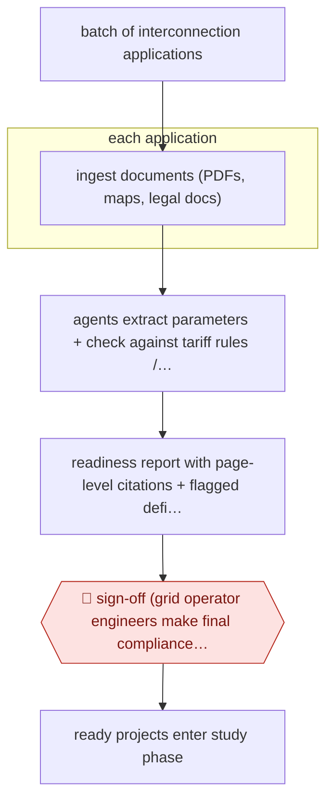

# Cited interconnection readiness review

`unplaced` (proposed: `ORG › ENE › INTERCONNECT`) · checkpointed · evidence B · **draft: needs a reference example** ([how to add one](../../../CONTRIBUTING.md#1-add-an-example-run))

**Shape:** `batch of interconnection applications → each application: ingest documents (PDFs, maps, legal docs) → agents extract parameters + check against tariff rules / manuals → readiness report with page-level citations + flagged deficiencies → 🛑 sign-off (grid operator engineers make final compliance determination) → ready projects enter study phase`
**How it differs:** Closest AWF-0151 First-pass submittal review (construction submittal vs specs, PM review then reviewer-of-record sign-off). Same check-against-rules pattern, but this runs a whole regulatory queue batch in parallel against a tariff, deliverable is a cited readiness report per application, and only the grid operator's final determination is a checkpoint (no per-item PM edit step). Different field: grid interconnection.
**Variants:** `tapestry-hyperq`

<!-- shape diagram: generated by scripts/build_diagrams.py from `shape`; don't edit -->

<!-- end shape diagram -->

## Steps
1. PJM's tariff, user manuals and how staff rated past applications are distilled into an instruction set; extraction and compliance tasks are split across agents with an orchestration layer [[1]](#sources).
2. Each application in the cycle is processed in parallel: the agents ingest PDFs, maps and legal documents and run the site-control Application Readiness Review against tariff requirements [[1]](#sources).
3. The output is a readiness report per application with page-, clause- or coordinate-level citations and flagged deficiencies [[1]](#sources).
4. 🛑 **Sign-off**: PJM's expert engineers perform the final compliance determination using the report [[1]](#sources).

**Output:** Citation-backed readiness reports per application, handed to grid-operator engineers; projects judged ready advance to the study phase.
**Failure modes → guards:** Black-box judgments in a regulated queue → every assessment links to the source page/clause, and engineers keep the determination [1]. Runtime tail on complex applications → p95 tracked (28 minutes) [1].

## Public runs

Coverage as of 2026-11-13: **Weak**: only anonymous, vendor-linked or journalist-told accounts. Collected and re-checked in [Third collection pass](../../../research/2026-11-third-pass.md).

- [Tapestry, HyperQ deployment in PJM's Cycle 1](https://www.tapestryenergy.com/en/projects/field-notes-hyperq-deployment-in-pjm-s-cycle-1) (2026-06-02). Site-control intake for PJM Cycle 1; PJM quoted on human governance; engineers make final determinations. "citation-backed readiness reports for 811 applications at a median runtime of 6 minutes and 15 seconds per application". *First-hand: vendor; confidence: med.*

## Sources

1. Tapestry (Alphabet), Field Notes: HyperQ deployment in PJM's Cycle 1, 2026-06-02. https://www.tapestryenergy.com/en/projects/field-notes-hyperq-deployment-in-pjm-s-cycle-1
