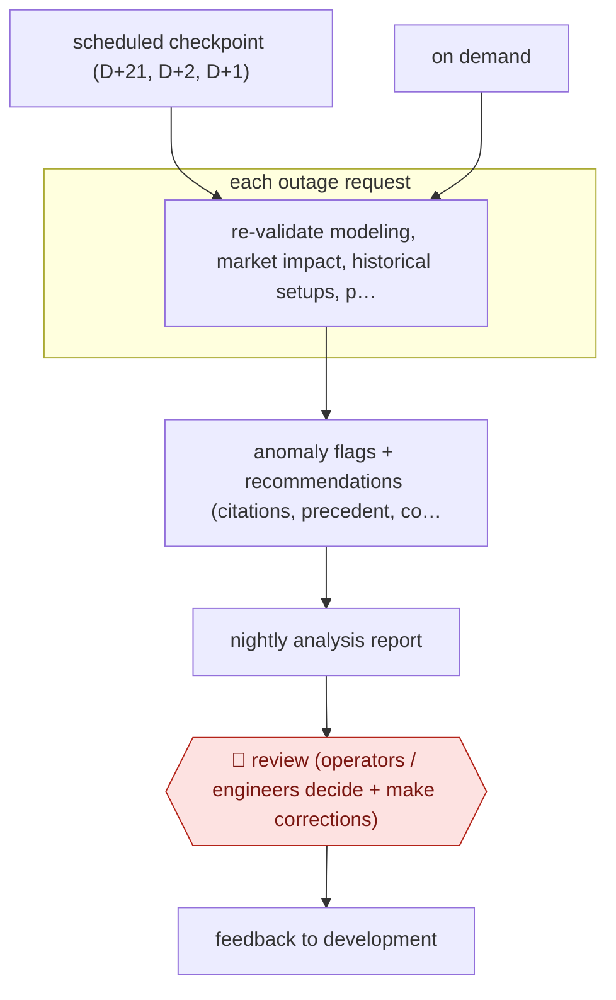

# Cited outage revalidation

`unplaced` (proposed: `ORG › ENE › OUTAGECOORD`) · checkpointed · evidence A · **draft: needs a reference example** ([how to add one](../../../CONTRIBUTING.md#1-add-an-example-run))

**Shape:** `scheduled checkpoint (D+21, D+2, D+1) | on demand → each outage request: re-validate modeling, market impact, historical setups, procedures, free-text notes → anomaly flags + recommendations (citations, precedent, confidence) → nightly analysis report → 🛑 review (operators / engineers decide + make corrections) → feedback to development`
**How it differs:** AWF-0213 (cited interconnection readiness review) is a one-off batch check of new interconnection applications against tariff rules, ending in an engineer's compliance determination. This workflow re-checks every live facility outage request at fixed horizons, every day, and produces an operations report that control-room staff act on. The trigger, cadence, deliverable and reviewers all differ.
**Variants:** `oati-genie`

<!-- shape diagram: generated by scripts/build_diagrams.py from `shape`; don't edit -->

<!-- end shape diagram -->

## Steps
1. Triggered at scheduled study checkpoints (e.g. D+21, D+2, D+1) or on demand. Each day the CAISO grid receives 500+ new generation outage requests and 200+ new transmission outage requests [[1]](#sources).
2. An orchestrator coordinates specialised agents. The Workflow agent runs the scheduled reviews across the fleet. It re-validates modeling, market impact, historical outage setups, operating procedures and anomalies in free-text outage notes, using OASIS, market systems and procedure data [[1]](#sources)[[2]](#sources).
3. Similarity-search agents compare each request with historical outage records by equipment, location and procedure. A keyword agent reads free-text notes against CAISO's operational dictionary and flags discrepancies [[2]](#sources).
4. Report agents build nightly analysis reports with anomaly flags and recommendations. Each recommendation carries traceable reasoning, source citations, precedent and a confidence level [[1]](#sources).
5. 🛑 **Review**: operators and engineers in transmission, reliability and generation review the findings and make the corrections themselves. The system is advisory only and cannot take a reliability action [[1]](#sources).
6. Users send feedback through a built-in feedback capability that goes back into the development cycle. Conversations are traced and access is controlled by role [[1]](#sources).

**Output:** A nightly outage-revalidation report, ready before reviewers start the day, plus cited answers on procedures and single-line diagrams. Operators make all corrections in the outage management system.
**Failure modes → guards:** Misrouted intent makes every answer look wrong → intent routing treated as critical. Legacy schemas the team did not design → named as the hard part. Hallucinated recommendations → each agent validated separately before integration, citations on every finding, and no autonomous grid actions (NERC/CIP alignment). Low operator trust → training and feedback loops.

## Public runs

Coverage as of 2026-11-13: **Strong**: a first-hand, detailed run that matches most of the shape. Collected and re-checked in [Fourth collection pass](../../../research/2026-11-fourth-pass.md).

- [California ISO, Deploying Agentic AI into Facility Outage Management](https://www.nationalacademies.org/cdn/materials/a3191bca-d63d-473b-ae9e-a98add3301c6) (2026; exact date not on page). Genie in expanded beta in production: nightly revalidation of next-day outages; operators decide. "< 8 min to analyze 500+ next-day outage requests, ready before reviewers start the day". *First-hand: yes; confidence: high.*

## Sources

1. Dede Subakti, P.E., VP System Operations, California ISO, Deploying Agentic AI into Facility Outage Management (slides, National Academies), 2026 (after EPRI SAFERai launch, Aug 2026). https://www.nationalacademies.org/cdn/materials/a3191bca-d63d-473b-ae9e-a98add3301c6
2. Maeve Allsup, Under the hood of CAISO's AI outage management pilot, Latitude Media, 2025-07-28 (press, interview with OATI). https://www.latitudemedia.com/news/under-the-hood-of-caisos-ai-outage-management-pilot/
