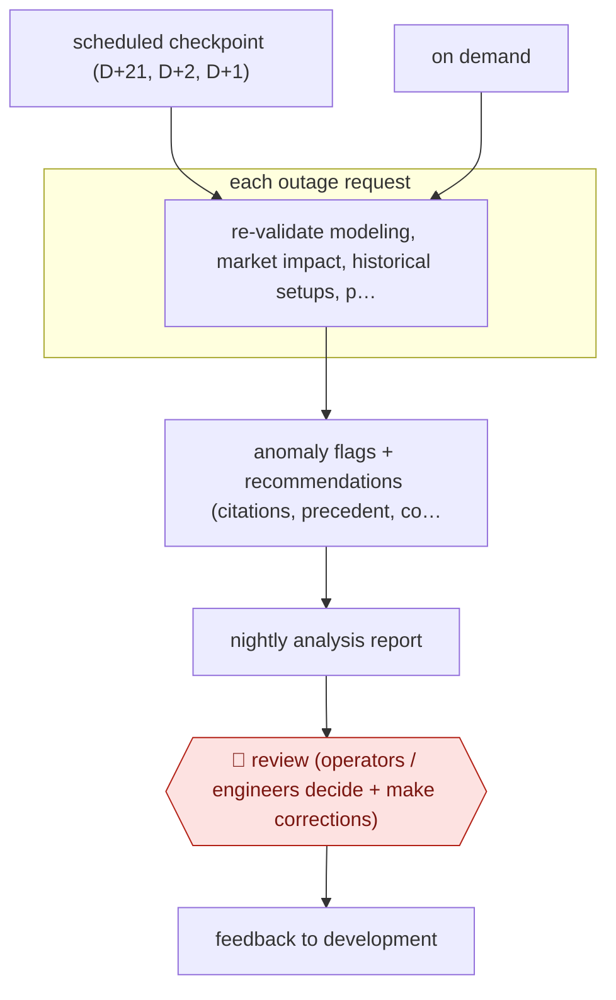

# Cited outage revalidation

`unplaced` (proposed: `ORG › ENE › OUTAGECOORD`) · checkpointed · evidence A · **draft: needs a reference example** ([how to add one](../../../CONTRIBUTING.md#1-add-an-example-run))

**Shape:** `scheduled checkpoint (D+21, D+2, D+1) | on demand → each outage request: re-validate modeling, market impact, historical setups, procedures, free-text notes → anomaly flags + recommendations (citations, precedent, confidence) → nightly analysis report → 🛑 review (operators / engineers decide + make corrections) → feedback to development`
**How it differs:** AWF-0213 (cited interconnection readiness review) is a one-off batch check of new interconnection applications against tariff rules, ending in an engineer's compliance determination. This workflow re-checks every live facility outage request at fixed horizons, every day, and produces an operations report that control-room staff act on. The trigger, cadence, deliverable and reviewers all differ.
**Variants:** `oati-genie`

<!-- shape diagram: generated by scripts/build_diagrams.py from `shape`; don't edit -->

<!-- end shape diagram -->

## Background

A transmission outage is scheduled weeks ahead and cleared to proceed on the day, and in between the grid changes underneath it: demand forecasts move, other outages are approved, a line that was available is not. An operator approving a request is therefore re-deciding the same question several times, and the later the decision the less time there is to think. In a large control area the volume makes that impossible to do properly by hand — hundreds of new generation outage requests and hundreds of transmission requests arrive daily — so the practical answer has been to check what looks risky and let the rest through. An agent fleet that re-validates every live request at fixed horizons (three weeks out, two days out, the day before) and again on demand inverts that: everything gets looked at, the anomalies are flagged with the precedent and the procedure they contradict, and the report is waiting when reviewers start their day. What it cannot do is act. Reliability actions stay with the operators, both because the standards require human authority and because a wrong switching decision is not a recoverable error.

**Terms:**
- **outage request**: a request to take a facility out of service, with a start and end time.
- **revalidation**: re-checking a request against current conditions at a fixed horizon before it starts.
- **OASIS**: the public system that publishes transmission and outage information.
- **free-text note**: the unstructured comment on a request, often where the real information is.
- **precedent**: a comparable past outage, used to argue that a setup was or was not acceptable.
- **reliability action**: an operational decision affecting the grid, reserved to qualified staff.
- **confidence**: the agent's own certainty, reported rather than used to suppress a flag.
- **change management**: the controlled process for altering a system inside the compliance boundary.

## Build it with an agent

**Form:** `service`. It runs nightly and at fixed horizons over the whole fleet of live requests, with nobody starting it, and the output is a report waiting before the morning shift. Operators act on it; the pipeline never acts on the grid. That is a service, not a skill an operator runs and not a per-cycle project.

**You need:** read access to the outage management system, market systems and procedure documents, with the data arriving by replication rather than integration inside the control boundary; the operating procedures and the operational dictionary as versioned references, since the flag is only credible if it cites the procedure it contradicts; the historical outage record, for the precedent comparison; the free-text notes parsed rather than ignored, because that is where the exception usually sits; a pinned model version per report, since an unnoticed model update changes the analysis of every request at once; and a morning review slot staffed by people with authority to correct the requests. The agent must not take a reliability action, must not approve or deny an outage, and must not be the only thing that read the note.

| Step | Built as |
|---|---|
| scheduled checkpoint (D+21, D+2, D+1) | Fixed horizons plus on-demand runs, so a request is re-checked as conditions change rather than once at submission. |
| each outage request: re-validate modeling, market impact, historical setups, procedures, free-text notes | Per-request validation across five dimensions at once, with the free-text note read against the operational dictionary because that is where discrepancies hide. |
| anomaly flags + recommendations (citations, precedent, confidence) | Each flag carries the procedure or precedent it rests on and a stated confidence, so a reviewer can dismiss a weak flag in seconds rather than reading the whole report. |
| nightly analysis report | The report is assembled overnight and waiting before the shift, which is the difference between advisory and useful. |
| 🛑 review (operators / engineers decide + make corrections) | Operators and engineers read, decide and make the corrections in the outage management system; the build cannot change a request or take a reliability action. |
| feedback to development | Operator feedback and traced conversations go back into development, which is how routing errors and weak flags get fixed rather than tolerated. |

**Checkpoints:** `review`: the report is advisory, and the correction happens in the operator's own system — the build has no write path to the grid, which is both the safety property and the compliance one, since the standards require human authority over operational actions.

**Since the sources:** Sources date from 2025-07 and 2026, and neither was re-opened on this pass. What has changed since is the legal frame around the deployment rather than the deployment itself. As of 2026-08 no state utility commission had issued formal guidance on operational AI, and only one had opened a formal examination of how utilities use it in forecasting, procurement and planning — so the operator is running this in a vacuum of specific rules, with the general reliability and critical-infrastructure obligations doing the work. Those obligations are the ones that shape the build: standards require controls on access and change management for systems that can reach critical infrastructure, and a practitioner consensus has formed around the architecture this entry already uses — models outside the security boundary, reading replicated data, returning advisories that a person acts on, with the operator's acceptance or override recorded. That last detail matters here: the record of which flags were acted on is both the improvement signal and the evidence that the AI informs rather than performs operations. The practical constraint to plan for is change control: a model or prompt update is an event in a controlled system, so the version behind each nightly report has to be pinned and the change scheduled, not rolled out quietly.

*A design based on this entry's steps and the tool documentation as of 2026-11, not a reported run.*

## Steps

*As reported by the sources.*

1. Triggered at scheduled study checkpoints (e.g. D+21, D+2, D+1) or on demand. Each day the CAISO grid receives 500+ new generation outage requests and 200+ new transmission outage requests [[1]](#sources).
2. An orchestrator coordinates specialised agents. The Workflow agent runs the scheduled reviews across the fleet. It re-validates modeling, market impact, historical outage setups, operating procedures and anomalies in free-text outage notes, using OASIS, market systems and procedure data [[1]](#sources)[[2]](#sources).
3. Similarity-search agents compare each request with historical outage records by equipment, location and procedure. A keyword agent reads free-text notes against CAISO's operational dictionary and flags discrepancies [[2]](#sources).
4. Report agents build nightly analysis reports with anomaly flags and recommendations. Each recommendation carries traceable reasoning, source citations, precedent and a confidence level [[1]](#sources).
5. 🛑 **Review**: operators and engineers in transmission, reliability and generation review the findings and make the corrections themselves. The system is advisory only and cannot take a reliability action [[1]](#sources).
6. Users send feedback through a built-in feedback capability that goes back into the development cycle. Conversations are traced and access is controlled by role [[1]](#sources).

**Output:** A nightly outage-revalidation report, ready before reviewers start the day, plus cited answers on procedures and single-line diagrams. Operators make all corrections in the outage management system.
**Failure modes → guards:** Misrouted intent makes every answer look wrong → intent routing treated as critical. Legacy schemas the team did not design → named as the hard part. Hallucinated recommendations → each agent validated separately before integration, citations on every finding, and no autonomous grid actions (NERC/CIP alignment). Low operator trust → training and feedback loops.

## Public runs

Coverage as of 2026-11-13: **Strong**: a first-hand, detailed run that matches most of the shape. Collected and re-checked in [Fourth collection pass](../../../research/2026-11-fourth-pass.md).

- [California ISO, Deploying Agentic AI into Facility Outage Management](https://www.nationalacademies.org/cdn/materials/a3191bca-d63d-473b-ae9e-a98add3301c6) (2026; exact date not on page). Genie in expanded beta in production: nightly revalidation of next-day outages; operators decide. "< 8 min to analyze 500+ next-day outage requests, ready before reviewers start the day". *First-hand: yes; confidence: high.*

## Sources

1. Dede Subakti, P.E., VP System Operations, California ISO, Deploying Agentic AI into Facility Outage Management (slides, National Academies), 2026 (after EPRI SAFERai launch, Aug 2026). https://www.nationalacademies.org/cdn/materials/a3191bca-d63d-473b-ae9e-a98add3301c6
2. Maeve Allsup, Under the hood of CAISO's AI outage management pilot, Latitude Media, 2025-07-28 (press, interview with OATI). https://www.latitudemedia.com/news/under-the-hood-of-caisos-ai-outage-management-pilot/
3. Carol J. Holahan and Daniel T. Carlston, Foley Hoag, Legal considerations for AI deployment in the power sector, 2026-09-09, on the absence of state PUC guidance and CIP obligations for systems reaching the bulk electric system. https://foleyhoag.com/news-and-insights/blogs/energy-and-climate-counsel/2026/september/legal-considerations-for-ai-deployment-in-the-power-sector/
