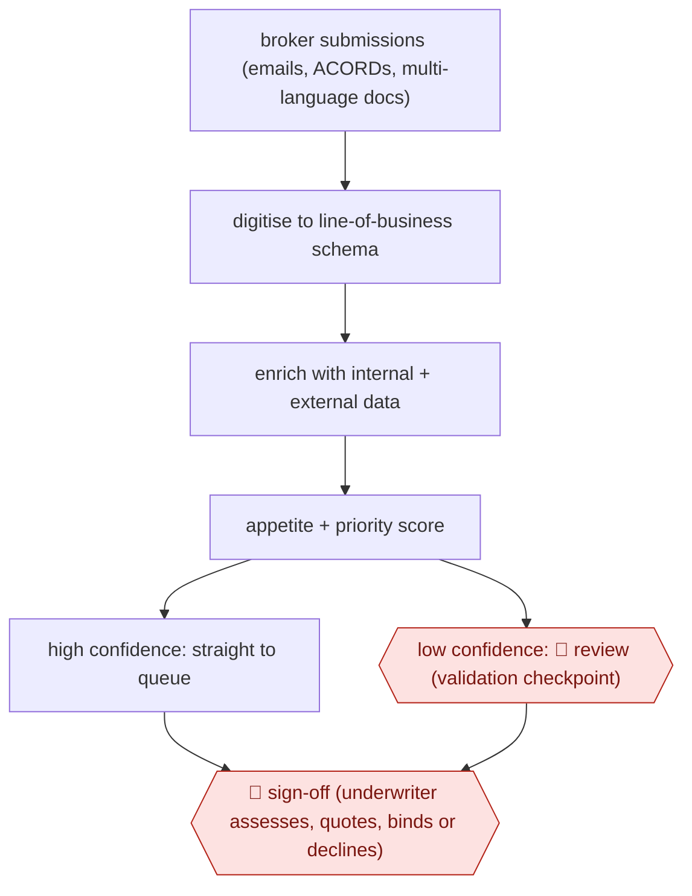

# Decision-ready submission triage

`unplaced` (proposed: `PRO › INS › UW`) · checkpointed · evidence B · **draft: needs a reference example** ([how to add one](../../../CONTRIBUTING.md#1-add-an-example-run))

**Shape:** `broker submissions (emails, ACORDs, multi-language docs) → digitise to line-of-business schema → enrich with internal + external data → appetite + priority score → high confidence: straight to queue | low confidence: 🛑 review (validation checkpoint) → 🛑 sign-off (underwriter assesses, quotes, binds or declines)`
**How it differs:** Hiscox quote drafting (above) produces a priced quote. Here the deliverable is a ranked submission queue, and the underwriter still prices every risk. AWF-0022 is close in shape but produces payables, not underwriting decisions.
**Why unplaced:** no class in taxonomy.yaml covers this yet. It is filed here until three similar workflows justify a new class `UW` (TAXONOMY.md rule 2).
**Variants:** `cytora` · `kalepa`

<!-- shape diagram: generated by scripts/build_diagrams.py from `shape`; don't edit -->

<!-- end shape diagram -->

## Steps
1. Ingest unstructured submissions and convert them into structured, 'decision-ready' risks against the carrier's schema [[1]](#sources)[[2]](#sources).
2. Enrich with external data and rank by appetite and strategy [[3]](#sources)[[4]](#sources).
3. High-confidence submissions go straight through to the underwriting queue [[2]](#sources).
4. 🛑 **Review**: low-confidence submissions stop at 'human-in-the-loop validation checkpoints', where a person checks the extracted data before the submission enters the queue [[2]](#sources).
5. 🛑 **Sign-off**: the underwriter assesses, quotes and binds (or declines) in the downstream system [[1]](#sources)[[4]](#sources).

**Output:** Prioritised queue of structured submissions in the underwriting workbench.
**Failure modes → guards:** Extraction errors flow into pricing → confidence thresholds and validation checkpoints. Underwriters only see a fraction of the inbox → full-inbox triage (Paragon) and decline routing.

**Recent practice (2026):**
- Step 2: Hiscox's UK high-net-worth model categorises broker submissions by risk appetite to streamline underwriter workflow (Hiscox 2025 Annual Report). [[5]](#sources)

## Public runs

Coverage as of 2026-11-06: **Partial**: first-hand runs that cover part of the shape or put checkpoints elsewhere. Collected and re-checked in [Second collection pass](../../../research/2026-11-second-pass.md).

- [Ivans, Arch Insurance submission intake](https://www.ivans.com/blog/posts/arch-insurance-ai-submission-intake-cytora/) (2026-05-26). Four lines live in under three months. "from two to three days down to two hours". *First-hand: vendor; confidence: med.*
- [Cytora, Zurich scales Agentic AI](https://cytora.com/risk-flow-center/blog/zurich-scales-agentic-ai-to-5-countries-in-90-days-proving-the-target-model-for-itsglobal-rollout) (n.d.). Rollout across Zurich country units. "manual triage time falling from 75 minutes to 15 minutes". *First-hand: vendor; confidence: med.*
- [Markel, AI can accelerate underwriting](https://www.markel.com/insights-and-resources/insights/ai-can-accelerate-underwriting-people-must-remain-accountable) (2026-11-02). Carrier's own account; underwriters finalise every quote. "a 65% quote-to-submission ratio". *First-hand: yes; confidence: high.*
- [Kalepa, Paragon case study](https://kalepa.com/case-studies/paragon-doubled-quote-to-bind-rate) (n.d.). Whole inbox through triage within 90 days; quotes from Paragon executives. "somewhere around 98 to 99% accurate now". *First-hand: vendor; confidence: med.*

## Sources

1. Cytora, Zurich scales Agentic AI to 5 countries in 90 days. https://cytora.com/risk-flow-center/blog/zurich-scales-agentic-ai-to-5-countries-in-90-days-proving-the-target-model-for-itsglobal-rollout
2. Ivans, From Days to Hours: How Arch Insurance Automated Submission Intake, 2026-05-26. https://www.ivans.com/blog/posts/arch-insurance-ai-submission-intake-cytora/
3. Markel, AI can accelerate underwriting. People must remain accountable, 2026-11-02. https://www.markel.com/insights-and-resources/insights/ai-can-accelerate-underwriting-people-must-remain-accountable
4. Kalepa, How Paragon Doubled Its Quote-to-Bind Rate. https://kalepa.com/case-studies/paragon-doubled-quote-to-bind-rate
5. Hiscox Ltd, 2025 Annual Report and Accounts (filed with BMA). https://cdn.bma.bm/documents/2026-07-16-21-20-40-Hiscox-Ltd-2025-Financial-Statement-Group.pdf
6. Reinsurance News, AI adoption drives productivity growth and opens business opportunities: Hiscox CFO Cooper, 2025-11-07. https://www.reinsurancene.ws/ai-adoption-drives-productivity-growth-and-opens-business-opportunities-hiscox-cfo-cooper/
