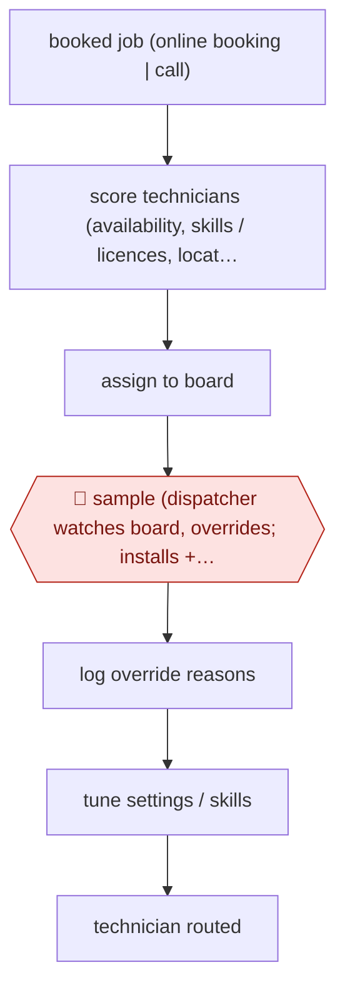

# Dispatcher-overridden job assignment

`unplaced` (proposed: `ORG › FSV › DISPATCH`) · sampled · evidence B · **draft: needs a reference example** ([how to add one](../../../CONTRIBUTING.md#1-add-an-example-run))

**Shape:** `booked job (online booking | call) → score technicians (availability, skills / licences, location, performance, revenue potential) → assign to board → 🛑 sample (dispatcher watches board, overrides; installs + follow-ups kept manual) → log override reasons → tune settings / skills → technician routed`
**How it differs:** None close. Closest by checkpoint style are sampled routing workflows like AWF-0150 (email-to-order), but the deliverable here is a technician schedule, and humans audit by overriding the live board rather than handling unresolved items.
**Variants:** `servicetitan-dispatch-pro` · `domo-roborouter`

<!-- shape diagram: generated by scripts/build_diagrams.py from `shape`; don't edit -->

<!-- end shape diagram -->

## Steps
1. Customers book through an online link that shows open times from capacity planning, or calls are booked by the office [[1]](#sources).
2. The dispatch agent assigns each job to a technician based on skills, location and revenue potential [[1]](#sources). T3's in-house RoboRouter ranks technicians in real time by availability, skills (including region-specific licences) and a recency-weighted performance score [[2]](#sources).
3. 🛑 **Sample**: dispatchers watch the board and change assignments they disagree with; at Esser overrides fell from about 40% of assignments early on to around 10% [[1]](#sources). T3 keeps installs and follow-up appointments manual and focuses dispatchers on exceptions [[2]](#sources).
4. Override reasons are tracked to improve the algorithm; teams adjust technician skills and settings [[1]](#sources)[[2]](#sources).

**Output:** A populated dispatch board / technician schedule in the field service management system.
**Failure modes → guards:** Wrong tech for the job early on → dispatcher overrides and skill/setting tuning (40% to ~10%) [1]. Dispatchers reject a slow tool → T3 cut runtime from 15-20 minutes to under five [2]. Tribal knowledge lost when dispatchers leave → decision logic codified [2].

## Public runs

Coverage as of 2026-11-13: **Weak**: only anonymous, vendor-linked or journalist-told accounts. Collected and re-checked in [Third collection pass](../../../research/2026-11-third-pass.md).

- [ServiceTitan, Esser Air](https://www.servicetitan.com/blog/success-story-esser-air-ai-dispatch-automation) (2026-06-22). Office manager describes overriding the dispatch agent's assignments less over time. "the team changed the software's assignments about 40% of the time" ... "Today that number is around 10%.". *First-hand: vendor; confidence: med.*
- [Domo, T3 Services Group RoboRouter](https://www.domo.com/blog/human-loop-ai-roborouter-dispatch) (2026-06-01). CIO's own in-house dispatch system across seven locations; humans keep exceptions. "they reduced runtime from 15–20 minutes down to under five minutes". *First-hand: vendor; confidence: med.*

## Sources

1. Pat McManamon, ServiceTitan, AI and ServiceTitan surprised everyone at Esser Air by changing more than processes, 2026-06-22. https://www.servicetitan.com/blog/success-story-esser-air-ai-dispatch-automation
2. Grant Stowell, Domo, Human-in-the-Loop Operational AI: How T3 Services Group Standardizes Dispatch Without Losing the Human Touch (Domopalooza 2026 session by T3 CIO Mike McDonald), 2026-06-01. https://www.domo.com/blog/human-loop-ai-roborouter-dispatch
