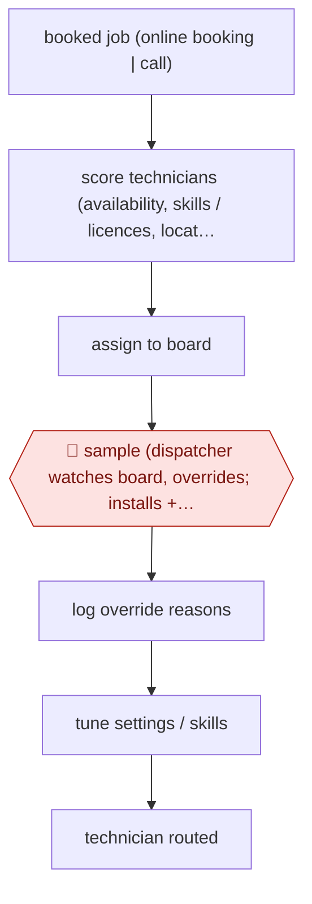

# Dispatcher-overridden job assignment

`unplaced` (proposed: `ORG › FSV › DISPATCH`) · sampled · evidence B · **draft: needs a reference example** ([how to add one](../../../CONTRIBUTING.md#1-add-an-example-run))

**Shape:** `booked job (online booking | call) → score technicians (availability, skills / licences, location, performance, revenue potential) → assign to board → 🛑 sample (dispatcher watches board, overrides; installs + follow-ups kept manual) → log override reasons → tune settings / skills → technician routed`
**How it differs:** None close. Closest by checkpoint style are sampled routing workflows like AWF-0150 (email-to-order), but the deliverable here is a technician schedule, and humans audit by overriding the live board rather than handling unresolved items.
**Variants:** `servicetitan-dispatch-pro` · `domo-roborouter`

<!-- shape diagram: generated by scripts/build_diagrams.py from `shape`; don't edit -->

<!-- end shape diagram -->

## Background

A field service business lives on the dispatch board: jobs arrive through a booking link or a phone call, and someone decides which technician goes. That decision is a small optimisation with soft constraints — who is free, who is licensed for this equipment, who is close, who is fast, who will sell the follow-up — and it is repeated all day, which is why dispatchers are expensive and why their judgement walks out the door when they leave. An agent that scores technicians on those dimensions and assigns the work gets most of it right, and the interesting design is what happens when it does not. The dispatcher keeps watching the board, overrides what they disagree with, and — critically — the reason is logged, because the override rate is the only honest measure of whether the algorithm has learned the business. At one contractor it started around 40% and settled near 10% over months of tuning skills and settings. Installations and follow-ups stay manual, which is the right boundary: complex work with a sales and sequencing dimension is where the model has least to go on.

**Terms:**
- **dispatch board**: the schedule of jobs and technicians that the office works from.
- **override**: a dispatcher changing an assignment the agent made.
- **override rate**: overrides as a share of assignments, the metric this workflow is judged on.
- **skills matrix**: which technician is licensed and trained for which work.
- **recency-weighted score**: a performance score that counts recent jobs more than old ones.
- **capacity planning**: deciding how much work to accept, upstream of dispatch.
- **follow-up**: a return visit after an install or repair, often kept manual.
- **revenue potential**: the expected value of a job, including upsell, used as a scoring input.

## Build it with an agent

**Form:** `service`. Jobs arrive continuously through booking and phone, the board is assigned as they land, and dispatchers supervise by exception rather than by approving each assignment. Nobody starts a run; the queue is the day. That is a service — not a skill a dispatcher invokes and not a project holding anything per customer.

**You need:** the booking and job data with the constraints that actually bind — licences by region, equipment certifications, warranty terms; a skills matrix that is maintained, since the score is only as good as it; travel times that reflect this business's geography rather than a national average; the revenue-per-job history, if revenue is going to be a scoring input, because that input shapes behaviour; an override reason taxonomy, since a rate without reasons teaches nothing; and dispatchers with authority to override without asking. The agent must not dispatch a job that legally requires a licence the technician lacks, and must not treat the override as noise: every override is either a bug in the score or a change in the business.

| Step | Built as |
|---|---|
| booked job (online booking | call) | Two intake paths into one board, with the online path drawing from capacity planning so the booking link cannot offer a slot the day cannot serve. |
| score technicians (availability, skills / licences, location, performance, revenue potential) | A scoring pass over eligible technicians only — licence and certification filter first, ranking second, so an ineligible assignment is impossible rather than merely unlikely. |
| assign to board | The board is assigned automatically as jobs land, which is what makes the dispatcher's attention available for exceptions. |
| 🛑 sample (dispatcher watches board, overrides; installs + follow-ups kept manual) | Dispatchers watch and override; complex work stays manual, and the override is one action on the board rather than a ticket to change a setting. |
| log override reasons | The reason is captured at the moment of override, in a short taxonomy, because reasons reconstructed later are rationalisations. |
| tune settings / skills | Skill and setting changes are made from the override log, which is also where a pattern of overrides becomes a defect report. |
| technician routed | The technician receives the assignment with what they need to know, and the dispatcher's override, if any, is what they see. |

**Checkpoints:** `sample`: the dispatcher's supervision is the check — sampling the live board rather than reviewing output after the fact — and the override rate over time is the measure of whether the agent has earned autonomy on this business's work.

**Since the sources:** Sources date from 2026-06-01 and 2026-06-22, and neither was re-opened on this pass. What has changed since: the vendor behind one of them has started publishing aggregate results for the package this workflow depends on, and the results are the kind that need reading carefully. The figures released on 2026-06-24 compare customers on the package with peers — call booking rates up over 500 basis points, close rates up over 1,000 — with no stated cohort sizes, no baseline period and no control beyond "similar businesses not on Max", and the package was in limited release at the time. That is a vendor's comparison, not the controlled measure this entry's override rate is. The more substantive change is scope: the same release describes agents that throttle demand generation to match available capacity, alongside voice agents that book calls and a field co-pilot that answers equipment questions mid-job. Routing a job is one decision in that set; deciding how much demand to accept is a different one, and it is upstream of everything on this board. A build that adds capacity throttling inherits a commercial decision, not a scheduling one, and should say so rather than treating it as another scoring input.

*A design based on this entry's steps and the tool documentation as of 2026-11, not a reported run.*

## Steps

*As reported by the sources.*

1. Customers book through an online link that shows open times from capacity planning, or calls are booked by the office [[1]](#sources).
2. The dispatch agent assigns each job to a technician based on skills, location and revenue potential [[1]](#sources). T3's in-house RoboRouter ranks technicians in real time by availability, skills (including region-specific licences) and a recency-weighted performance score [[2]](#sources).
3. 🛑 **Sample**: dispatchers watch the board and change assignments they disagree with; at Esser overrides fell from about 40% of assignments early on to around 10% [[1]](#sources). T3 keeps installs and follow-up appointments manual and focuses dispatchers on exceptions [[2]](#sources).
4. Override reasons are tracked to improve the algorithm; teams adjust technician skills and settings [[1]](#sources)[[2]](#sources).

**Output:** A populated dispatch board / technician schedule in the field service management system.
**Failure modes → guards:** Wrong tech for the job early on → dispatcher overrides and skill/setting tuning (40% to ~10%) [1]. Dispatchers reject a slow tool → T3 cut runtime from 15-20 minutes to under five [2]. Tribal knowledge lost when dispatchers leave → decision logic codified [2].

## Public runs

Coverage as of 2026-11-13: **Weak**: only anonymous, vendor-linked or journalist-told accounts. Collected and re-checked in [Third collection pass](../../../research/2026-11-third-pass.md).

- [ServiceTitan, Esser Air](https://www.servicetitan.com/blog/success-story-esser-air-ai-dispatch-automation) (2026-06-22). Office manager describes overriding the dispatch agent's assignments less over time. "the team changed the software's assignments about 40% of the time" ... "Today that number is around 10%.". *First-hand: vendor; confidence: med.*
- [Domo, T3 Services Group RoboRouter](https://www.domo.com/blog/human-loop-ai-roborouter-dispatch) (2026-06-01). CIO's own in-house dispatch system across seven locations; humans keep exceptions. "they reduced runtime from 15–20 minutes down to under five minutes". *First-hand: vendor; confidence: med.*

## Sources

1. Pat McManamon, ServiceTitan, AI and ServiceTitan surprised everyone at Esser Air by changing more than processes, 2026-06-22. https://www.servicetitan.com/blog/success-story-esser-air-ai-dispatch-automation
2. Grant Stowell, Domo, Human-in-the-Loop Operational AI: How T3 Services Group Standardizes Dispatch Without Losing the Human Touch (Domopalooza 2026 session by T3 CIO Mike McDonald), 2026-06-01. https://www.domo.com/blog/human-loop-ai-roborouter-dispatch
3. ServiceTitan, ServiceTitan's Max drives AI-powered growth for contractors (aggregate performance data, 2026-06-24). https://www.servicetitan.com/press/servicetitans-max-drives-ai-powered-growth-for-contractors
