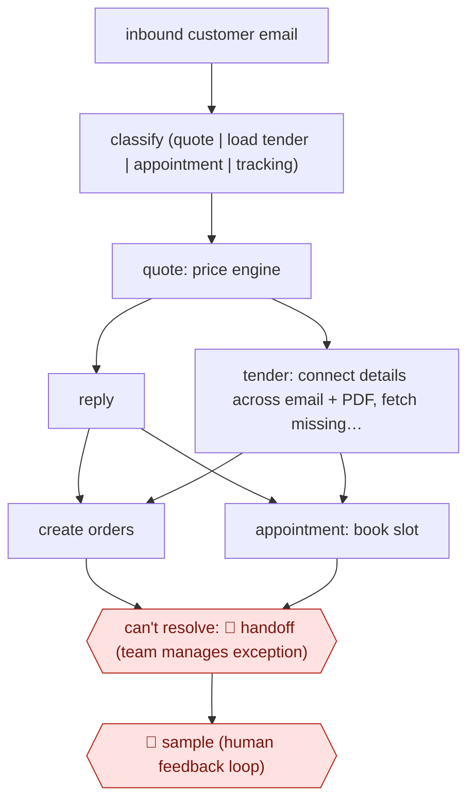

# Email-to-order freight agents

`unplaced` (proposed: `ORG › LOG › FREIGHT`) · sampled · evidence A · **draft: needs a reference example** ([how to add one](../../../CONTRIBUTING.md#1-add-an-example-run))

**Shape:** `inbound customer email → classify (quote | load tender | appointment | tracking) → quote: price engine → reply | tender: connect details across email + PDF, fetch missing info → create orders | appointment: book slot → can't resolve: 🛑 handoff (team manages exception) → 🛑 sample (human feedback loop)`
**How it differs:** AWF-0021 Procedure agent answers customers and performs authenticated transactions. Here there is no conversation: email is turned into operational records, and people handle only exceptions.
**Why unplaced:** no class in taxonomy.yaml covers this yet. It is filed here until three similar workflows justify a new class `FREIGHT` (TAXONOMY.md rule 2).
**Variants:** `langgraph` · `azure-openai`

<!-- shape diagram: generated by scripts/build_diagrams.py from `shape`; don't edit -->

<!-- end shape diagram -->

## Steps
1. Classify incoming emails by request type, including truckload, less-than-truckload (LTL), intermodal and air [[1]](#sources)[[3]](#sources).
2. Quotes: read the request, query the Dynamic Pricing Engine and reply [[2]](#sources).
3. Load tenders: connect details across the email and attachments (including handwritten PDF notes), detect and fetch missing data, and create orders; 20 loads are processed in parallel [[1]](#sources).
4. Appointments: extract details and lock in pickup or delivery slots [[1]](#sources).
5. 🛑 **Handoff**: workflows are built 'so that if something doesn't go right, that's what our managers work on' [[4]](#sources).
6. 🛑 **Sample**: a 'human feedback loop' on classification [[3]](#sources).

**Output:** Orders, quotes and appointments written into the transport system.
**Failure modes → guards:** Ambiguous tenders ('I have a load for Tuesday') → customer-history context fills the gaps. Unhandled cases → exception queue for managers.

## Public runs

Coverage as of 2026-11-06: **Strong**: a first-hand, detailed run that matches most of the shape. Collected and re-checked in [Second collection pass](../../../research/2026-11-second-pass.md).

- [C.H. Robinson, freight lifecycle press release](https://www.chrobinson.com/en-us/about-us/newsroom/press-releases/2024/generative-ai-for-freight-shipment-lifecycle/) (2024-10-31). Quotes, tenders and appointments automated from email. "The tech is turning emails into 5,500 shipment orders a day, achieved in 90 seconds.". *First-hand: yes; confidence: high.*

## Sources

1. C.H. Robinson, press release: generative AI for freight shipment lifecycle, 2024-10-31. https://www.chrobinson.com/en-us/about-us/newsroom/press-releases/2024/generative-ai-for-freight-shipment-lifecycle/
2. Mike Neill, C.H. Robinson, How C.H. Robinson ensures ROI from agentic AI, 2026-01-06. https://www.chrobinson.com/en-us/resources/blog/how-chrobinson-ensures-roi-from-agentic-ai/
3. Microsoft, C.H. Robinson customer story. https://www.microsoft.com/en/customers/story/19575-ch-robinson-azure-ai-studio
4. Victoria Kickham, DC Velocity, Putting artificial intelligence to work, 2025-01-23. https://www.dcvelocity.com/technology/artificial-intelligence/putting-artificial-intelligence-to-work
