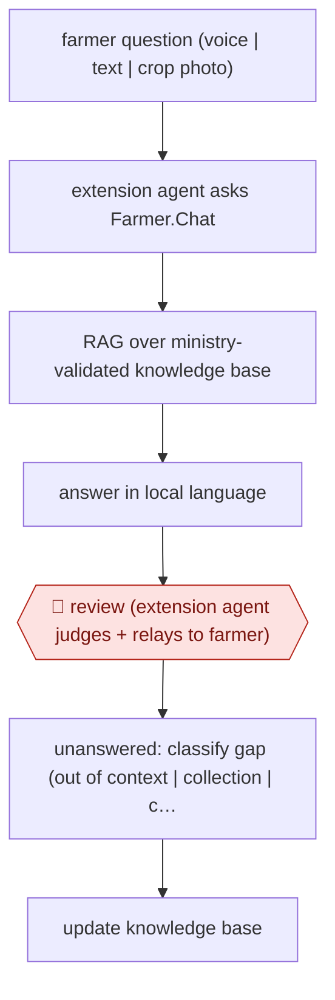

# Extension-agent mediated advice

`unplaced` (proposed: `ORG › AGR › ADVISORY`) · assist · evidence A · **draft: needs a reference example** ([how to add one](../../../CONTRIBUTING.md#1-add-an-example-run))

**Shape:** `farmer question (voice | text | crop photo) → extension agent asks Farmer.Chat → RAG over ministry-validated knowledge base → answer in local language → 🛑 review (extension agent judges + relays to farmer) → unanswered: classify gap (out of context | collection | content) → update knowledge base`
**How it differs:** Closest AWF-0154 Plot-registered agronomy advice: that runs a season-long, plot-specific nutrient plan with farmer plot verification and technician handoff. This is on-demand Q&A for any crop or topic, with no plot model, where the human checkpoint is an extension agent reviewing every answer before it reaches the farmer (assist, not checkpointed).
**Variants:** `farmer-chat`

<!-- shape diagram: generated by scripts/build_diagrams.py from `shape`; don't edit -->

<!-- end shape diagram -->

## Steps
1. A curated knowledge base is built from training-video transcripts, annotated call-centre logs and crop research factsheets; India's Ministry of Agriculture validates all documents in it [[2]](#sources).
2. An extension agent (or lead farmer) asks the question by text, voice or crop photo; the assistant retrieves from the knowledge base (RAG) and answers in the local language, with weather and disease diagnosis services [[1]](#sources)[[2]](#sources).
3. 🛑 **Review**: in the initial rollout the chatbot was deployed as an assistant to extension agents, not directly to farmers, so the agent reviews the advice before passing it on [[2]](#sources).
4. Unanswered queries are classified with an LLM into out-of-context, out-of-collection and out-of-content; content gaps drive knowledge-base additions [[1]](#sources).

**Output:** An advisory answer the extension agent relays to the farmer; a log of unanswered queries that feeds knowledge-base updates.
**Failure modes → guards:** Chatbot advises farmers in error → curated KB and extension agent as the review stage [2]. Knowledge gaps: 66% of unanswered queries were content gaps → gap classification and KB updates [1].

## Public runs

Coverage as of 2026-11-13: **Strong**: a first-hand, detailed run that matches most of the shape. Collected and re-checked in [Third collection pass](../../../research/2026-11-third-pass.md).

- [Digital Green, Farmer.Chat (arXiv 2409.08916)](https://arxiv.org/abs/2409.08916) (2024-10-08). Kenya, India, Ethiopia, Nigeria deployment; extension agents, lead farmers and farmers as users. "Deployed in four countries, Farmer.Chat has engaged over 15,000 farmers and answered over 300,000 queries.". *First-hand: yes; confidence: high.*
- [OpenAI, Digital Green](https://openai.com/index/digital-green/) (n.d.). CEO explains extension-agent-first rollout as a human review stage. "As of January 1, 2024, over 4,500 extension agents are using Farmer.Chat across both Kenya and India.". *First-hand: vendor; confidence: med.*

## Sources

1. Namita Singh et al. (Digital Green), Farmer.Chat: Scaling AI-Powered Agricultural Services for Smallholder Farmers, arXiv 2409.08916, 2024-09-13 (v2 2024-10-08). https://arxiv.org/abs/2409.08916
2. OpenAI, Digital Green customer story (Farmer.Chat). https://openai.com/index/digital-green/
