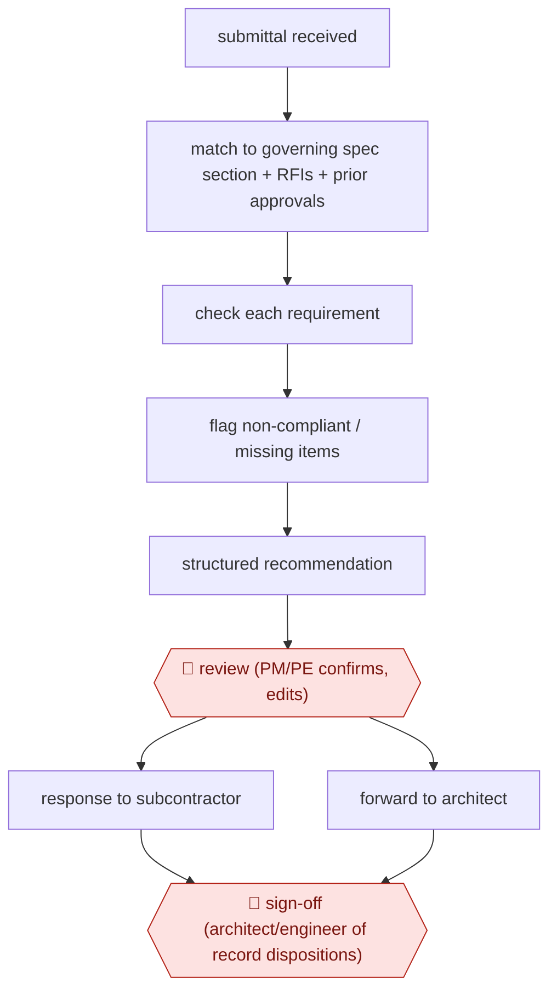

# First-pass submittal review

`unplaced` (proposed: `TEC › ENG › SUBMITTAL`) · checkpointed · evidence B · **draft: needs a reference example** ([how to add one](../../../CONTRIBUTING.md#1-add-an-example-run))

**Shape:** `submittal received → match to governing spec section + RFIs + prior approvals → check each requirement → flag non-compliant / missing items → structured recommendation → 🛑 review (PM/PE confirms, edits) → response to subcontractor | forward to architect → 🛑 sign-off (architect/engineer of record dispositions)`
**How it differs:** AWF-0058 Cited pre-screen checks screens a permit applicant's plan set for code compliance. Here the contractor checks a subcontractor's product data and shop drawings against the project spec. Different deliverable (submittal response) and different approver (PM, then architect of record).
**Why unplaced:** no class in taxonomy.yaml covers this yet. It is filed here until three similar workflows justify a new class `SUBMITTAL` (TAXONOMY.md rule 2).
**Variants:** `trunk-tools` · `procore-datagrid`

<!-- shape diagram: generated by scripts/build_diagrams.py from `shape`; don't edit -->

<!-- end shape diagram -->

## Steps
1. When a submittal arrives, compare it to project specifications, relevant RFI responses and previously approved submittals [[1]](#sources).
2. Flag non-compliant line items and generate a structured recommendation 'in minutes' [[1]](#sources).
3. 🛑 **Review**: the assistant PM or project engineer acts on the analysis and responds to the subcontractor [[1]](#sources).
4. 🛑 **Sign-off**: approval stays with the reviewer of record; Procore's agents 'require human consent before actions are finalized' [[2]](#sources).

**Output:** Corrected submittal routed to the architect, so it doesn't come back as Revise and Resubmit.
**Failure modes → guards:** Missed non-compliance shows up in the field → requirement-by-requirement check. Superseded specs → reads the current project set from the project-management system.

## Public runs

Coverage as of 2026-11-06: **Partial**: first-hand runs that cover part of the shape or put checkpoints elsewhere. Collected and re-checked in [Second collection pass](../../../research/2026-11-second-pass.md).

- [Trunk Tools, Cleveland Construction](https://trunktools.com/content/customers/pdfs/cleveland.pdf) (n.d.). Electrical submittal turned around the same day; quotes from the assistant PM. "estimated savings of 790+ hours and $60K+ across four projects". *First-hand: vendor; confidence: med.*
- [ENGtechnica, Procore/Datagrid](https://engtechnica.com/procore-embeds-datagrid-ai-agents-in-construction-workflows/) (2026-05-22). Level 10 Construction built its own submittal agent. "We ran 10 submittal reviews in an hour using our agent, easily saving 12 hours of work". *First-hand: interview; confidence: med.*

## Sources

1. Trunk Tools, Case Study: Cleveland Construction x ACC x Trunk Tools. https://trunktools.com/content/customers/pdfs/cleveland.pdf
2. Joydeep Kar, ENGtechnica, Procore Embeds Datagrid AI Agents in Construction Workflows, 2026-05-22. https://engtechnica.com/procore-embeds-datagrid-ai-agents-in-construction-workflows/
3. Procore, Bernards case study, 2026-11-02. https://www.procore.com/casestudies/bernards-ai
