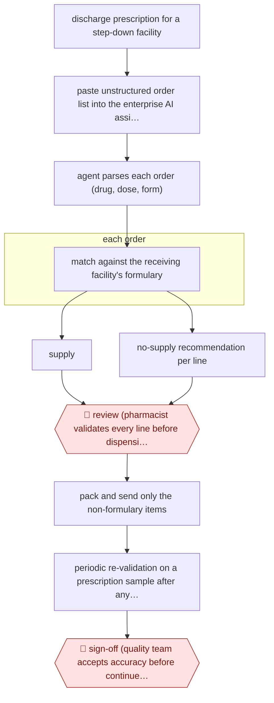

# Formulary-checked discharge supply

`unplaced` (proposed: `PRO › HLT › PHARMACY`) · assist · evidence A · **draft: needs a reference example** ([how to add one](../../../CONTRIBUTING.md#1-add-an-example-run))

**Shape:** `discharge prescription for a step-down facility → paste unstructured order list into the enterprise AI assistant → agent parses each order (drug, dose, form) → each order: match against the receiving facility's formulary → supply | no-supply recommendation per line → 🛑 review (pharmacist validates every line before dispensing; false negatives are the feared error) → pack and send only the non-formulary items → periodic re-validation on a prescription sample after any dispensing-system change → 🛑 sign-off (quality team accepts accuracy before continued use)`
**How it differs:** The one existing pharmacy entry, AWF-0215 Pharmacist-verified script entry, is a checkpointed RPA bot keying prescriptions into the pharmacy management system with two sequential pharmacist verifications (QV1/QV2) before dispensing. Swap test fails: the deliverable here is a per-line supply/no-supply decision against another institution's formulary at a care transition (not a data-entered prescription record), there is one pharmacist review rather than a two-stage verification chain, autonomy is assist (no skip-and-log autonomy band), and the workflow carries its own re-validation gate after a system change.
**Variants:** `pair-govtech-assistant` · `pairchat-epic-assistants`

<!-- shape diagram: generated by scripts/build_diagrams.py from `shape`; don't edit -->

<!-- end shape diagram -->

## Steps
1. A hospital pharmacy receives a discharge prescription for a patient transferring to a step-down facility (community hospital or nursing home) that supplies some medicines from its own formulary. Order data is copied out of the dispensing system and is unstructured, which rules out spreadsheet macros [[1]](#sources).
2. Pharmacy staff — without programming expertise — configured an assistant on Pair, the government AI platform approved for Restricted/Sensitive Normal data, to hold the receiving facility's formulary and the supply rules [[1]](#sources).
3. The pasted order list is parsed and each medication line is cross-checked against that facility's formulary; the assistant returns a supply / no-supply recommendation per line in real time [[1]](#sources).
4. 🛑 **Review**: a pharmacist validates each recommendation before the supply decision is finalised. The paper is explicit that the system must remain decision support with mandatory human oversight, because a false negative means a needed medicine is not supplied [[1]](#sources).
5. Only the recommended items are dispensed for the transfer, cutting oversupply and waste at the receiving facility [[1]](#sources).
6. 🛑 **Sign-off**: the pharmacy re-ran the technical evaluation on a fresh sample of 100 prescriptions after the hospital moved from iPharm to the National Harmonised Integrated Pharmacy System in June 2025, before continuing to rely on the assistant; accuracy held at 99.4% and false negatives fell from three to zero [[1]](#sources).
7. Sibling deployment at the same hospital shows the pattern generalises: two LLM assistants built on the same platform (EPIC Notes Analyser; Medication Change Identification) sit in discharge prescription processing with the same mandatory-validation rule, monitored through continuous feedback across 63 unique users [[2]](#sources).

**Output:** A validated per-line supply decision for a transferring patient's discharge prescription, used to pack the transfer supply; accuracy and time-motion metrics feed the pharmacy's quality review.
**Failure modes → guards:** False negatives omit a needed medicine → mandatory per-line pharmacist validation and a false-negative-focused error taxonomy. Drift when the dispensing system changes the output format → full re-evaluation on a new 100-prescription sample after the system migration. Staff overestimate the saving (92.3% perceived >3 minutes saved per prescription against ~48 seconds measured) → time-motion measurement rather than self-report. Weekend rotating staff unfamiliar with facility rules → the assistant carries the formulary rather than the roster.

## Public runs

Coverage as of 2026-11-13: **Strong**: a first-hand, detailed run that matches most of the shape. Collected and re-checked in [Fourth collection pass](../../../research/2026-11-fourth-pass.md).

- [Tan, Yew & Phua, Evaluation of an AI-Assisted Decision Support for Medication Supply in Stepdown Care Transitions](https://www.rescp.org/journal/view.html?uid=311&vmd=Full&year=) (2025-12-31). Prospective hospital evaluation with pharmacist validation of every recommendation. "The AI assistant achieved 99.5% overall accuracy in the former system and 99.4% in the new system"; "a 68.5% reduction in processing time per medication (median 5.4 to 1.7 seconds)". *First-hand: yes; confidence: high.*
- [Tan W.Q. et al., Integration of AI Powered Co-Pilot Tools for Discharge Prescription Processing Efficiency](https://www.rescp.org/journal/view.html?uid=218&vmd=Full&year=) (2025-12-31). Same hospital, same mandatory-validation rule, in discharge processing. "an average of 17% reduction in processing time"; "analysis of 1,219 utilisations". *First-hand: yes; confidence: high.*

## Sources

1. Tan, C.J.Y., Yew, W.K. & Phua, C.J. (Division of Pharmacy, Tan Tock Seng Hospital), Evaluation of an Artificial intelligence (AI)-Assisted Decision Support for Medication Supply in Stepdown Care Transitions, R Clin Pharm, published online 31 December 2025. https://www.rescp.org/journal/view.html?uid=311&vmd=Full&year=
2. Tan, W.Q. et al. (Tan Tock Seng Hospital), Integration of AI Powered Co-Pilot Tools for Discharge Prescription Processing Efficiency, R Clin Pharm 2025;3(Suppl 1):S4. https://www.rescp.org/journal/view.html?uid=218&vmd=Full&year=
