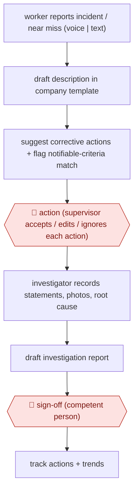

# Incident-to-signed investigation

`unplaced` (proposed: `ORG › BIZ › EHS`) · assist · evidence B · **draft: needs a reference example** ([how to add one](../../../CONTRIBUTING.md#1-add-an-example-run))

**Shape:** `worker reports incident / near miss (voice | text) → draft description in company template → suggest corrective actions + flag notifiable-criteria match → 🛑 action (supervisor accepts / edits / ignores each action) → investigator records statements, photos, root cause → draft investigation report → 🛑 sign-off (competent person) → track actions + trends`
**How it differs:** Closest AWF-0152 Layered safety audit agents: that audits a site's safety documentation against criteria and produces an audit report (multi-agent, reviewed once). This handles a single incident from report to signed investigation, with a per-action acceptance and a competent-person sign-off; deliverable and checkpoints differ.
**Variants:** `safety-space` · `custom-gpt`

<!-- shape diagram: generated by scripts/build_diagrams.py from `shape`; don't edit -->

<!-- end shape diagram -->

## Steps
1. A worker reports the incident or near miss on the mobile app by voice or text [[2]](#sources). At Sundt, the safety manager's field description is reformatted by a custom GPT into the standard incident template before it goes on the report [[1]](#sources).
2. The AI reads the description, suggests corrective actions, and flags descriptions that match notifiable-incident criteria for a person to check; it does not decide notifiability [[2]](#sources).
3. 🛑 **Action**: the supervisor or safety manager accepts, edits or ignores each suggested action; nothing is assigned until a person says so [[2]](#sources).
4. People take statements, attach photos and record the root cause; the AI does nothing at this stage [[2]](#sources).
5. The AI drafts the investigation report from the record (description, people, timeline, contributing factors, root cause, actions) [[2]](#sources).
6. 🛑 **Sign-off**: a competent person reviews, edits and signs off the report [[2]](#sources). At Sundt the group HS&E manager formally reports and tracks it [[1]](#sources).

**Output:** A signed investigation report and assigned corrective actions in the EHS system, feeding trend analysis.
**Failure modes → guards:** Inconsistent free-text descriptions hurt trend analysis → standard template reformatting [1]. Over-reliance on AI for regulatory notification → AI only flags; the notification decision stays with people [2].

## Public runs

Coverage as of 2026-11-13: **Partial**: first-hand runs that cover part of the shape or put checkpoints elsewhere. Collected and re-checked in [Third collection pass](../../../research/2026-11-third-pass.md).

- [Sundt, A Smarter Way to Stay Safe](https://www.sundt.com/2026/a-smarter-way-to-stay-safe/) (2026-08-17). HS&E team built IDA custom GPT to template incident descriptions before reporting; covers only the drafting step. "nearly 1,739 incident reports that came through in 2025". *First-hand: yes; confidence: med.*

## Sources

1. Reed Lenker, Sundt, A Smarter Way to Stay Safe, 2026-08-17. https://www.sundt.com/2026/a-smarter-way-to-stay-safe/
2. Safety Space, AI-Assisted Incident Reporting: Describe It, AI Drafts the Rest, 2026-10-23. https://safetyspace.co/ai-incident-reporting
