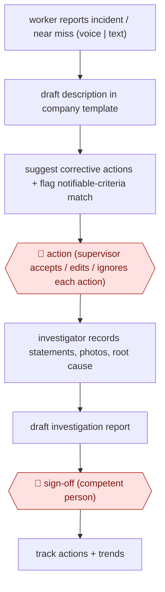

# Incident-to-signed investigation

`unplaced` (proposed: `ORG › BIZ › EHS`) · assist · evidence B · **draft: needs a reference example** ([how to add one](../../../CONTRIBUTING.md#1-add-an-example-run))

**Shape:** `worker reports incident / near miss (voice | text) → draft description in company template → suggest corrective actions + flag notifiable-criteria match → 🛑 action (supervisor accepts / edits / ignores each action) → investigator records statements, photos, root cause → draft investigation report → 🛑 sign-off (competent person) → track actions + trends`
**How it differs:** Closest AWF-0152 Layered safety audit agents: that audits a site's safety documentation against criteria and produces an audit report (multi-agent, reviewed once). This handles a single incident from report to signed investigation, with a per-action acceptance and a competent-person sign-off; deliverable and checkpoints differ.
**Variants:** `safety-space` · `custom-gpt`

<!-- shape diagram: generated by scripts/build_diagrams.py from `shape`; don't edit -->

<!-- end shape diagram -->

## Background

A worker who has just been hurt, or nearly hurt, writes a few lines on a phone and that becomes the record a regulator reads months later. The quality of those lines decides everything downstream: whether the incident can be trended against others, whether the right corrective action is assigned, whether a notification to the safety regulator is filed inside its deadline, and whether an investigation can establish a root cause rather than a story. Most of the failure is not analytical but clerical — descriptions in incompatible free text, actions assigned to nobody, a report assembled from memory a week later. A model can lift that clerical load: reformat the description into the company template as it is filed, propose corrective actions from comparable incidents, flag whether the description matches any of the criteria that trigger a mandatory notification, and draft the investigation report once the investigator has done the human work of taking statements, attaching photographs and settling on a cause. The decision on whether to notify stays with a person, deliberately, because a wrong notification and a missed one are both serious and only one of them is reversible.

**Terms:**
- **incident / near miss**: an event that caused harm, or could have.
- **corrective action**: a change assigned to a named owner to remove the cause.
- **notifiable incident**: an event that must be reported to the safety regulator within a legal deadline.
- **competent person**: the role legally entitled to sign an investigation's conclusions.
- **root cause**: the underlying condition, as opposed to the immediate act.
- **free-text description**: the reporter's own words, which must be kept, not replaced.
- **trend analysis**: comparing incidents across time and site to find patterns.
- **EHS system**: the environmental, health and safety record system of record.

## Build it with an agent

**Form:** `service`. Reports arrive continuously from phones, each one triggers a fixed pipeline, and the outputs land in a queue for supervisors and investigators. Nobody starts a run per incident, the volume is set by what happens on site, and people appear at the action gate and the signature — a queue with gates, not a per-user tool.

**You need:** the report as filed, with the reporter's own words preserved alongside any rewrite, because the original phrasing is evidence; the company template and the criteria list for notifiable incidents, versioned, since those criteria are legal; the action library from past incidents, so proposals are grounded in what the organisation has actually done before; a route by which each proposed action reaches a named owner or is explicitly dropped; the investigator's own material — statements, photographs, measurements — as attachments to the report rather than text pasted into it; and a signature route for the competent person. The agent must not decide notifiability, must not assign an action to a person on its own, and must not write a root cause the investigator has not reached.

| Step | Built as |
|---|---|
| worker reports incident / near miss (voice | text) | Intake on a phone, by voice or text, with the original recording or text stored next to the transcript, since the reporter's phrasing may matter to an investigation. |
| draft description in company template | A rewrite into the template's fields that keeps the original alongside it, so the standardisation helps trend analysis without destroying the evidence. |
| suggest corrective actions + flag notifiable-criteria match | Proposals drawn from comparable past incidents, and a flag when the description matches a notification criterion — a flag for a person to check, never a decision, because both a wrong notification and a missed one are serious. |
| 🛑 action (supervisor accepts / edits / ignores each action) | Each proposal is accepted, edited or ignored individually, and nothing is assigned until a person does that; the record shows which proposals were dropped. |
| investigator records statements, photos, root cause | The human stage, deliberately outside the model: interviews, photographs and the causal judgement, attached to the case rather than summarised by it. |
| draft investigation report | The report is assembled from the case file — description, people, timeline, contributing factors, actions — with each section traceable to the record it came from. |
| 🛑 sign-off (competent person) | A competent person reviews, edits and signs; the build has no path to a signed report, which keeps the legal role with the person who holds it. |
| track actions + trends | Actions are tracked to closure and incidents are compared across sites; the trend view is the output that justifies the whole pipeline. |

**Checkpoints:** `action`: the supervisor decides per action, which is where safety ownership actually sits — a model can propose, but assigning work to a named person is a management act. `sign-off`: the competent person signs, and the entry's evidence is thin on how that role is exercised in practice, so the build keeps the signature as an absolute gate rather than a review step.

**Since the sources:** Sources date from 2026-08-17 and 2026-10-23 and are recent enough that no newer account was found as of 2026-11; neither was re-opened on this pass. What the entry leaves out, and what the regulatory clock makes urgent, is timing. Under 29 CFR 1904.39 a work-related fatality must be reported to the US regulator within 8 hours of learning of it, and an in-patient hospitalisation, amputation or loss of an eye within 24 hours; failure to report inside those windows is treated as a separate violation, and recordable cases have to be entered on the log within 7 days. That changes the design requirement in a way the shape does not show: the notifiable-criteria flag has to reach a person within the reporting window, which means the drafting and flagging steps cannot sit in a queue overnight and still be worth having. The practical fix is a two-speed pipeline — flag on arrival, draft afterwards — and a rota that names who receives the flag outside working hours. The entry's decision to flag rather than decide remains right; what it needs is a deadline attached to the flag.

*A design based on this entry's steps and the tool documentation as of 2026-11, not a reported run.*

## Steps

*As reported by the sources.*

1. A worker reports the incident or near miss on the mobile app by voice or text [[2]](#sources). At Sundt, the safety manager's field description is reformatted by a custom GPT into the standard incident template before it goes on the report [[1]](#sources).
2. The AI reads the description, suggests corrective actions, and flags descriptions that match notifiable-incident criteria for a person to check; it does not decide notifiability [[2]](#sources).
3. 🛑 **Action**: the supervisor or safety manager accepts, edits or ignores each suggested action; nothing is assigned until a person says so [[2]](#sources).
4. People take statements, attach photos and record the root cause; the AI does nothing at this stage [[2]](#sources).
5. The AI drafts the investigation report from the record (description, people, timeline, contributing factors, root cause, actions) [[2]](#sources).
6. 🛑 **Sign-off**: a competent person reviews, edits and signs off the report [[2]](#sources). At Sundt the group HS&E manager formally reports and tracks it [[1]](#sources).

**Output:** A signed investigation report and assigned corrective actions in the EHS system, feeding trend analysis.
**Failure modes → guards:** Inconsistent free-text descriptions hurt trend analysis → standard template reformatting [1]. Over-reliance on AI for regulatory notification → AI only flags; the notification decision stays with people [2].

## Public runs

Coverage as of 2026-11-13: **Partial**: first-hand runs that cover part of the shape or put checkpoints elsewhere. Collected and re-checked in [Third collection pass](../../../research/2026-11-third-pass.md).

- [Sundt, A Smarter Way to Stay Safe](https://www.sundt.com/2026/a-smarter-way-to-stay-safe/) (2026-08-17). HS&E team built IDA custom GPT to template incident descriptions before reporting; covers only the drafting step. "nearly 1,739 incident reports that came through in 2025". *First-hand: yes; confidence: med.*

## Sources

1. Reed Lenker, Sundt, A Smarter Way to Stay Safe, 2026-08-17. https://www.sundt.com/2026/a-smarter-way-to-stay-safe/
2. Safety Space, AI-Assisted Incident Reporting: Describe It, AI Drafts the Rest, 2026-10-23. https://safetyspace.co/ai-incident-reporting
3. ClickSafety, OSHA Recordkeeping Requirements for 2026, covering the 8-hour and 24-hour reporting deadlines under 29 CFR 1904.39 and the 7-day entry rule. https://www.clicksafety.com/blog/osha-recordkeeping-requirements-for-2026
