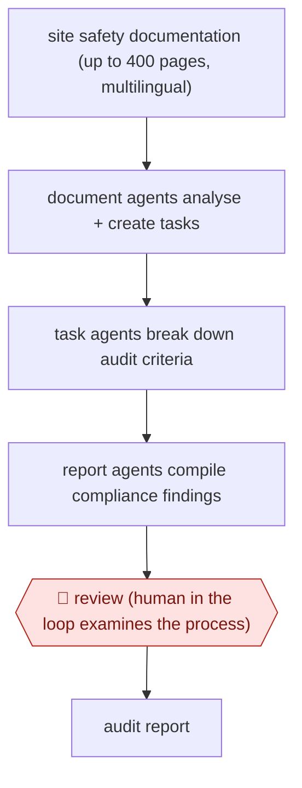

# Layered safety audit agents

`unplaced` (proposed: `ORG › BIZ › EHS`) · checkpointed · evidence B · **draft: needs a reference example** ([how to add one](../../../CONTRIBUTING.md#1-add-an-example-run))

**Shape:** `site safety documentation (up to 400 pages, multilingual) → document agents analyse + create tasks → task agents break down audit criteria → report agents compile compliance findings → 🛑 review (human in the loop examines the process) → audit report`
**How it differs:** AWF-0040 Full-population control testing is a financial audit with evidence on every control. Here the work is an operational safety audit over site documentation, with one human review of the agent process.
**Why unplaced:** no class in taxonomy.yaml covers this yet. It is filed here until three similar workflows justify a new class `EHS` (TAXONOMY.md rule 2).
**Variants:** `claude-vertex`

<!-- shape diagram: generated by scripts/build_diagrams.py from `shape`; don't edit -->

<!-- end shape diagram -->

## Background

A safety audit of an operating site means reading what the site says it does — procedures, permits, inspection records, training logs, sometimes 400 pages across several languages — and checking it against a set of criteria that come from the regulator, the insurer and the client. It is reading work, and reading work is exactly what a model is good at, except that the volume defeats the method most auditors use: skim for the sections you expect, check those closely, trust the rest. Splitting the job across layers is what makes the volume tractable. Document agents read and create tasks, task agents break each audit criterion into the questions it implies, and report agents compile findings against the criteria. A person then examines the process rather than re-reading the site's paperwork, which is a different and weaker check than a full re-audit — and that is the honest description of what this workflow buys: coverage of the whole corpus with one human review, instead of deep reading of a sample by a person. What it must not become is a compliance certificate: a finding is a question for the auditor, and a missed finding in a safety document is the failure that matters.

**Terms:**
- **audit criteria**: the requirements the site is being measured against, from regulator, insurer or client.
- **document agent**: a step that reads a subset of the site's documents and extracts what is relevant.
- **task agent**: a step that turns one audit criterion into the specific questions to ask of the documents.
- **report agent**: a step that compiles findings into the audit report's structure.
- **finding**: a statement that a criterion is met, partly met, or not evidenced.
- **false negative**: a real gap the audit missed, the failure that matters in safety work.
- **multilingual corpus**: documents in more than one language, common on sites with migrant workforces.
- **human in the loop**: a person reviewing the process, as opposed to re-performing the audit.

## Build it with an agent

**Form:** `project`. Each audit has its own corpus, criteria set and report, and the harness — the layer definitions, the criteria decomposition and the report template — persists across audits at a site or a client. That is a project with a repository and a workflow, not a skill run and not a service, since audits are commissioned rather than continuous.

**You need:** the site's documentation as a corpus with a manifest, because an audit that silently misses a document is worse than none; the criteria set written out and versioned, since the decomposition into questions is where the audit's scope is actually decided; language handling that is checked rather than assumed, because a translated procedure can lose the modal verb that carries the obligation; the layer definitions with a rule for what each may conclude, so a document agent cannot pronounce compliance; per-finding citations to the page and clause, without which the human review is of the prose rather than of the evidence; and a reviewer with authority to reject the report. The agent must not issue a compliance conclusion on its own, and must not close a criterion it could not find evidence for — "not evidenced" is the finding, not a pass.

| Step | Built as |
|---|---|
| site safety documentation (up to 400 pages, multilingual) | Ingestion with a manifest and a language check per document, so the corpus is known and the obligation-bearing sentences are readable. |
| document agents analyse + create tasks | Parallel readers over document subsets, each returning extracted passages with their locations and a list of what it could not resolve, which becomes work for the next layer. |
| task agents break down audit criteria | Each criterion is decomposed into the questions it implies, and those questions are what the report answers — this is where scope is set, so it is versioned. |
| report agents compile compliance findings | Findings are assembled per criterion as met, partly met or not evidenced, each with its citations; a criterion with no evidence stays "not evidenced" rather than being filled in. |
| 🛑 review (human in the loop examines the process) | The reviewer checks the decomposition, the citations and the judgement calls, which is a process review rather than a re-audit — the build has no path to issuing the report itself. |

**Checkpoints:** `review`: one human examines the process, and the sources describe this only briefly, which is the entry's main weakness — the check is weaker than a full re-audit by construction, so the build has to make it as strong as it can by attaching evidence to every finding and keeping "not evidenced" as a real outcome.

**Since the sources:** Both sources are undated vendor customer stories, and neither was re-opened on this pass; no newer account was found as of 2026-11. What that means for this entry is worth stating plainly: the two quoted numbers — 14 days to one hour per audit, and about 1,500 audits a year — are the vendor's, with no published accuracy, no false-negative rate and no description of what the human review actually checks. The entry's evidence grade stays B for that reason, and the design has to carry the safety argument instead of the numbers. The one thing the sources do establish is scale, and scale is the argument: an organisation running roughly 1,500 audits a year cannot deep-read 400 pages per audit, so the realistic choice is between sampling deeply and covering shallowly, and this workflow chooses coverage with a human process review on top. Read that way, the missing number is the one that matters most, and it is the number to ask a vendor for: of the findings the audit missed, how many would a full re-audit have caught.

*A design based on this entry's steps and the tool documentation as of 2026-11, not a reported run.*

## Steps

*As reported by the sources.*

1. Document-processing agents analyse the audit documents and create tasks [[1]](#sources).
2. Task-breakdown agents simplify complex audit tasks [[1]](#sources).
3. Report-generation agents compile results into the final audit report [[1]](#sources).
4. 🛑 **Review**: agents handle half the workload; 'the other half, which involves a human in the loop examining the process, remains in place' [[2]](#sources).

**Output:** Safety-management-program audit report (AES runs about 1,500 a year).
**Failure modes → guards:** Missed findings in long, multilingual documents → layered agents plus human examination. The checkpoint is described only briefly.

## Public runs

Coverage as of 2026-11-06: **Weak**: only anonymous, vendor-linked or journalist-told accounts. Collected and re-checked in [Second collection pass](../../../research/2026-11-second-pass.md).

- [Google Cloud, AES](https://cloud.google.com/customers/aes?hl=en) (n.d.). More than 50 agent audits conducted; quotes from AES data science staff. "Our auditors previously spent 14 days completing each audit process. Now, with our Claude-powered agents on Gemini platform, the same work is completed in just one hour". *First-hand: vendor; confidence: med.*

## Sources

1. Anthropic, AES customer story. https://claude.com/customers/aes
2. Google Cloud, AES: Scaling energy safety audits with Claude on Google Cloud. https://cloud.google.com/customers/aes?hl=en
