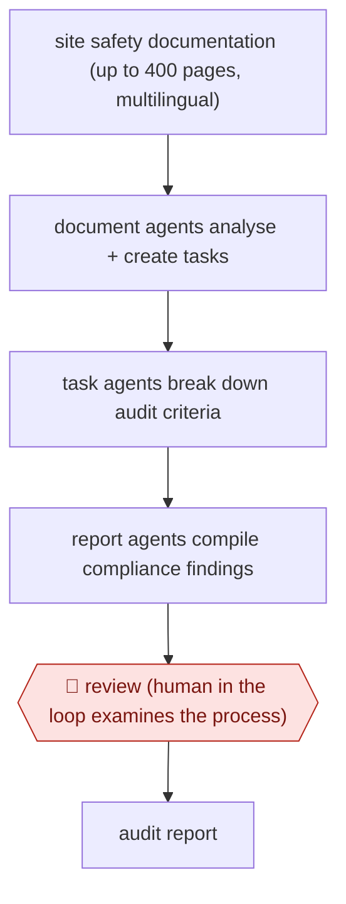

# Layered safety audit agents

`unplaced` (proposed: `ORG › BIZ › EHS`) · checkpointed · evidence B · **draft: needs a reference example** ([how to add one](../../../CONTRIBUTING.md#1-add-an-example-run))

**Shape:** `site safety documentation (up to 400 pages, multilingual) → document agents analyse + create tasks → task agents break down audit criteria → report agents compile compliance findings → 🛑 review (human in the loop examines the process) → audit report`
**How it differs:** AWF-0040 Full-population control testing is a financial audit with evidence on every control. Here the work is an operational safety audit over site documentation, with one human review of the agent process.
**Why unplaced:** no class in taxonomy.yaml covers this yet. It is filed here until three similar workflows justify a new class `EHS` (TAXONOMY.md rule 2).
**Variants:** `claude-vertex`

<!-- shape diagram: generated by scripts/build_diagrams.py from `shape`; don't edit -->

<!-- end shape diagram -->

## Steps
1. Document-processing agents analyse the audit documents and create tasks [[1]](#sources).
2. Task-breakdown agents simplify complex audit tasks [[1]](#sources).
3. Report-generation agents compile results into the final audit report [[1]](#sources).
4. 🛑 **Review**: agents handle half the workload; 'the other half, which involves a human in the loop examining the process, remains in place' [[2]](#sources).

**Output:** Safety-management-program audit report (AES runs about 1,500 a year).
**Failure modes → guards:** Missed findings in long, multilingual documents → layered agents plus human examination. The checkpoint is described only briefly.

## Public runs

Coverage as of 2026-11-06: **Weak**: only anonymous, vendor-linked or journalist-told accounts. Collected and re-checked in [Second collection pass](../../../research/2026-11-second-pass.md).

- [Google Cloud, AES](https://cloud.google.com/customers/aes?hl=en) (n.d.). More than 50 agent audits conducted; quotes from AES data science staff. "Our auditors previously spent 14 days completing each audit process. Now, with our Claude-powered agents on Gemini platform, the same work is completed in just one hour". *First-hand: vendor; confidence: med.*

## Sources

1. Anthropic, AES customer story. https://claude.com/customers/aes
2. Google Cloud, AES: Scaling energy safety audits with Claude on Google Cloud. https://cloud.google.com/customers/aes?hl=en
