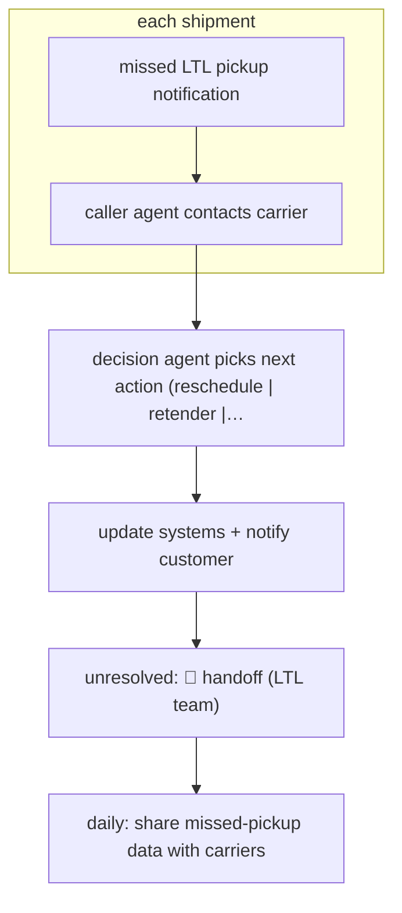

# Missed-pickup call-and-decide

`unplaced` (proposed: `ORG › LOG › FREIGHT`) · sampled · evidence A · **draft: needs a reference example** ([how to add one](../../../CONTRIBUTING.md#1-add-an-example-run))

**Shape:** `missed LTL pickup notification → each shipment: caller agent contacts carrier → decision agent picks next action (reschedule | retender | confirm already picked up) → update systems + notify customer → unresolved: 🛑 handoff (LTL team) → daily: share missed-pickup data with carriers`
**How it differs:** AWF-0005 Alert enrich and adjudicate closes benign alerts automatically. Here the agent acts in the world (outbound carrier calls, retendering), and the deliverable is a resolved shipment, not a verdict.
**Why unplaced:** no class in taxonomy.yaml covers this yet. It is filed here until three similar workflows justify a new class `FREIGHT` (TAXONOMY.md rule 2).

<!-- shape diagram: generated by scripts/build_diagrams.py from `shape`; don't edit -->

<!-- end shape diagram -->

## Steps
1. The agent is notified automatically when a pickup doesn't happen as planned [[1]](#sources)[[2]](#sources).
2. One agent phones or contacts the carrier; a second agent decides the next action; together they make '100 calls and 100 decisions simultaneously' [[1]](#sources).
3. Systems are updated and customers notified; previously people checked carrier websites, called, recorded updates and retendered [[1]](#sources)[[2]](#sources).
4. 🛑 **Handoff**: the share not automated (95% of checks are) stays with the team; the sources don't describe this routing in detail [[1]](#sources).
5. Missed-pickup data is shared with carriers daily [[2]](#sources).

**Output:** Each missed pickup resolved or escalated, plus a daily carrier data feed.
**Failure modes → guards:** Wrong retender sends a truck to freight that isn't ready → the agent confirms status with the carrier first. Note: the handoff path is only implied by the source.

## Public runs

Coverage as of 2026-11-06: **Strong**: a first-hand, detailed run that matches most of the shape. Collected and re-checked in [Second collection pass](../../../research/2026-11-second-pass.md).

- [C.H. Robinson, missed LTL pickups](https://www.chrobinson.com/en-us/about-us/newsroom/press-releases/2026/chrobinson-lean-ai-agents-for-ltl-pickup-efficiency/) (2026-01-26). Scaled across LTL customers; hundreds of shipments a day. "95% of checks on missed LTL pickups have been automated, saving over 350 hours of manual work per day.". *First-hand: yes; confidence: high.*

## Sources

1. C.H. Robinson, launches AI agents to combat missed LTL pickups, 2026-01-26. https://www.chrobinson.com/en-us/about-us/newsroom/press-releases/2026/chrobinson-lean-ai-agents-for-ltl-pickup-efficiency/
2. Mary O'Connell, FreightWaves, How C.H. Robinson is using AI to fix LTL's missed pickup problem, 2026-01-26. https://www.freightwaves.com/news/how-c-h-robinson-is-using-ai-to-fix-ltls-missed-pickup-problem
