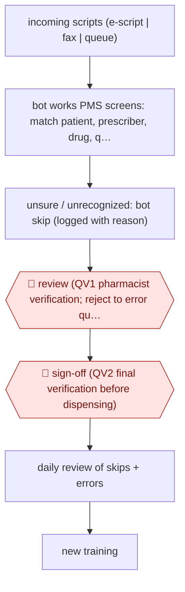

# Pharmacist-verified script entry

`unplaced` (proposed: `PRO › HLT › PHARMACY`) · checkpointed · evidence A · **draft: needs a reference example** ([how to add one](../../../CONTRIBUTING.md#1-add-an-example-run))

**Shape:** `incoming scripts (e-script | fax | queue) → bot works PMS screens: match patient, prescriber, drug, quantity, SIG → unsure / unrecognized: bot skip (logged with reason) → 🛑 review (QV1 pharmacist verification; reject to error queue) → 🛑 sign-off (QV2 final verification before dispensing) → daily review of skips + errors → new training`
**How it differs:** None close in PRO/HLT (CLINDOC, RCM, CLINTRIAL, DRUGDISC). Nearest by shape is AWF-0148 entry prep (extract → licensed reviewer → submit), but here the agent operates a PMS by computer use and every item passes two pharmacist verifications before dispensing.
**Variants:** `tjm-labs`

<!-- shape diagram: generated by scripts/build_diagrams.py from `shape`; don't edit -->

<!-- end shape diagram -->

## Steps
1. Training mirrors onboarding a technician: record how staff enter a new patient, search insurance and enter a prescription; review weekly for 4-5 weeks; then test on five or ten scripts a day for about six weeks before going live on one facility [[1]](#sources).
2. The bot reads e-scripts and faxes and enters them in the pharmacy management system through the same screens technicians use: patient matched by name, date of birth and address, prescriber by NPI, then drug, quantity, days supply and directions [[1]](#sources)[[2]](#sources).
3. When it hits something it does not recognize it stops and flags a 'bot skip', logging why in a running sheet; controlled substances are held for the pharmacist by default [[1]](#sources)[[2]](#sources).
4. 🛑 **Review**: every bot-entered script gets the QV1 pharmacist verification right after data entry; errors are rejected to an error resolution queue for a technician, and the bot is logged as a named technician so its errors are tracked [[1]](#sources).
5. 🛑 **Sign-off**: QV2 final pharmacist verification before medication leaves the pharmacy [[1]](#sources).
6. The team reviews skips and errors daily, shares them with the vendor for fixes, and adds a new skill roughly every 90 days [[1]](#sources).

**Output:** Prescriptions entered in the PMS and verified twice by pharmacists before dispensing; a skip/error log that drives retraining.
**Failure modes → guards:** Bot guesses on an unusual script → bot-skip by design, never improvise [1][2]. Entry errors → QV1 catches and rejects to the error queue; the error is documented and fixed with the vendor [1]. High skip rate early → managed down from mid-20s% to under 10% [1].

## Public runs

Coverage as of 2026-11-13: **Strong**: a first-hand, detailed run that matches most of the shape. Collected and re-checked in [Third collection pass](../../../research/2026-11-third-pass.md).

- [TJM Labs, Inside Horizon Pharmacy webinar](https://tjmlabs.com/blog/horizon-pharmacy-redesigning-ltc-operations-with-ai-webinar/) (2026-09-16). LTC pharmacy's CEO and pharmacist describe bot 'Hal', two pharmacist verifications, skip-rate tracking. "Megan has managed the bot-skip rate down from the mid-20s at the start to under 10% in the last 60 days. That is about 2,700 scripts a month the team does not have to touch directly.". *First-hand: yes; confidence: high.*

## Sources

1. TJM Labs, Redesigning Pharmacy Operations with AI: Inside Horizon Pharmacy (webinar with Horizon CEO Jason Dana Costa and VP Compliance Megan McCaskill, transcript), 2026-09-16. https://tjmlabs.com/blog/horizon-pharmacy-redesigning-ltc-operations-with-ai-webinar/
2. TJM Labs, AI Agents for Pharmacy: What They Do (updated November 2026). https://tjmlabs.com/ai-agents-for-pharmacy/
