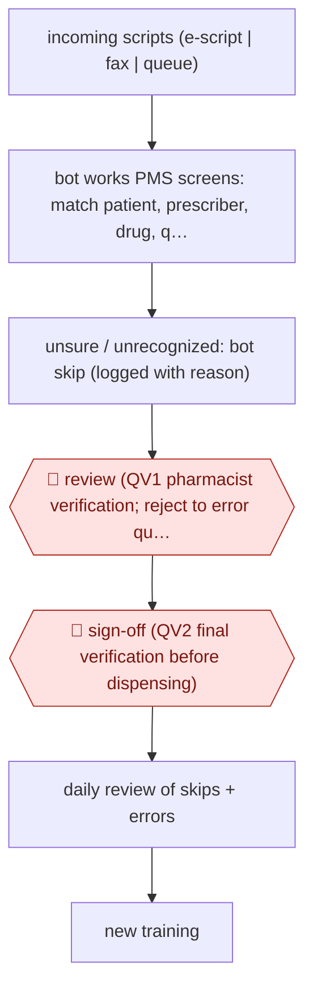

# Pharmacist-verified script entry

`unplaced` (proposed: `PRO › HLT › PHARMACY`) · checkpointed · evidence A · **draft: needs a reference example** ([how to add one](../../../CONTRIBUTING.md#1-add-an-example-run))

**Shape:** `incoming scripts (e-script | fax | queue) → bot works PMS screens: match patient, prescriber, drug, quantity, SIG → unsure / unrecognized: bot skip (logged with reason) → 🛑 review (QV1 pharmacist verification; reject to error queue) → 🛑 sign-off (QV2 final verification before dispensing) → daily review of skips + errors → new training`
**How it differs:** None close in PRO/HLT (CLINDOC, RCM, CLINTRIAL, DRUGDISC). Nearest by shape is AWF-0148 entry prep (extract → licensed reviewer → submit), but here the agent operates a PMS by computer use and every item passes two pharmacist verifications before dispensing.
**Variants:** `tjm-labs`

<!-- shape diagram: generated by scripts/build_diagrams.py from `shape`; don't edit -->

<!-- end shape diagram -->

## Background

A long-term-care pharmacy takes in prescriptions as e-scripts, faxes and queued orders, and somebody has to key each one into the pharmacy management system: patient matched by name, date of birth and address, prescriber by NPI, then the drug, quantity, days supply and directions. It is typing, it is unglamorous, and it is where errors enter a workflow that has no room for them — a transcribed digit becomes a wrong dose three steps later. A bot that works the same screens a technician works can do the entry, but the interesting design decision is what it does when the fax is smudged or the drug name does not match the catalogue. The answer here is that it stops. It logs a "bot skip" with the reason and leaves the item for a person, and controlled substances are held for the pharmacist by default rather than entered and corrected later. Two pharmacist verifications then bracket the work — one immediately after entry, one before the medicine leaves — so the bot's output is checked twice by the only people licensed to check it. What makes the arrangement improve over time is that the bot is logged as a named technician, which means its errors are counted the way a person's are, and the skip list is reviewed daily.

**Terms:**
- **PMS**: pharmacy management system, the software the prescription is entered into.
- **e-script**: an electronic prescription, as opposed to a fax.
- **SIG**: the directions for use printed on the label.
- **NPI**: the US national provider identifier, used to match a prescriber.
- **bot skip**: an item the bot declined to enter, logged with the reason.
- **skip rate**: the share of items the bot declines, the main measure of its coverage.
- **QV1 / QV2**: the two pharmacist verifications, after entry and before dispensing.
- **error queue**: the list of rejected entries a technician corrects.
- **computer use**: an agent operating a graphical application through its screens rather than an API.

## Build it with an agent

**Form:** `service`. Prescriptions arrive continuously from three channels and the bot works the queue unattended, with people appearing at two verification gates and one daily review. Nothing about the work is a single deliverable a person asks for, and nothing accumulates per patient that a project would hold — it is a queue that must keep moving.

**You need:** access to the PMS through the same screens staff use, since a bot with API access would bypass the controls the pharmacy relies on; the catalogue and the insurance rules it matches against, current, because a stale catalogue produces confident wrong entries; a skip rule that fires on any ambiguity, with the reason recorded, because a guess is worse than a gap; the bot registered in the system as a named technician, which is what makes its errors trackable and attributable; a daily review slot with someone reading the skip list, since the skip rate drifts with the script mix; and the two verification gates staffed, because the whole safety argument rests on them being real. The agent must not enter a controlled substance without a pharmacist, must not resolve an unmatched drug by similarity, and must not be the last thing that touches a prescription.

| Step | Built as |
|---|---|
| incoming scripts (e-script | fax | queue) | Three intake channels, each with its own failure mode: an e-script is structured, a fax needs reading, a queue item may already be half-entered. |
| bot works PMS screens: match patient, prescriber, drug, quantity, SIG | Computer use over the live application rather than an API, so the bot is subject to the same validation rules as a technician and leaves the same audit trail. |
| unsure / unrecognized: bot skip (logged with reason) | The skip is the safety mechanism: any ambiguity stops the item with a coded reason, and controlled substances are held by default rather than entered. |
| 🛑 review (QV1 pharmacist verification; reject to error queue) | Every entry is verified immediately after data entry; a rejection goes to an error queue for a technician and the case is documented, which is how the entry error rate is known at all. |
| 🛑 sign-off (QV2 final verification before dispensing) | The second verification before the medicine leaves is the last human gate, and the build cannot dispense. |
| daily review of skips + errors → new training | The skip list and the error queue are read daily and shared with the vendor; new capabilities are added on a slow cadence rather than by letting the bot attempt more. |

**Checkpoints:** `review`: QV1 catches entry errors while the prescription is still in the pharmacy's hands, and the error queue turns each rejection into a documented case rather than a correction that leaves no trace. `sign-off`: QV2 is the pharmacist's final check before dispensing, and the design keeps the bot incapable of reaching it — the safety argument is that two licensed people have looked, not that the bot is accurate.

**Since the sources:** Sources date from 2026-09-16 and an undated vendor page updated 2026-11; no newer account was found as of 2026-11. What the sources leave open is worth recording rather than inventing. The headline number — a skip rate managed from the mid-20s to under 10% over 60 days — is a trailing figure on a changing script mix, so it will move as the pharmacy's intake changes, and the entry should be read as a trajectory rather than a settled rate. The second thing is the detail that makes the rest work: the bot is registered as a named technician, so its errors land in the same reporting as a person's. That is a system-administration decision rather than a model decision, and it is the one most likely to be skipped by a team copying this workflow, because it requires someone to own the bot's identity in the PMS. Everything else in the entry is unchanged, and the evidence grade stays A: the account is first-hand, from the operator and the pharmacist running it, rather than from a vendor case study.

*A design based on this entry's steps and the tool documentation as of 2026-11, not a reported run.*

## Steps

*As reported by the sources.*

1. Training mirrors onboarding a technician: record how staff enter a new patient, search insurance and enter a prescription; review weekly for 4-5 weeks; then test on five or ten scripts a day for about six weeks before going live on one facility [[1]](#sources).
2. The bot reads e-scripts and faxes and enters them in the pharmacy management system through the same screens technicians use: patient matched by name, date of birth and address, prescriber by NPI, then drug, quantity, days supply and directions [[1]](#sources)[[2]](#sources).
3. When it hits something it does not recognize it stops and flags a 'bot skip', logging why in a running sheet; controlled substances are held for the pharmacist by default [[1]](#sources)[[2]](#sources).
4. 🛑 **Review**: every bot-entered script gets the QV1 pharmacist verification right after data entry; errors are rejected to an error resolution queue for a technician, and the bot is logged as a named technician so its errors are tracked [[1]](#sources).
5. 🛑 **Sign-off**: QV2 final pharmacist verification before medication leaves the pharmacy [[1]](#sources).
6. The team reviews skips and errors daily, shares them with the vendor for fixes, and adds a new skill roughly every 90 days [[1]](#sources).

**Output:** Prescriptions entered in the PMS and verified twice by pharmacists before dispensing; a skip/error log that drives retraining.
**Failure modes → guards:** Bot guesses on an unusual script → bot-skip by design, never improvise [1][2]. Entry errors → QV1 catches and rejects to the error queue; the error is documented and fixed with the vendor [1]. High skip rate early → managed down from mid-20s% to under 10% [1].

## Public runs

Coverage as of 2026-11-13: **Strong**: a first-hand, detailed run that matches most of the shape. Collected and re-checked in [Third collection pass](../../../research/2026-11-third-pass.md).

- [TJM Labs, Inside Horizon Pharmacy webinar](https://tjmlabs.com/blog/horizon-pharmacy-redesigning-ltc-operations-with-ai-webinar/) (2026-09-16). LTC pharmacy's CEO and pharmacist describe bot 'Hal', two pharmacist verifications, skip-rate tracking. "Megan has managed the bot-skip rate down from the mid-20s at the start to under 10% in the last 60 days. That is about 2,700 scripts a month the team does not have to touch directly.". *First-hand: yes; confidence: high.*

## Sources

1. TJM Labs, Redesigning Pharmacy Operations with AI: Inside Horizon Pharmacy (webinar with Horizon CEO Jason Dana Costa and VP Compliance Megan McCaskill, transcript), 2026-09-16. https://tjmlabs.com/blog/horizon-pharmacy-redesigning-ltc-operations-with-ai-webinar/
2. TJM Labs, AI Agents for Pharmacy: What They Do (updated November 2026). https://tjmlabs.com/ai-agents-for-pharmacy/
