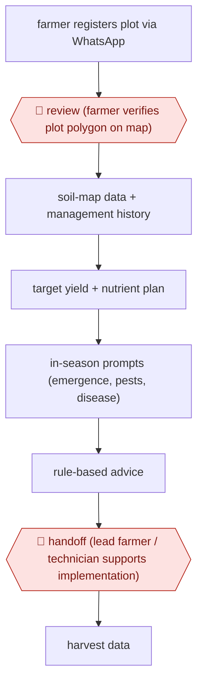

# Plot-registered agronomy advice

`unplaced` (proposed: `ORG › AGR › ADVISORY`) · checkpointed · evidence A · **draft: needs a reference example** ([how to add one](../../../CONTRIBUTING.md#1-add-an-example-run))

**Shape:** `farmer registers plot via WhatsApp → 🛑 review (farmer verifies plot polygon on map) → soil-map data + management history → target yield + nutrient plan → in-season prompts (emergence, pests, disease) → rule-based advice → 🛑 handoff (lead farmer / technician supports implementation) → harvest data`
**How it differs:** None close. The nearest is AWF-0042 Tutor-approved AI turns, but there a person approves every turn.
**Why unplaced:** no class in taxonomy.yaml covers this yet. It is filed here until three similar workflows justify a new class `ADVISORY` (TAXONOMY.md rule 2).
**Variants:** `chatgpt-whatsapp`

<!-- shape diagram: generated by scripts/build_diagrams.py from `shape`; don't edit -->

<!-- end shape diagram -->

## Steps
1. The farmer georeferences the plot and verifies the polygon on a map (🛑 **Review**) [[1]](#sources).
2. Generate a target yield and nutrient plan from the iSDA soil property map and the farmer's answers [[1]](#sources).
3. Prompt for observations through the season and return tailored advice from rule models [[1]](#sources).
4. 🛑 **Handoff**: lead farmers or technicians support implementation; the technician-supported group got the larger yield gain [[2]](#sources).

**Output:** Per-field nutrient plan and in-season advice.
**Failure modes → guards:** Farmers don't follow the plan → yields track basal-fertiliser compliance; technician support helps.

## Public runs

Coverage as of 2026-11-06: **Weak**: only anonymous, vendor-linked or journalist-told accounts. Collected and re-checked in [Second collection pass](../../../research/2026-11-second-pass.md).

- [agriRxiv 2026.00493](https://www.cabidigitallibrary.org/doi/10.31220/agriRxiv.2026.00493) (2026-09-18). 605 farmers surveyed at harvest; crop-cut yields compared. "2.21-fold higher among Technician-supported VA farmers". *First-hand: study (observational preprint; authors may be linked to the platform provider); confidence: med.*

## Sources

1. iSDA / IFA, Virtual Agronomist - an AI-assisted chatbot for guiding crop management decisions (agriRxiv 2025.00332). https://www.cabidigitallibrary.org/doi/pdf/10.31220/agriRxiv.2025.00332?download=true
2. Yield and economic impacts of an AI-enabled Virtual Agronomist advisory system... (agriRxiv 2026.00493), 2026-09-18. https://www.cabidigitallibrary.org/doi/10.31220/agriRxiv.2026.00493
