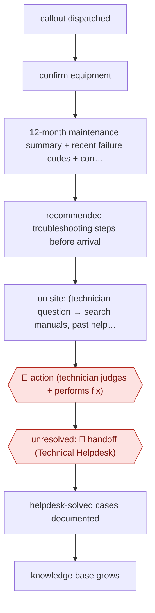

# Pre-arrival troubleshooting assist

`unplaced` (proposed: `ORG › FSV › TROUBLESHOOT`) · assist · evidence A · **draft: needs a reference example** ([how to add one](../../../CONTRIBUTING.md#1-add-an-example-run))

**Shape:** `callout dispatched → confirm equipment → 12-month maintenance summary + recent failure codes + connected-equipment data → recommended troubleshooting steps before arrival → on site: (technician question → search manuals, past helpdesk cases → cited steps) → 🛑 action (technician judges + performs fix) → unresolved: 🛑 handoff (Technical Helpdesk) → helpdesk-solved cases documented → knowledge base grows`
**How it differs:** AWF-0214 (dispatcher-overridden job assignment) decides which technician gets a job, with dispatchers sampling the board. This workflow starts after dispatch: it plans the diagnosis and guides one technician through the repair, and the technician decides each step (assist), with a handoff to a human helpdesk. The deliverable, user and checkpoints all differ. AWF-0108 (resident maintenance triage) triages resident requests into work orders and does not guide the repair.
**Variants:** `amazon-bedrock-claude` · `fluid-topics-rag`

<!-- shape diagram: generated by scripts/build_diagrams.py from `shape`; don't edit -->

<!-- end shape diagram -->

## Steps
1. A technician is dispatched on a callout. In the field service management tool, Technician Assistant first confirms the technician is working on the right equipment [[1]](#sources)[[3]](#sources).
2. It summarises the past 12 months of maintenance records and recent failure data for that unit, including connected-equipment (24/7 Connect) signals, and decodes unclear failure codes into likely root causes and fixes [[1]](#sources)[[3]](#sources).
3. Before the technician arrives, it generates recommended troubleshooting steps, so the technician can bring the right part [[1]](#sources)[[2]](#sources).
4. On site, the technician asks follow-up questions (component replacement, parameter settings, access). The assistant searches approved manuals, support documents and verified past helpdesk cases and returns short, cited steps, sometimes with images from manuals. Relevance and grounding are checked with an LLM-as-judge / guardrails before display [[1]](#sources)[[3]](#sources).
5. 🛑 **Action**: the technician decides what to do and does the work. KONE says the tool supports decision-making 'while always leaving the final judgment to them' [[1]](#sources).
6. 🛑 **Handoff**: if the problem is still unresolved, the technician escalates to the Technical Helpdesk (experienced field service engineers). Cases the helpdesk solves are documented and added to the knowledge base, which 'is growing on a daily basis' [[1]](#sources)[[3]](#sources).

**Output:** A troubleshooting plan and cited on-site guidance for one callout. Cases that stay unresolved go to the Technical Helpdesk, and every resolved helpdesk case becomes new knowledge for the next callout.
**Failure modes → guards:** Unsafe instructions → only approved documentation and verified cases are retrieved ('We cannot make instructions by AI that are not safe to use'). Long answers unusable on site → technician feedback shortened outputs. Hands busy → speech-to-text requested and on the roadmap. Terminology across markets → technicians refined translations.

## Public runs

Coverage as of 2026-11-13: **Strong**: a first-hand, detailed run that matches most of the shape. Collected and re-checked in [Fourth collection pass](../../../research/2026-11-fourth-pass.md).

- [KONE, How an AI tool helps service technicians stay one step ahead](https://www.kone.com/global/en/newsroom/stories/technician-assistant-ai-elevator-maintenance.html) (2026-08-19). Rollout to KONE's technicians; callout pre-diagnosis; the technician keeps the final judgment. "Already available to approximately 15,000 KONE service technicians across 60 countries"; "80% of surveyed technicians report being satisfied with the tool". *First-hand: yes; confidence: high.*
- [KONE Singapore, Living tall with Singapore's vertical nervous system](https://www.kone.sg/stories-and-references/stories/living-tall-with-singapore-vertical-nervous-system.aspx) (undated). Singapore/Malaysia pilots of Technician Assistant; early outcome on escalations. "a 6% decrease in call-out rates and 30% fewer escalated cases". *First-hand: yes; confidence: med.*

## Sources

1. KONE, How an AI tool helps service technicians stay one step ahead, 2026-08-19. https://www.kone.com/global/en/newsroom/stories/technician-assistant-ai-elevator-maintenance.html
2. KONE Singapore, Living tall with Singapore's vertical nervous system (undated). https://www.kone.sg/stories-and-references/stories/living-tall-with-singapore-vertical-nervous-system.aspx
3. KONE speaker at AWS re:Invent 2024, KONE Safeguards AI Applications with Amazon Bedrock Guardrails (third-party transcript). https://zenn.dev/kiiwami/articles/a332fc0b89657691?locale=en
4. AWS, Securing troubleshooting for 40,000 technicians using AWS with KONE (vendor case study, extra source). https://aws.amazon.com/solutions/case-studies/aws-ai-security-kone-case-study/
